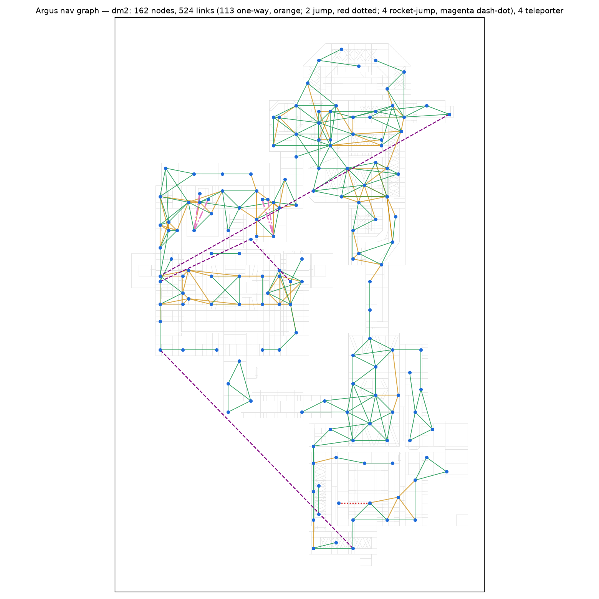

# Argus

Vanilla Quake deathmatch bots, with a lab for testing and improving them.

[](https://github.com/saworbit/argus/actions/workflows/compile.yml)
[](https://github.com/saworbit/argus/discussions)
[](LICENSE)
[](LICENSE-MIT)
[](CODE_OF_CONDUCT.md)

Three bots join automatically: Carmack, Romero and Joe Rogan. Play against
them, watch through ArgusCam, or use the lab to inspect navigation and compare
changes. The game runs in vanilla QuakeC on NetQuake protocol 15 with a
600-edict limit.

**Start here:** [Install and play](#install-and-play) |
[Controls](#controls) | [Maps](#maps) | [Lab workflow](#lab-workflow) |
[Troubleshooting](#troubleshooting) | [Changelog](CHANGELOG.md)

## Install and play

### What you need

- A Quake engine and game data. The `dm2`, `dm3`, `dm4` and `dm6` examples use
  the full game's `id1` data. LibreQuake's `lqdm2` is the free-content test map.
- This repository's **`game/argus` folder**. It contains a ready-built
  `progs.dat` and `autoexec.cfg`; Rust, Python and a compiler are only needed
  for development. Maps and licensed player-model assets are not bundled.

Download and extract this repository, or use a local clone. The folder to
install is `game/argus` inside that checkout, not the whole repository.

### Classic engines: QuakeSpasm, Ironwail or vkQuake

1. Copy **the `argus` folder inside `game/`** beside your engine's `id1`
   folder. The result should look like this:

   ```text
   Quake/
     quakespasm.exe          # or your engine executable
     id1/
       pak0.pak
       pak1.pak
     argus/
       progs.dat
       autoexec.cfg
   ```

2. Start the engine from that Quake directory:

   ```text
   quakespasm -listen 8 -game argus +skill 1 +deathmatch 1 +map dm4
   ```

   Replace `quakespasm` with your executable (`.\quakespasm.exe` in Windows
   PowerShell). `-listen 8` reserves client slots for your connection and the
   bot scoreboard. Keep the supplied `autoexec.cfg`, which sets protocol 15
   and the 600-edict limit.

3. Wait for the three bots to spawn. Play normally; use `Tab` for scores.
   Open the Quake console, usually with `~`, and enter `impulse 210` to watch.

### Official 2021 rerelease: KEX

1. Copy `game/argus` to **`Saved Games/Nightdive Studios/Quake/argus`** in
   your Windows user profile. Do not nest it as `argus/argus`.
2. Add these launch options, or pass them to `quake_x64_steam.exe`:

   ```text
   +game argus +skill 1 +deathmatch 1 +map dm4
   ```

   KEX uses **`+game argus`** rather than the classic `-game argus` switch.
   Use the session's multiplayer settings to provide spare player slots if
   you need the bot scoreboard and roster capacity.

For coloured bot models and the rerelease's MDL fallback, see
[bot colours](docs/controls.md#bot-colours). The repository copy includes
the game code and configuration; extra player-model skins are generated locally.

## Controls

Enter these in the **Quake console**, not your operating-system terminal.

### Play and difficulty

| Command | Result |
|---|---|
| `map dm2` | Start another map; also try `dm3`, `dm4` or `dm6` |
| `skill 1` | Set the difficulty baseline; 0-3 and fractional values such as `1.5` are supported; applies at next bot respawn |
| `fraglimit 20` | End the match at 20 frags; `0` disables the limit |
| `timelimit 10` | Set a ten-minute match; `0` disables the limit |
| `impulse 100` | Show the roster command menu |
| `impulse 105` | Show bot statistics |

### Add, remove and retune bots

In deathmatch or co-op, first enter **`scratch1 147` in the server console**.
On your own listen server, that is your local Quake console. On a dedicated
server, use its server console. This is a server-wide opt-in for client roster
commands; `developer 1` does not grant that access.

| Command | Result |
|---|---|
| `impulse 101` | Add a bot, up to four total and subject to spare client slots |
| `impulse 102` | Remove the most recently added bot |
| `impulse 103` | Cycle baseline skill 0 -> 1 -> 2 -> 3 -> 0 and retune live bots immediately |
| `impulse 106` to `impulse 109` | Cycle the skill offset for roster slots 0 to 3 |
| `impulse 110` | Toggle adaptive difficulty; off by default, active only against humans in deathmatch at baseline skill 1 |

### Watch with ArgusCam

| Command | Result |
|---|---|
| `impulse 210` | Enter or leave spectator camera mode |
| `impulse 211` | Cycle POV, chase, director, duel, free flight and orbit |
| `impulse 212` | Cycle the target bot |
| `impulse 213` | Switch centred/shoulder chase framing |
| `impulse 214` | Toggle the broadcast HUD |

Optional bindings, entered in the Quake console:

```text
bind F6 "impulse 210"
bind F7 "impulse 211"
bind F8 "impulse 212"
```

These replace any existing bindings on those keys. Full camera behaviour,
per-slot difficulty, chat commands and developer controls are in the
[control reference](docs/controls.md).

## Maps

| Map | Name | Navigation highlights |
|---|---|---|
| `dm4` | The Bad Place | Lava walkways, rocket-jump Quad route, teleporters |
| `dm2` | Claustrophobopolis | Doors, lifts and moving-platform bridge |
| `dm3` | The Abandoned Base | Water routes, stairs and connected platform islands |
| `dm6` | The Dark Zone | Teleport loops and sprint-jump links |
| `lqdm2` | LibreQuake DM2 | Free-content map used by the CI smoke check |

These maps have compiled navigation. The BSP/game data must also be installed;
a baked graph does not supply the map. Other maps can run with direct visible
item seeking and combat, but full routing needs a generated, registered graph.
Inspect the current map inventory with `see what=project` in the lab.



## Lab workflow

The lab is optional for playing. It handles compilation, map inspection,
headless matches and comparison reports. Start with the
[lab setup and first experiment](docs/lab-workflow.md).

| Interface | Use it for | How to start |
|---|---|---|
| Local web wizard | Human map ingest, navigation, compile/install and restore | `argus-mcp gui` |
| MCP server | Structured inspection and experiments from a connected client | Run the installed `argus-mcp` binary as the client's stdio server |
| Terminal CLI | Puppet observations, link probes and saved-tape queries | `argus-mcp client observe`, `argus-mcp probelinks`, `argus-mcp corpus` |

`argus-mcp` means the installed binary on your `PATH`, or its full path under
`tools/argus_mcp/install/bin/`. The wizard binds `127.0.0.1:7420`.

Use this loop. `see`, `experiment`, `matrix_experiment` and `tune` are
**MCP calls**; the harvest command runs in a **terminal**.

1. **Inspect:** `see what=project`, then `see what=map name=dm4`.
2. **Preserve human play:** harvest the current session before launching
   another engine. Use `python tools/harvest_session.py --tag my_session`
   from the repository root; see the guide for expected input locations.
3. **Edit and test:** after a QuakeC change, call
   `experiment map=dm4 duration_sec=30 skill=2`. For several maps, use
   `matrix_experiment maps=["dm2","dm4"] duration_sec=30 skill=2`.
4. **Read the result:** use the native brief, verdict and `next_steps`.
   Short experiments scale baseline counts; `compare_runs` is unscaled and
   expects comparable durations and tick rates. Movement changes need two
   maps or a suitable control, not one passing tape.
5. **Watch or adjust:** `see what=status` returns an incremental cursor;
   `tune command="skill 3"` changes the live baseline for the next respawn.

If the lab reports a build/checkout mismatch, install the current server and
restart the MCP client before trusting quality verdicts. Never hand-edit
generated `src/argus_nav_<map>.qc`; use the lab's navigation tools.

## Troubleshooting

| Symptom | Check |
|---|---|
| Stock Quake loads or no bots appear | Confirm `argus/progs.dat` is beside `id1`; use `-game argus` on classic engines or `+game argus` on KEX; restart the map |
| A map will not load | Install its BSP/game data; the repository does not include licensed id maps |
| Bots fight but their scoreboard rows are missing | Restart a classic engine with `-listen 8`; spare client slots supply the fake scoreboard rows |
| Add/remove/skill impulses are refused | Enter `scratch1 147` in the server console; `developer 1` is logging, not roster permission |
| Bot colours match or skin warnings appear | The base player model lacks extra skins; see [bot colours](docs/controls.md#bot-colours) |
| No `qconsole.log` or no telemetry | Launch with both `-condebug` and `+developer 1`; check the process working directory |
| Lab configuration is missing | Run the MCP `config_check` tool and fill the named `ARGUS_*` paths |
| Lab verdict says the server is stale | Reinstall the lab, restart the client and inspect its reported build identity |

## Documentation and development

| I want to... | Read |
|---|---|
| Find every play/camera/chat command | [Controls](docs/controls.md) |
| Set up the lab, add a map or run a controlled comparison | [Lab workflow](docs/lab-workflow.md) |
| Look up every lab tool and configuration option | [Lab operator guide](tools/argus_mcp/README.md) |
| Record a match, read events or inspect a demo | [Telemetry and recording](docs/telemetry.md) |
| Record a bot POV or render a saved viewpoint | [Rendered POV evidence](tools/argus_mcp/README.md#rendered-pov-evidence) |
| Understand the bot and source layout | [Architecture](docs/architecture.md) |
| See what changed and which build it belongs to | [Changelog](CHANGELOG.md) |
| Contribute or report a problem | [Contributing](CONTRIBUTING.md), [support](SUPPORT.md), [discussions](https://github.com/saworbit/argus/discussions) |

The main source is in `src/`; the playable mod is `game/argus`; lab tools
live under `tools/argus_mcp`; saved evidence lives in `runs/`. Engine installs,
licensed assets, local lab configuration and backups stay machine-local.

## License

The QuakeC game (`src/`, `game/`) is GPL v2: [LICENSE](LICENSE).
Python/Rust tooling and documentation use MIT: [LICENSE-MIT](LICENSE-MIT).
See the [code of conduct](CODE_OF_CONDUCT.md) and
[security policy](SECURITY.md) for community and reporting guidance.
