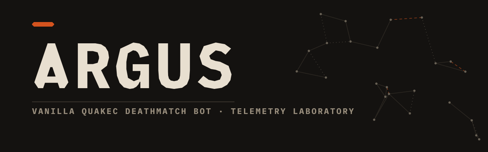
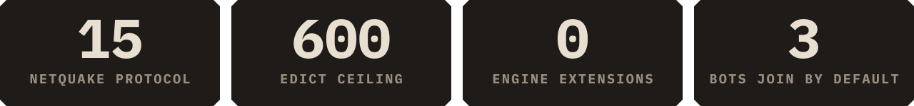
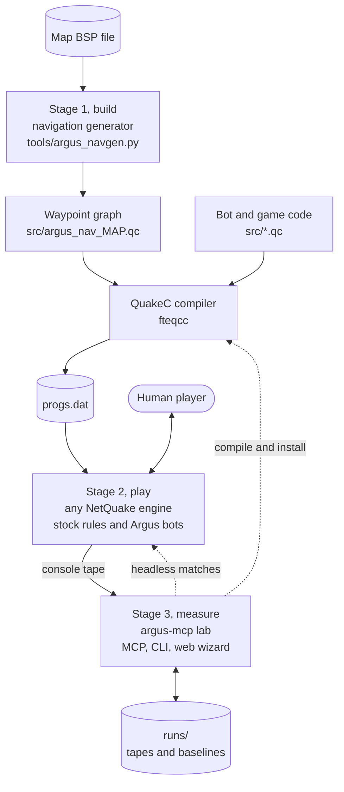
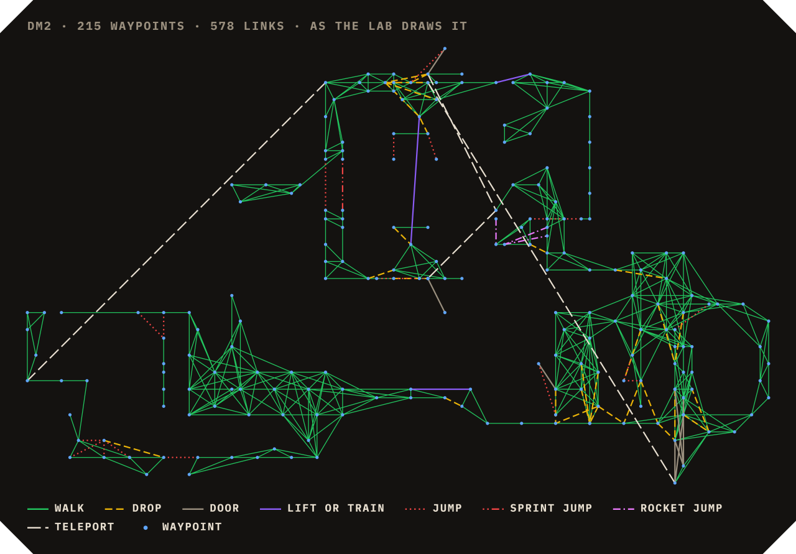
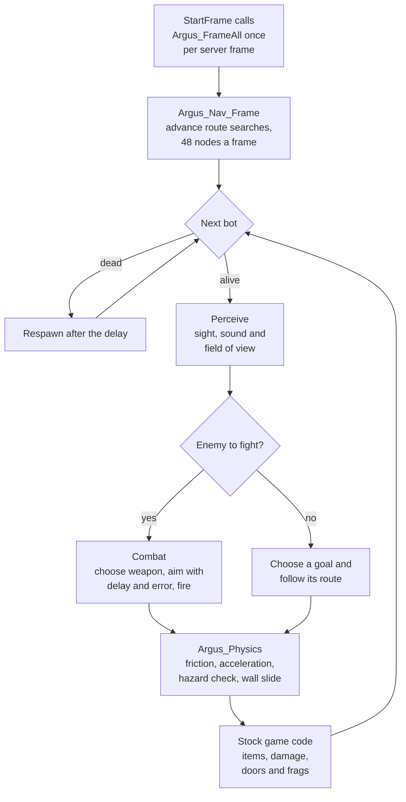
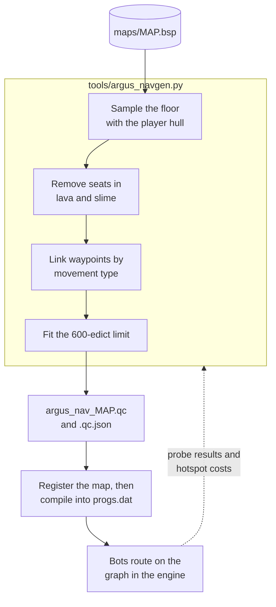
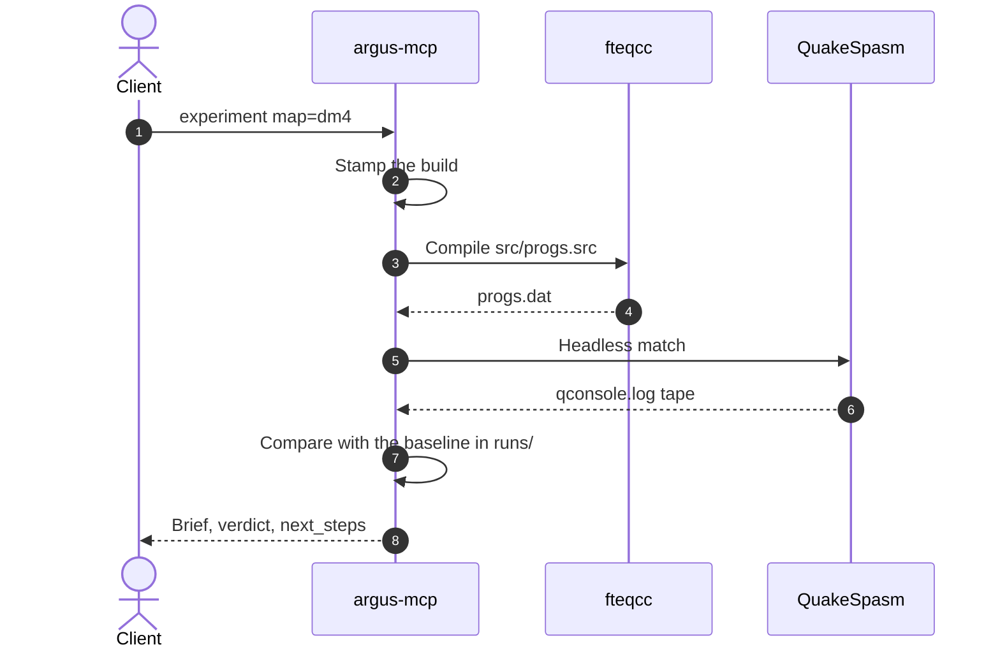
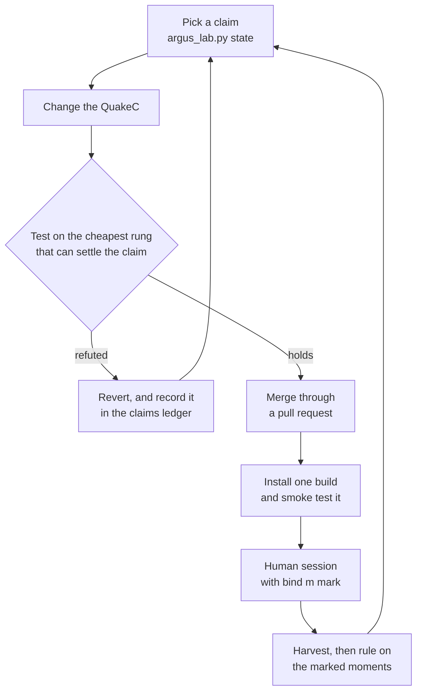

<h1>
  <picture>
    <source media="(prefers-color-scheme: light)" srcset="docs/brand/readme-banner-light.svg">
    
  </picture>
</h1>

Vanilla Quake deathmatch bots, with a lab for testing and improving them.

[](https://github.com/saworbit/argus/actions/workflows/compile.yml)
[](https://github.com/saworbit/argus/actions/workflows/fast.yml)
[](https://github.com/saworbit/argus/actions/workflows/codeql.yml)
[](https://scorecard.dev/viewer/?uri=github.com/saworbit/argus)
[](https://github.com/saworbit/argus/releases/latest)
[](https://github.com/saworbit/argus/discussions)
[](LICENSE)
[](LICENSE-MIT)
[](CODE_OF_CONDUCT.md)

<picture>
  <source media="(prefers-color-scheme: light)" srcset="docs/brand/readme-facts-light.svg">
  
</picture>

**Start here:** [What Argus is](#what-argus-is) |
[Install and play](#install-and-play) | [Controls](#controls) |
[Maps](#maps) | [How Argus works](#how-argus-works) |
[Lab workflow](#lab-workflow) | [Development status](#development-status) |
[Troubleshooting](#troubleshooting) | [Changelog](CHANGELOG.md)

## What Argus is

Argus is a Quake mod. It adds computer-controlled opponents (bots) to
deathmatch. Three bots join automatically: Carmack, Romero and Joe Rogan.
They move, collect items and fight under the same game rules as a human
player. You can play against them, or you can watch them through ArgusCam,
the spectator camera.

Argus follows the Reaper and Omicron bots of the 1990s. It is written in
QuakeC, the script language of the original 1996 game. It uses no engine
extensions, so it runs without changes on the original engine and on all
NetQuake engines.

The repository has two parts:

| Part | Contents | Who uses it |
|---|---|---|
| The mod (`game/argus/`) | A compiled `progs.dat` and an `autoexec.cfg`. Copy this folder to play. | Players |
| The lab (`tools/`) | Tools that build navigation, compile the mod, run headless bot matches and compare the results | Developers |

These rules apply to all of the game code:

- **Vanilla QuakeC only.** The code uses no engine extensions, no file input
  or output, and no builtins after the 1996 set.
- **Protocol 15 and 600 edicts.** The supplied `autoexec.cfg` sets NetQuake
  protocol 15 and a limit of 600 edicts. A change that works only on
  protocol 666 is a defect.
- **The engine is a test tool, not a dependency.** The lab uses QuakeSpasm
  for headless matches. The mod does not need QuakeSpasm.
- **Fair play.** Bots have a reaction delay and an aim error. They do not use
  the engine's autoaim, and they do not use the hidden inventory of an
  opponent.

### The three stages



1. **Build.** The navigation generator reads the BSP file of a map. It writes
   a waypoint graph as QuakeC source. The compiler puts the graph and the bot
   code into one `progs.dat`.
2. **Play.** A Quake engine loads `progs.dat`. The bots run inside the game
   code, beside the stock id rules for items, damage and doors.
3. **Measure.** The lab starts headless matches and reads the console log of
   each match. It compares each new log with a saved baseline in `runs/`.

## Install and play

### What you need

- A Quake engine and game data. The `dm2`, `dm3`, `dm4` and `dm6` examples use
  the full game's `id1` data. LibreQuake's `lqdm2` is the free-content test map.
- This repository's **`game/argus` folder**. It contains a ready-built
  `progs.dat` and `autoexec.cfg`. You need Rust, Python and a compiler only
  for development. Maps and licensed player-model assets are not included.

Download and extract this repository, or use a local clone. Install the
`game/argus` folder from that copy, not the whole repository.

As an alternative, download `argus-<tag>.zip` from a
[release](https://github.com/saworbit/argus/releases). It holds the same
`argus` folder, ready to copy. Releases from the release workflow also
attach a `.sha256` checksum and a signed provenance attestation. The
[security policy](SECURITY.md#scope) shows how to verify them.

### Classic engines: QuakeSpasm, Ironwail or vkQuake

1. Copy **the `argus` folder inside `game/`** beside the `id1` folder of your
   engine. The result must look like this:

   ```text
   Quake/
     quakespasm.exe          # or your engine executable
     id1/
       pak0.pak
       pak1.pak
     argus/
       progs.dat
       autoexec.cfg
   ```

2. Start the engine from that Quake directory:

   ```text
   quakespasm -listen 8 -game argus +skill 1 +deathmatch 1 +map dm4
   ```

   Replace `quakespasm` with your executable (`.\quakespasm.exe` in Windows
   PowerShell). `-listen 8` keeps client slots free for your connection and
   the bot scoreboard. Keep the supplied `autoexec.cfg`. It sets protocol 15
   and the 600-edict limit.

3. Wait for the three bots to spawn. Play as usual. Push `Tab` to see the
   scores.

4. To watch the bots, open the Quake console (usually with `~`) and enter
   `impulse 210`.

### Official 2021 rerelease: KEX

1. Copy `game/argus` to **`Saved Games/Nightdive Studios/Quake/argus`** in
   your Windows user profile. Do not nest it as `argus/argus`.
2. Add these launch options, or give them to `quake_x64_steam.exe`:

   ```text
   +game argus +skill 1 +deathmatch 1 +map dm4
   ```

   KEX uses **`+game argus`**, not the classic `-game argus` switch.
   For the bot scoreboard and roster, use the multiplayer settings of the
   session to keep spare player slots.

For coloured bot models and the rerelease's MDL fallback, see
[bot colours](docs/controls.md#bot-colours). The repository copy includes
the game code and configuration. You make the extra player-model skins
on your own computer.

## Controls

Enter these commands in the **Quake console**, not in the terminal of your
operating system.

### Play and difficulty

| Command | Result |
|---|---|
| `map dm2` | Start another map; also try `dm3`, `dm4` or `dm6` |
| `skill 1` | Set the difficulty baseline; 0-3 and fractional values such as `1.5` are supported; applies at next bot respawn |
| `fraglimit 20` | End the match at 20 frags; `0` disables the limit |
| `timelimit 10` | Set a ten-minute match; `0` disables the limit |
| `impulse 100` | Show the roster command menu |
| `impulse 105` | Show bot statistics |
| `mark` | Bookmark the moment in a recorded session when a bot looks wrong; `bind m mark` once ([session marks](docs/controls.md#session-marks)) |

### Add, remove and retune bots

In deathmatch or co-op, first enter **`scratch1 147` in the server console**.
On your own listen server, that is your local Quake console. On a dedicated
server, use its server console. This setting lets clients use the roster
commands on that server. `developer 1` does not give that access.

| Command | Result |
|---|---|
| `impulse 101` | Add a bot, up to four total and subject to spare client slots |
| `impulse 102` | Remove the most recently added bot |
| `impulse 103` | Cycle baseline skill 0 -> 1 -> 2 -> 3 -> 0 and retune live bots immediately |
| `impulse 106` to `impulse 109` | Cycle the skill offset for roster slots 0 to 3 |
| `impulse 110` | Toggle adaptive difficulty; off by default, active only against humans in deathmatch at baseline skill 1 |

### Watch with ArgusCam

| Command | Result |
|---|---|
| `impulse 210` | Enter or leave spectator camera mode |
| `impulse 211` | Cycle POV, chase, director, duel, free flight and orbit |
| `impulse 212` | Cycle the target bot |
| `impulse 213` | Switch centred/shoulder chase framing |
| `impulse 214` | Toggle the broadcast HUD |

Optional bindings, entered in the Quake console:

```text
bind F6 "impulse 210"
bind F7 "impulse 211"
bind F8 "impulse 212"
```

These bindings replace the current bindings on those keys. The
[control reference](docs/controls.md) has the full camera behaviour,
per-slot difficulty, chat commands and developer controls.

## Maps

| Map | Name | Navigation highlights |
|---|---|---|
| `dm4` | The Bad Place | Lava walkways, rocket-jump Quad route, teleporters |
| `dm2` | Claustrophobopolis | Doors, lifts and moving-platform bridge |
| `dm3` | The Abandoned Base | Water routes, stairs and connected platform islands |
| `dm6` | The Dark Zone | Teleport loops and sprint-jump links |
| `lqdm2` | LibreQuake DM2 | Free-content map used by the CI smoke check |
| `e1m1`, `e1m2`, `e1m5`, `e1m6`, `e1m7`, `e1m8` | Episode one | Doors, buttons, lifts and moving platforms; the lab uses these maps for navigation tests |

These maps have compiled navigation. You must also install the BSP file of
each map, because the compiled graph does not contain the map.

Bots can also play on other maps. There, they go only to items that they can
see, and they fight. Full routes need a generated and registered graph. To
see the map inventory, use `see what=project` in the lab. Some graph files
in that inventory are not registered. For example, the experimental e1m3 and
e1m4 graphs fail the playability gates. They are not in the compilation list
or the dispatcher, so the bots have no routes on those maps.



The shipped dm2 graph, drawn from `src/argus_nav_dm2.qc.json` in the lab's
own [link colours](docs/brand/README.md#navigation-link-colours).

## How Argus works

The [architecture guide](docs/architecture.md) has the full component and
source map. This section gives the main data flows.

### One server frame

The bots are not network clients. Each bot is an entity with the classname
`player`. Because of this, stock items, doors, triggers, damage and
obituaries apply to bots and humans in the same way. The engine calls `StartFrame` in the game
code once per server frame, and Argus moves all of its bots from that call.



For each live bot, `Argus_AI` decides what to do and `Argus_Physics` moves
the bot:

- **Perception.** A bot sees through a soft field of view and hears weapons
  and item pickups. It keeps a short memory of what it saw.
- **Goals.** Utility scores rank all items by value to the bot and by
  distance. A planner adds a prerequisite when necessary. For example, an
  unarmed bot gets a weapon before it goes for the Quad Damage.
- **Combat.** The bot fires through the stock weapon code. Ammunition, refire
  time and projectiles are the same as for a human player.
- **Physics.** The bot movement copies the NetQuake player rules for
  friction, acceleration and air control. A hazard check examines the floor
  ahead and turns the bot away from lava, slime and long drops.

### Navigation

QuakeC cannot read files. Because of this, the navigation generator makes
the waypoint graph for each map before the match. The compiler then puts the
graph into `progs.dat`.



The generator samples the map with the player hull to find floor where a
player can stand. It removes seats in lava and slime. It links the waypoints
by movement type: walk, drop, jump, rocket jump, lift, door, train, swim and
teleport. It also keeps the total entity count below the 600-edict limit.

Lab probes in the real engine record the links that fail and the links that
work (`.probe.json` and `.proven.json`). Hotspot learning records the cells
where bots stall or die in lava (`.costs.json`). The next generation uses
these records.

Do not edit the generated `src/argus_nav_<map>.qc` files by hand. Use the
[lab navigation tools](docs/lab-workflow.md#add-or-regenerate-navigation).

### Telemetry

With `-condebug` and `+developer 1`, each bot writes its state to the
console log once a second (`ARGLOG`). It also writes one line for each event
(`ARGEVT`). Near the start, the log names the build, so each log identifies
the code that made it.
These lines are from a dm4 smoke match on the supplied build:

```text
ARGUS build 004b4ff9ddf7
ARGLOG Romero t  10.9 pos '513.7 -346.4 -104.0' spd 322.8 yaw 107.2 mode 2 st 0 gl 1 hp 100 frg 0
ARGEVT Joe Rogan goal weapon_lightning
ARGEVT Joe Rogan route 3 start '145.0 -471.0  24.0' goal '529.0 -311.0 -104.0'
ARGEVT Romero engage Joe Rogan
ARGEVT Joe Rogan death Carmack pos '368.7 -56.9 -296.0'
```

A `goal` event records a decision, not a pickup. The
[telemetry guide](docs/telemetry.md) gives the full grammar and the rules
for reading it.

## Lab workflow

You do not need the lab to play. The lab compiles the mod, examines maps,
runs headless matches and writes comparison reports. To start, read
[lab setup and first experiment](docs/lab-workflow.md).

| Interface | Use it for | How to start |
|---|---|---|
| Local web wizard | Human map ingest, navigation, compile/install and restore | `argus-mcp gui` |
| MCP server | Structured inspection and experiments from a connected client | Run the installed `argus-mcp` binary as the client's stdio server |
| Terminal CLI | Puppet observations, link probes, saved-tape queries, fast seeded ladders and the stand-in human | `argus-mcp client observe`, `argus-mcp probelinks`, `argus-mcp corpus`, `argus-mcp seeds`, `argus-mcp standin` |

`argus-mcp` is the installed binary on your `PATH`, or its full path under
`tools/argus_mcp/install/bin/`. The wizard binds `127.0.0.1:7420`.

### What one experiment does



The headless match runs at protocol 15, with the 600-edict limit and
`+sys_ticrate 0.0139`. That is approximately 70 frames a second, the same
rate as a listen server.

### The basic loop

`see`, `experiment`, `matrix_experiment` and `tune` are **MCP calls**. The
harvest command runs in a **terminal**.

1. **Inspect.** Call `see what=project`, then `see what=map name=dm4`.
2. **Keep human play.** Before you start another engine, harvest the current
   session. From the repository root, run
   `python tools/harvest_session.py --tag my_session`. The guide gives the
   expected input locations.
3. **Edit and test.** After a QuakeC change, call
   `experiment map=dm4 duration_sec=30 skill=2`. For more than one map, call
   `matrix_experiment maps=["dm3","dm6","e1m6"] duration_sec=30 skill=2`.
4. **Read the result.** Use the native brief, the verdict and `next_steps`.
   Short experiments scale the baseline counts. `compare_runs` does not scale
   them, so it needs tapes of the same duration and tick rate. A movement
   change needs two maps or a suitable control, not one tape that passes.
5. **Watch or adjust.** `see what=status` returns an incremental cursor.
   `tune command="skill 3"` changes the live baseline for the next respawn.

For a specific route, the [fixed navigation benchmark](tools/argus_mcp/README.md#fixed-navigation-benchmark)
runs one bot and checks its starting position against the manifest before
scoring the attempt.

If the lab reports a build or checkout mismatch, install the current server.
Then restart the MCP client before you trust a quality verdict. Do not edit
the generated `src/argus_nav_<map>.qc` files by hand. Use the navigation
tools of the lab.

### The improvement cycle

Each change starts as a claim, and the cheapest test that can settle the
claim comes first. One install closes each cycle, so each human session
belongs to exactly one build.



The [improvement loop](docs/improvement-loop.md) gives the rungs, from
static checks to a human session, and tells you what each rung can and
cannot settle.

## Development status

The supplied `game/argus/progs.dat` is built from main as of 2026-11-15
(build `004b4ff9ddf7`, MD5 `5FD814CC448AF8FBA7BFB16CD29062BC`). It contains
all of the behaviour work below. The [changelog](CHANGELOG.md) records each
change and its build.

The dm3 red armour route has been restored in development source and awaits
a new gameplay binary. The [dm3 study](docs/navmesh-experiment.md#turning-late-after-775-904)
records the fixed-seed and played-rate results.

| Area | What the bot does | Details |
|---|---|---|
| Visual memory (step 1a) | Keeps the last observation of its target for a short time. A hidden prediction lasts not more than 0.4 seconds and 128 units. | [Perception step 1a](docs/behaviour-diagnostics.md#perception-step-1a) |
| Health and inventory cues (step 1b) | Uses observed cues and fixed estimates, not the exact health or inventory of an opponent | [Step 1b](docs/behaviour-diagnostics.md#healthinventory-perception-step-1b) |
| Rocket muzzle clearance | Releases the trigger when a wall blocks the rocket near the muzzle | [Muzzle clearance](docs/behaviour-diagnostics.md#ordinary-rocket-muzzle-clearance) |
| Failed plans | Finds a plan that makes no progress, then chooses another goal | [Failed-plan recognition](docs/behaviour-diagnostics.md#shared-failed-plan-recognition) |
| Doors and buttons | Steps on floor buttons, follows relayed door openers and waits a limited time for a door to open | [Door ownership](docs/behaviour-diagnostics.md#opening-door-ownership-and-physical-deadline) |
| Gait | Sometimes stops for a short time, for example at a sound or a junction, and goes near lava or slime below full speed | [Human gait](docs/behaviour-diagnostics.md#human-gait-hesitation-and-cautious-liquid-approach) |
| Route distance | Of the routes with the fewest links, chooses the shortest | [Map intelligence](docs/map-intelligence.md) |
| Pinned under fire | Tries a short, checked exit and keeps its aim and fire | [Freeze recovery](docs/freeze-recovery.md) |
| Target choice | Changes target when another visible player attacks it, or when its target is invulnerable and another opponent is not. Focus and reaction delay stay. | [Combat attention](docs/combat-attention.md) |
| Route actions | Keeps swim and jump plans, chooses actions it can do, and plans again when it does not get closer to the next waypoint | [e1m5 encounters](docs/e1m5-encounters.md) |
| Moving platforms | Stays on a moving platform until it docks, and examines the landing arc before it jumps off | [e1m6 decisions](docs/e1m6-decisions.md) |
| Body separation | Ignores players on other floors, and does not move to a spot where the player hull cannot fit | [Height](docs/body-height-investigation.md), [same floor](docs/body-nudge-investigation.md) |

Open items:

| Item | State | Reference |
|---|---|---|
| Human-play check of the installed build | Open | [#610](https://github.com/saworbit/argus/issues/610) |
| The dm4 gameplay warning for step 1b | Not resolved; the gate is parked | [#583](https://github.com/saworbit/argus/issues/583) |
| Incoming-projectile perception | On hold | [Current status](docs/behaviour-diagnostics.md#current-development-status) |
| Too many movement reversals | Open | [Findings so far](docs/behaviour-diagnostics.md#movement-reversals) |
| e1m3 and e1m4 navigation | Experimental and not registered | [Mover investigation](docs/mover-intelligence.md) |
| Other outstanding work | Listed | [Session audit, 2026-11-02](docs/session-cleanup-2026-11-02.md) |

> [!NOTE]
> Botmatch studies do not show better play against people. Only a human
> session can show that.

## Troubleshooting

| Symptom | Check |
|---|---|
| Stock Quake loads or no bots appear | Make sure that `argus/progs.dat` is beside `id1`; use `-game argus` on classic engines or `+game argus` on KEX; restart the map |
| A map does not load | Install its BSP file or game data; the repository does not include licensed id maps |
| Bots fight but their scoreboard rows are missing | Restart a classic engine with `-listen 8`; spare client slots hold the bot scoreboard rows |
| Add/remove/skill impulses are refused | Enter `scratch1 147` in the server console; `developer 1` controls logging, not roster permission |
| Bot colours match or skin warnings appear | The base player model has no extra skins; see [bot colours](docs/controls.md#bot-colours) |
| No `qconsole.log` or no telemetry | Start with both `-condebug` and `+developer 1`; look in the working directory of the process |
| Lab configuration is missing | Run the MCP `config_check` tool and fill in the named `ARGUS_*` paths |
| Lab verdict says the server is stale | Install again and reconnect, then make sure that `lab_identity.authoritative` is `true` in that chat; see [Windows staged updates](tools/argus_mcp/README.md#update-a-running-windows-server) |

## Documentation and development

| I want to... | Read |
|---|---|
| Find every play/camera/chat command | [Controls](docs/controls.md) |
| Set up the lab, add a map or run a controlled comparison | [Lab workflow](docs/lab-workflow.md) |
| See what is true now, what is stale, and whether a comparison can be believed | [The lab spine](docs/lab-spine.md) |
| Know which instrument answers which question, from a static check to a human session | [The improvement loop](docs/improvement-loop.md) |
| Isolate one bot behaviour on a generated micro-map | [Lab scenarios](docs/lab-scenarios.md) |
| Run ladders faster than real time, or replay a match exactly by its seed | [The fixed lab clock](docs/fixed-clock.md) |
| Estimate how often bots kill a person without one | [The stand-in human](docs/stand-in.md) |
| Rule on the marked and suspect moments of a session in two minutes | [The session gallery](docs/session-gallery.md) |
| Look up every lab tool and configuration option | [Lab operator guide](tools/argus_mcp/README.md) |
| Record a match, read events or inspect a demo | [Telemetry and recording](docs/telemetry.md) |
| Measure movement at the full frame rate from a demo | [Demo ingest](tools/argus_mcp/README.md#demo-ingest) |
| Record a bot POV or export images and video clips | [Rendered POV evidence](tools/argus_mcp/README.md#rendered-pov-evidence) |
| Understand the bot and source layout | [Architecture](docs/architecture.md) |
| See what changed and which build it belongs to | [Changelog](CHANGELOG.md) |
| Contribute or report a problem | [Contributing](CONTRIBUTING.md), [support](SUPPORT.md), [discussions](https://github.com/saworbit/argus/discussions) |
| Use the Argus mark, banner or palette | [Brand](docs/brand/README.md) |

### Repository layout

```text
game/argus/   The playable mod: progs.dat and autoexec.cfg
src/          QuakeC source: argus*.qc files are Argus, the other files are the LibreQuake base game
tools/        Navigation generator, analysis scripts and the lab (tools/argus_mcp/)
docs/         Guides, studies and design records
runs/         Saved tapes, outcomes and build provenance
```

Engine installs, licensed assets, local lab configuration and backups stay
on the local computer, as `.gitignore` specifies.

## Licence

The QuakeC game (`src/`, `game/`) uses GPL v2: [LICENSE](LICENSE).
The Python and Rust tools and the documentation use MIT:
[LICENSE-MIT](LICENSE-MIT). See the [code of conduct](CODE_OF_CONDUCT.md)
and the [security policy](SECURITY.md) for community and reporting guidance.

<p align="center">
  
</p>
