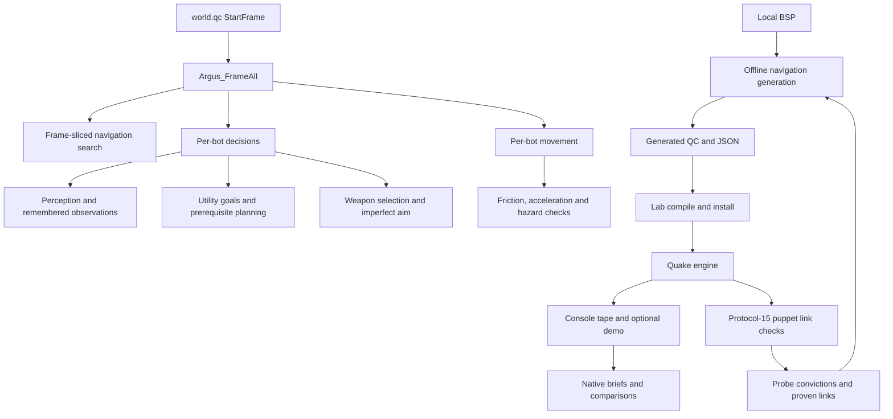

# Bot architecture and source map

[README](../README.md) | [Controls](controls.md) |
[Lab workflow](lab-workflow.md) | [Change history](../CHANGELOG.md)

Argus is a vanilla QuakeC bot inspired by the Reaper and Omicron lineage.
The engine runs the game; offline tools build navigation and analyse saved
evidence. Playing the shipped mod needs neither the lab nor a network service.

## Runtime and lab

## Behaviour by component

| Component | Responsibilities |
|---|---|
| Movement | Ground/air acceleration, friction, wall sliding, corner lookahead and separate move/aim headings |
| Hazards | Braking-aware floor probes, dry landings, liquid checks and knockback-aware ledge avoidance |
| Navigation | Sliced search, cached routes, typed walks/drops/jumps, doors, lifts, trains, teleports and water transitions |
| Combat | Weapon/range choice, projectile lead, splash clearance, movement under threat and crossfire responses |
| Perception | Soft field of view, weapon/item hearing, cached visual combat inputs and limited invisible-player glimpses |
| Aim and skill | Damped spring tracking, blended aim offsets, reaction delay and continuous per-bot skill |
| Goals | Utility scoring, personality appetites, pickup claims, item timing, prerequisite errands and shared failed-plan evidence |
| Presentation | Fake scoreboard rows, stock player models/deaths/backpacks, chat and spectator camera |

The tactical attack-cover-return state machine owns movement temporarily on
two authored routes. It preserves item-route state but suppresses incompatible
launches, validates incoming momentum and brakes during handoff. See its
[implementation and acceptance limits](attack-cover-return.md).

The development perception code gives ordinary combat an observation cache
for its target's position, velocity, movement flags and powerup cues. Hidden
prediction lasts at most 0.4 seconds and travels at most 128 units. Damage
alone cannot create a visual observation, and entity lifecycle changes clear
cached identity. Step 1b health/inventory perception is active again in
development: acquisition, retreat and hunch use observed cues and fixed priors
rather than exact opponent health/inventory. Its earlier dm4 stall warning
remains unresolved; controlled boundary checks do not establish gameplay
regression safety. Projectile
recognition remains a separate follow-up on hold. See the
[observation boundary and engine checks](behaviour-diagnostics.md#perception-step-1a).

`Argus_MuzzleClear` gates the ordinary final-aim rocket trigger after movement
has been computed. It traces the actual firing direction for the nearer of
240 units and muzzle-to-aim-point distance. Blocked shots release the trigger
without cancelling movement. Authored tactics retain their full 240-unit
probe and existing settle/abort rule. Ordinary grenade/hitscan fire and the
separate exact-line speculative prefire remain unchanged. This is outgoing
shot clearance, not incoming-projectile perception. Its controlled checks
cover the shared gate and stock firing, rather than the entire combat AI.

The development goal executor tracks goal identity, best objective distance
and per-goal waypoint visits, using one epoch mark per bot slot on existing
nodes. Useful progress clears failed recovery history and renews the goal
deadline; repeated waypoint cycles, movement or route-cache adoption alone
do not. Detours retain a monotonic best-distance reference. Failed co-op fetches
rest per bot/subject before retrying. Existing bailout
and utility selection choose another goal after repeated failed attempts.
Combat/tactical ownership and established mover/door/link handling pause or
reset the evidence. There is no map-specific escape sequence. See the
[controlled proof and limits](behaviour-diagnostics.md#shared-failed-plan-recognition).

Flat ordinary walking handoffs check landing. Off-centre approaches use two
lateral rays into the next corridor; positions within eight units of the
canonical node trust that seat. Both normal arrival and the apex shortcut use this check;
typed transitions, changed heights and the final node retain their handling.
The wall-slide cutoff and arrival radius stay unchanged. A validated apex
transition also supplies the shared progress observer, so detours do not lose
their deadline solely because they used corner cuts.

### Navigation is generated, not loaded at runtime

QuakeC has no file I/O. A BSP is sampled offline into generated
`argus_nav_<map>.qc`, compiled into `progs.dat`, and registered in both the
dispatcher and build manifest. Its `.qc.json` twin is for tooling.

Generation accounts for player-hull support, movement arcs, doors and mover
geometry, spawn reach and the edict budget. Real-engine probes record refused
links by endpoint; proven candidates and learned hotspot costs feed the next
generation. A generated graph and a well-connected graph are different claims.
New maps need current reach and mill evidence before registration.

Do not hand-edit generated navigation. Use the
[lab generation and validation workflow](lab-workflow.md#add-or-regenerate-navigation).

### Aim and difficulty

The four integer skill rows anchor a continuous 0-3 scale. Reaction time,
error, tracking and spring gains interpolate, while tactical abilities unlock
in an ordered ladder. Console baseline changes apply on respawn; roster
impulses can retune immediately. Per-slot offsets and optional human-only
adaptation are described in the [control reference](controls.md).

Physics rates use `frametime`, and the aim spring is sub-stepped for stable
integration. The lab requests the played rate, but records actual cadence.
Compare matched tick classes and retain the source identity for every arm.

## Source and evidence locations

| Path | Purpose |
|---|---|
| `game/argus/` | Playable `progs.dat` and protocol/edict configuration |
| `src/argus.qc` | Decisions, physics, combat, perception, skills and roster |
| `src/argus_tactics.qc` | Bounded tactical state machine |
| `src/argus_tactic_fixture.qc` | Explicit developer-only engine fixture |
| `src/argus_nav.qc` | Runtime sliced search and route handling |
| `src/argus_nav_dispatch.qc` | Hand-maintained map dispatcher |
| `src/argus_nav_<map>.qc` | Generated graph compiled into the game |
| `src/argus_nav_<map>.qc.json` | Machine-readable graph twin |
| `src/argus_nav_<map>.probe.json` / `.proven.json` | Engine refusals / proven candidates |
| `src/argus_cam.qc` | Spectator camera and HUD |
| `src/defs.qc` / `src/progs.src` | Definitions, client-message shims and compile order |
| `tools/argus_mcp/` | Lab server, wizard, CLI, puppet and native reports |
| `tools/argus_navgen.py` | BSP navigation generation |
| `tools/harvest_session.py` | Preserve console logs and demos from human play |
| `runs/` | Saved tapes, outcomes and build provenance |

Engine installs, licensed maps/models, local configuration, demos and dated
backups are machine-local where specified by `.gitignore`.

## Engine constraints that affect changes

- **Vanilla only:** NetQuake protocol 15, maximum 600 edicts, no engine
  extensions and no QuakeC file I/O. The engine is the measurement harness.
- **Bots are spawned entities:** They use `classname = "player"` for stock
  pickups, damage and triggers, but are not network clients. Client-only
  message shims must reject them. Extra skins provide colours in GL renderers.
- **Trace semantics:** A trace beginning in solid can report fraction 1 with
  `trace_allsolid`; support checks must distinguish that from clear space.
- **View pitch:** `vectoangles()` and view angles use opposite pitch signs.
  Camera and firing code must convert deliberately.
- **Console versus chat:** Diagnostics use `dprint` with `developer 1`.
  Dedicated logs do not prove client-visible `bprint` chat; observe through
  the puppet's `last_prints` to verify it.
- **Evidence:** A goal selection is not a pickup, a shot is not a hit and a
  passing short tape is not proof of improved player experience. Use the
  [recording and report contracts](telemetry.md).
