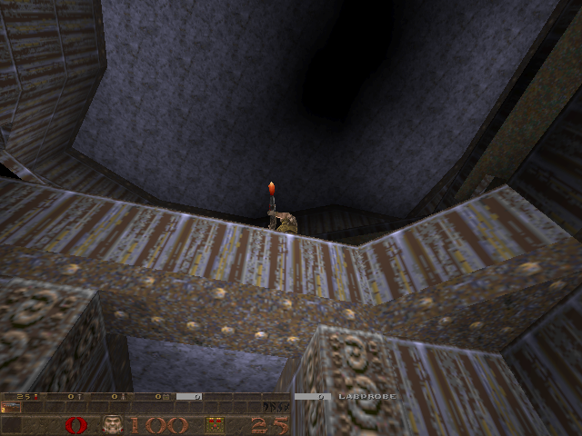
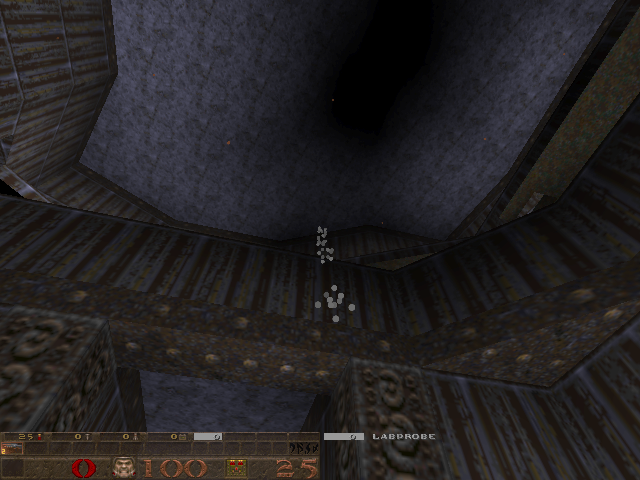
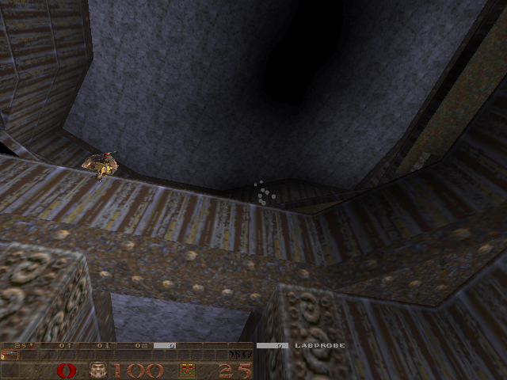
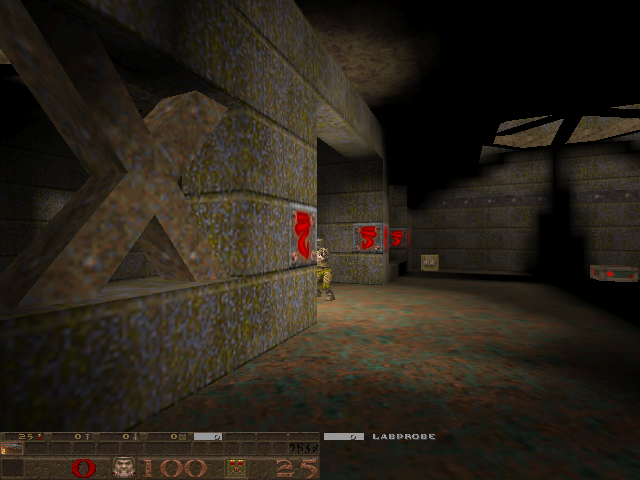
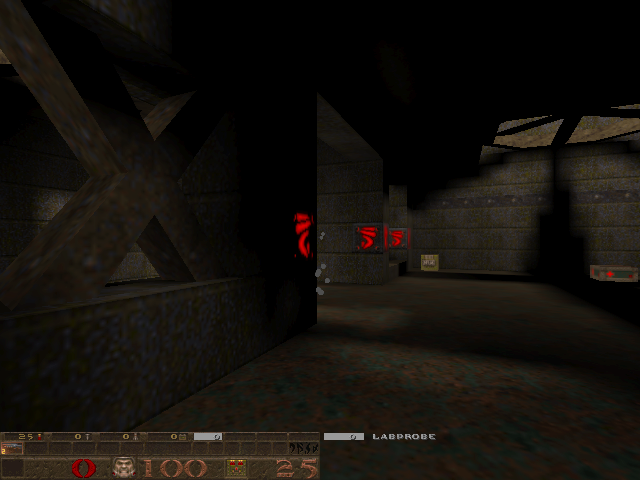
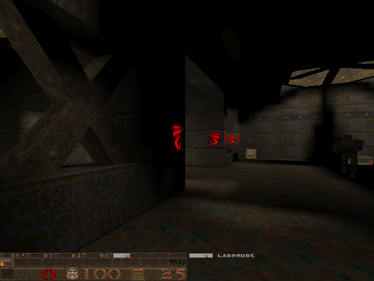
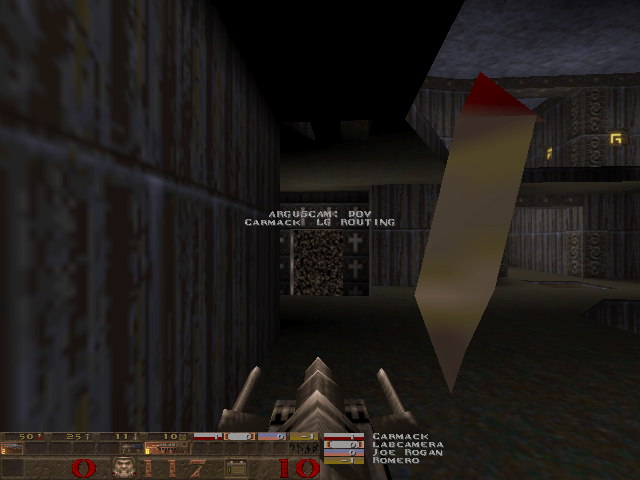
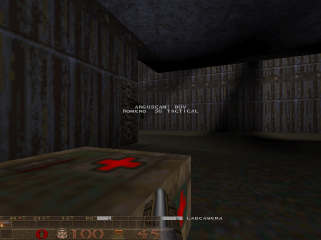

# Attack, cover, return - reviewed implementation

Romero can fire an opening rocket, walk through full-body cover and return
from a different angle on two verified routes. This repair branch restores
the feature preserved at c4c6716, which was closed as PR #528 after its dm4
damage acceptance failed. Historical passing tapes do not certify this build.

The feature is limited to deathmatch at base skill 1, roster slot 1, rockets,
at least two rounds, sufficient effective health and a dry walking approach.
Normal reaction, weapon selection and imperfect aim govern every shot.
The 0.35 adaptive aim share is retained. The separate 0.60 experiment, human
tapes and scorecards remain preserved under issue #527 and the verified
backups/pr-cleanup-20261022/ archive; they are outside this repair.

| Route | Opening | Via | Full-body cover | Return | Observed opponent |
|---|---|---|---|---|---|
| dm4 A | (465,-279,-104) | cover | (561,-183,-104) | (465,-151,-104) | (337,-247,-296) |
| dm2 C | (2209,-279,24) | (2241,-87,24) | (2177,-23,24) | (2145,-119,24) | (2433,-183,24) |

Candidates resolve existing plain graph links. No generated navigation is
modified. Runtime checks include floor and body clearance, avoidance,
teleport exclusion, all eight hull corners plus centre for concealment,
rocket lanes and at least 30 degrees around the observed opponent at first
reappearance. Hidden travel uses remembered coordinates only.

## Ordinary-session evidence

With `developer 1`, `TACTICCHECK` records why Romero's existing half-second
entry checks stop. `evaluated`, `visible`, `loaded`, `eligible` and `at_start`
are nested milestones; the remaining stage names are refusal reasons.
These are sampled evaluation ticks during the existing combat path, not
independent encounters. Busy tactics, settling and cooldowns skip entry
checks as before. No eligibility, route, safety or aim threshold changes.

Run `python tools/tactic_review.py runs/<session>.log` after harvesting a
session. It uses the shared tape reader for map and phase records and reads
the separate diagnostic lines. Old tapes without diagnostics cannot say how
many eligible opportunities occurred. A `returnshot` is an attack
acknowledgement. Ordinary-session hits remain unmeasured; controlled damage
acceptance uses the projectile fixture. Human observations are still needed
to judge whether an actual disappearance and changed-angle return reads as
deliberate, surprising and fair.

`ARGUS difficulty` records base skill, cognition, aim, offset, adaptive drift,
eligibility and aim-share percent when skill is applied. Tier values use
Quake's one-decimal console formatting; aim share is reported as whole percent.
The share remains 35 percent. `ARGUS skilldrift` records explicit toggles.
These records make a future 0.35/0.60 human comparison identifiable, without
adopting the deferred tuning.

## Review changes

- Item-route state survives tactical ownership, but routed dives, jumps,
  climbs, drops, rocket jumps and incidental gap jumps cannot execute then.
- Completion and abort keep a 0.5-second braking handoff, holding item-route
  launches until ordinary movement takes over. Dodge and retreat can release
  the handoff immediately. Respawn and explicit navigation tasks clear it.
- Entry validates the incoming horizontal braking envelope, using the
  existing friction constants and an extra frame of travel. An unsafe
  moving approach is refused before a tactical state or cooldown is set.
- The return radius is 16 units. Actual angle and rocket-lane checks still
  gate the current seat; a blocked lane keeps walking under the 0.6-second
  progress watchdog. It does not park at the first failed lane probe.
- Begin runs after ordinary weapon selection. Active tactics skip ordinary
  circle, item-grab and threat-movement choices and their telemetry. An
  incompatible pre-existing item detour is released without a failure shelf.
- Hidden turns clear spring aim velocity. Exit sight loss aborts immediately.
  An obstructed actual muzzle direction allows 0.4 seconds for normal aim to
  settle; the exposed exit state is capped at 0.6 seconds before yielding.
- Successful W_Attack acknowledgement drives tactical shot transitions,
  independently of net ammunition changes or unlimited-ammo rules. Travel
  clears the fire button on the opening transition frame.
- Navigation cancellation releases the owner's shared flood and shopping
  latch together. Death, respawn, skill boundary changes, life veto, task
  reset, roster removal and fixture reset all use it. Cancelling another
  bot leaves the live owner's queue intact.
- The failed-life veto is applied after GOAP weapon substitution. A vetoed
  route also clears every typed-hop latch before re-planning.
- Overlapping fixtures are refused. Cleanup resets tactical state and bot
  references before removing target edicts, and restores saved solidity,
  camera flags and weapon touches. Setup clears avoid marks and item detours.
  Shop checks release a frozen packmate's pending flood and re-arm its errand.
  The fixed target clears knockback in its pain callback; otherwise normal
  aim would lead phantom velocity on a target whose position cannot move.

## Engine acceptance

Harvest a human session before any new launch. Compile and start an isolated
deathmatch on dm4 or dm2 through the lab MCP, with skill 1 and enough time
for the suite.

Use an isolated lab match. Arming this fixture lets a connected client
rewrite live bot/loadout/pickup state and freeze the other bots for six
seconds. Keep `scratch1 197` disarmed on shared servers.

Run the acknowledgement-based driver from the repository root:

```text
argus-mcp tactic-suite dm4 tactic_ack_full_dm4
argus-mcp tactic-suite dm2 tactic_ack_full_dm2 --no-compile
argus-mcp tactic-suite dm4 tactic_ack_slow_dm4 --step 0.1 --no-compile
argus-mcp tactic-suite dm2 tactic_ack_slow_dm2 --step 0.1 --no-compile
```

The default sequence is `0,0,0,1,2,3,4,5,6,7,8,9,10,11,12`. The driver owns
an isolated match at skill 1. It waits for console-ready, matching trial ID
and case, end, and post-restoration cleanup records. Each trial has a
15-second deadline. Case 9 deliberately sends one overlapping start and
requires exactly one refusal. Missing, duplicate, wrong-case and incomplete
acknowledgements stop the match and fail the command. No fixed delay stands
in for an acknowledgement. Each run reports source, installed binary and
navigation hashes; changes during the suite fail it.

Use `--cases 0,0,0,10 --deathmatch 4` for the unlimited-ammo acceptance arm.
The observer counts newly seen bot-owned rocket entities every engine frame,
independently of ammunition and planner events. New tapes use this counter
for opening/return shots; old tapes retain their ammo-delta interpretation.
Damage still has the first-return 0.6-second window and later-shot exclusion.

The requested step is configuration, not measured cadence. Check complete
slow suites with both `--review-suite` and `--hz 10`. Do not mix tick classes
in ordinary A/B comparisons. The older `--suite` subset and `--slow-suite`
seven-case checker remain available for historical tapes.

```text
python tools/check_tactic_fixture.py runs/tactic_ack_full_dm4.log --review-suite
python tools/check_tactic_fixture.py runs/tactic_ack_slow_dm4.log --review-suite --hz 10
```

For a manual trial, use the existing developer/scratch1 197 gate, scratch2
for the case and scratch3 for a distinct integer trial ID before impulse 217.
Confirm the requested `TACFIX trial` and matching `TACFIX done`; an elapsed
client wait is not an acknowledgement. Prefer the driver for suites.

| Case | Setup |
|---|---|
| 0 | Stationary damageable target; run three times |
| 1 | Target rushes the exit after concealment |
| 2 | Target leaves behind cover |
| 3 | Initial low health |
| 4 | Low health during cover |
| 5 | Weapon change during cover |
| 6 | Moving entry toward the opening walkway's brink |
| 7 | New visible attacker during cover |
| 8 | Moving at 70 u/s with an exact preserved route node (dm4 pit floor) |
| 9 | Lightning owned with cells; selector must prevent entry |
| 10 | Ammo added after prepare, before the opening shot |
| 11 | Sight breaks at reappearance, before the return shot |
| 12 | Shop cancellation on death, respawn and skill change, plus ownership isolation |
| 13 | Shared trigger-box boundary check; reports `TACFIX hull ok` before the encounter |
| 14 | Failed-life GOAP substitution, repeated selection and active-route ownership checks |

The checker includes at least 0.5 seconds after an active moving-entry abort
or a completed return when checking the floor. A refused entry is reported
as a refusal, without a positive tactical-safety claim. Ordinary dry drops
after refusal are recorded separately. Any prepare event counts as ownership,
including a prepare and abort between observer samples; an unsampled
transition cannot become a refusal. It credits damage only within 0.6 seconds
of the first post-return rocket and before any subsequent rocket. Later ordinary combat
cannot rescue a missed return. The three stationary cases must still yield
at least two damaging returns; this threshold and ordinary aim are unchanged.

    python -B tools/check_tactic_fixture.py runs/tactic_review7_full_dm4.log --review-suite
    python -B tools/check_tactic_fixture.py runs/tactic_review7_slow_dm2.log --slow-suite

Tactical ARGEVT phases and reasons are already supported by main's Rust and
Python readers, including track names containing event words. A returnshot
is a shot acknowledgement, not proof of a hit. Use the independent fixture
checker for acceptance outcomes, and native lab briefs for normal matches.

## Validation record

The final build passed 44 controlled trials: two 15-case suites at the
played cadence and two seven-case suites at 10 Hz. The latter also require
refusal of an overlapping impulse and the moving, routed regression setup.
Completed manoeuvres and active moving-entry cases are checked through the
post-ownership window; refused entries carry a separate ordinary-drop observation.

| Suite | Cases | Measured cadence | Damaging stationary returns |
|---|---|---|---|
| full dm4 | 15 | 64.2-64.5 Hz | 3/3 |
| full dm2 | 15 | 63.3-64.5 Hz | 3/3 |
| slow dm4 | 7 | 10.0-10.0 Hz | 3/3 |
| slow dm2 | 7 | 10.0-10.0 Hz | 3/3 |

All 114 Python tests and 271 Rust tests passed. The final QuakeC emitter
audit also passed after the physics handoff change. Source and both binary
hashes are in runs/tactic_review7.state.json; the matching binary MD5 is
1B17C38CE8053E713112CCF2D1EA4F7C. Per-trial results, tape hashes and recovery-archive identity
are in runs/tactic_review7.results.json.

These manifests describe implementation checkpoint `bf170a9`, before the
subsequent documentation cleanup. Documentation edits do not replace its
source, binary or tape identities.

The final 30-second native matrix returned parity on dm4 and dm2. A prior
dm2 tape recorded 15 stalls; all attempts were retained. Three repeat tapes
returned duration-normalised parity, with median six stalls against a control
median of eight. The current lab CLI's report is
runs/tactic_review6_repeat.compare.txt. The connected experiment surface's
unscaled aggregate is not evidence of improvement. This matches the
stale-server failure already tracked and fixed in source by
[#499](https://github.com/saworbit/argus/issues/499); install the current lab
and restart the connected process before trusting its quality verdicts.
Short matches are smoke checks, and no win-rate improvement is claimed.

Intermediate trials exposed an overly eager lane abort, phantom knockback
velocity on the fixed dummy, shared-queue contention in the shop fixture,
and full-gait acceleration immediately after tactical reset. Those diagnostic
tapes and manifests were archived with SHA-256 verification in
backups/tactic-review-intermediate-20261022.zip. The source/binary recovery
snapshot for the earlier controlled build is
backups/tactic-review-build5-20261022.zip. Final acceptance uses only build 7.

Human playtesting remains necessary to judge encounter frequency and whether
the move reads as deliberate
([#517](https://github.com/saworbit/argus/issues/517)). The historical 44-trial checkpoint used ordinary ammo and inferred rockets
from ammo loss. The current observer counts real owned projectiles; see the
acknowledged-suite checkpoint below for independent unlimited-ammo coverage
([#529](https://github.com/saworbit/argus/issues/529)).
Case 12 checks cancellation lifecycle and queue ownership. Case 14 now covers
failed-life avoidance after GOAP substitution and active typed-hop cancellation
([#530](https://github.com/saworbit/argus/issues/530)).
Short normal matches establish smoke parity,
not improved win rate. The compare_band_primary_scaled note in review 3.3
requires no change: scaled correctly describes whether any arm changed scale.

## Acknowledged-suite checkpoint, 2026-10-22

The new driver passed every complete interruption suite at both cadences,
plus ordinary-ammo addition cases and eight unlimited-ammo trials. Both
installed binaries have MD5 `98C66862A34D1A2501F4C104CE02D8B3`.
Source, binary, nav and normalized tape identities, requested case order,
measured rates and every result are retained in
[runs/tactic_ack.state.json](../runs/tactic_ack.state.json).

| Suite | Trials | Measured cadence | Damaging stationary returns |
|---|---|---|---|
| full dm4 | 15 | 64.2-65.5 Hz | 3/3 |
| full dm2 | 15 | 64.0-66.2 Hz | 3/3 |
| slow dm4 | 15 | 10.0-10.0 Hz | 3/3 |
| slow dm2 | 15 | 10.0-10.0 Hz | 3/3 |
| unlimited dm4 | 4 | 64.3-66.3 Hz | 3/3 |
| unlimited dm2 | 4 | 64.3-66.5 Hz | 3/3 |

All 68 trials passed the unchanged walking, concealment, angle, cancellation,
first-return damage and self-damage checks that apply to their cases. Both
full suites include all interruption cases at measured 10.0 Hz. Case 9's
extra impulse was refused once per full suite. Cleanup was acknowledged
before the next trial. Unlimited ammo used deathmatch 4 and real owned-rocket
counts; all six stationary returns and both ammo-addition returns damaged
the target. This closes the coverage gaps in #515, #516 and #529. It does
not settle ordinary encounter frequency, human feel or adaptive aim.

The first driver diagnostic caught a stale case/ID write; a second found
joined back-to-back Windows console submissions. Both commands failed and
stopped their owned engines. Console-ready acknowledgement and one initial
setup submission resolved these transport failures. Diagnostic tapes are
retained locally in backups/soak-20261022/fixture-driver-diagnostics.zip.

## Failed-life regression checkpoint, 2026-10-22

Run `argus-mcp tactic-suite dm4 lifeveto_dm4 --cases 14` and repeat on dm2
with `--no-compile`. The case supplies the real scorer with a transient
completed distance field and three items. An unarmed bot first chooses a
powerup via a distant weapon. Failed-life memory then replaces that weapon
with a nearer health item on three consecutive picks; a live fight is also
checked. The active-route test checks every typed-hop latch and route
metadata, replacement of the owner's old shopping flood, and preservation
of another owner's queue. All transient entities and item-chain changes are
removed before ordinary fixture observation resumes.

Both final map trials passed at 66.5 Hz. Moving GOAP substitution after the
veto and removing the typed-jump reset each made the checker fail. Final
source, installed binary and nav identities, passing tapes and both rejected
mutation tapes are retained in [runs/lifeveto.state.json](../runs/lifeveto.state.json).
The matching gameplay binary MD5 is `2AA92D4EB164CB4241BB654EB70BCD46`.
The live route-veto body is unchanged and remains after combat acquisition;
it is a named function so this engine fixture can exercise that exact path.


## Rendered observation checkpoint, 2026-10-22

The observation path now renders actual protocol-15 demos in the configured
QuakeSpasm client. The old POV tool returned a parked response and substitute
plot paths. It now returns engine PNG image blocks, with bounded recording,
fresh output directories, capture acknowledgements and timeout cleanup.
The writer follows the pinned engine's
[demo message framing](https://github.com/sezero/quakespasm/blob/quakespasm-0.96.3/Quake/cl_demo.c).
The renderer uses its stock `wait` and `screenshot png` commands.

Reproduce a recorded opponent-eye trial on each map:

```text
argus-mcp tactic-suite dm4 visual_dm4 --cases 0 --record
argus-mcp tactic-suite dm2 visual_dm2 --cases 0 --record --no-compile
argus-mcp capture-demo visual_dm4 0.5 12 0.45
argus-mcp capture-demo visual_dm2 0.5 12 0.45
```

The server selects the actual target edict as the observer's view entity.
This hides the target's own model and preserves its sightline. The recorder
stores original complete server messages, not reconstructed entity updates.
The client view entity is checked after cleanup; disconnect clears the
observer reference before its client slot can be reused. The fixture dummy
and spectator do not reproduce player input or player hit feedback.

| Final trial | Full concealment first sampled | First reappearance | Angle change | Return damaged target | Measured cadence |
|---|---|---|---|---|---|
| dm4 | 0.5 s | 1.1 s | 40.9 degrees | yes | 66.3 Hz |
| dm2 | 1.3 s | 1.7 s | 49.8 degrees | yes | 66.3 Hz |

These timings and damage come from the existing independent fixture checker.
The six uncropped engine images below are selected from the corresponding
12-frame captures. Image schedules are playback steps and have a startup
offset from the fixture clock. The manifests identify the source frames;
no exact event time is inferred from a screenshot.

| Map | Opening | Covered | Returned |
|---|---|---|---|
| dm4 |  |  |  |
| dm2 |  |  |  |

Both sequences visibly lose the bot behind solid geometry and recover it at
a different screen position. On dm4 it moves from the upper centre to the
left edge of the walkway. On dm2 it disappears behind the left pillar and
returns to the right of the original sightline. The opening and return
rockets are visible in the complete frame sequences. This supports visual
readability in the authored encounters; it does not measure surprise,
enjoyment or fairness during ordinary play.

Two further 45-second ordinary matches include 30-second automatic bot POV
recordings. They contain no authored manoeuvre. Their final refusals are
loadout (42 dm4 checks, 31 dm2 checks) or no visible target (10 and 11).
The earlier 30/185-second ordinary tapes reached safe/loadout eligibility
on some checks, but all fourteen such checks across both longer tapes were
outside the authored starting seats. These are throttled evaluation ticks,
not independent encounters or successful pickups. Zero phases cannot be
credited as a completed return or a return hit.

Decision: retain the existing bounded eligibility and cooldowns. These
samples do not support promoting this feature as a common ordinary-play
behaviour. Broadening sensing or adding a general route search just to
increase its count is not justified by this evidence. Keep ordinary aim
and the 0.35 adaptive share unchanged. A success claim about human feel is
still unsupported; no further human session is a gate on this observation
work. Original demos remain local under ignored `runs/demos/`. Source,
binary, nav, demo and frame identities, retained tapes, results and limits
are in [runs/tactic_visual.state.json](../runs/tactic_visual.state.json).


The same rendered review exposed and fixed #565: moving the observer into
the bot did not hide the bot model. Selecting the bot as protocol view
entity hid that model but exposed the co-located observer body. The final
camera also hides the observer's render index while active and restores
its exact index on exit, preserving its model string and collision hull.
A real-client regression rejects both incomplete states and verifies mode
change and direct POV exit. The fixture opponent-eye view is restored
before cleanup as well.

| Automatic POV before the fix | Automatic POV after the fix |
|---|---|
|  |  |

These are separate ordinary recordings, not matching simulation frames.
The real-client checks establish the view/entity and model changes; the
images verify that the new observation path produces a clear rendered view.
