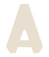

# Argus brand

The Argus identity: one mark, one wordmark, one palette and one container
rule. Every file in this folder is generated by [`tools/brand`](../../tools/brand)
from a handful of parameters, so nothing here is hand-drawn and any asset can
be rebuilt exactly.

<p>
  
  &nbsp;
  
  &nbsp;
  
</p>

## The mark

**The A of ARGUS, with no curve and no point anywhere in it.**

Nothing in Quake is round and nothing comes to a point. Every surface in a BSP
is a flat plane and every model face is a polygon. So the apex is cut to a flat
platform, the terminals are chamfered at 45 degrees, and the counter is a
flat-topped facet cut by the same rule as the outline.

```python
MASTER = dict(k=0.34, wh=24.0, f=0.28, cyt=74.0, cyb=88.0,
              foot=13.0, ink=84.5, lsb=0.7, H=100.0)
```

`ink` and `lsb` are IBM Plex Mono Bold's own A-glyph ink width and left side
bearing at cap height 100. The mark therefore drops into the wordmark as its
own first letter rather than merely resembling it.

A heavier cut, `FAVICON`, exists for 24 px and below, where the master's
counter closes up and its chamfers muddy. [`favicon.svg`](favicon.svg) uses it.

### Rules for the mark

1. **The crossbar is never broken, thinned to a hairline or removed.** A
   chamfered A with no crossbar is the Half-Life lambda: another franchise and
   someone else's trademark.
2. **The mark is never set beside or above the wordmark.** It *is* the
   wordmark's A, so any such lockup reads "A ARGUS". Use the mark alone or the
   wordmark alone; the generator deliberately builds no combined lockup.
3. **No gradient, stroke, outline version or second colour.** The mark is a
   solid in one colour.
4. **Clear space** on every side is one crossbar thickness: 14 per cent of the
   cap height.

The mark ships in three colourways only: bone on rock, rust on rock, and rock
on bone.

## The wordmark

ARGUS set in IBM Plex Mono Bold, the console voice of a tool driven from the
Quake console, with **every curve flattened to a single straight segment** and
the A replaced by the mark. Tracking is +5 at cap 100.

The faceting is meant to be nearly invisible at a glance. It shows in the G, S
and U, and it is structural: the letterforms contain no curve data. Every SVG
is outlined to paths, so none depends on an installed font. The outlines derive
from IBM Plex Mono, used under the SIL Open Font License 1.1.

## Palette

The core palette is the lab GUI's own (`tools/argus_mcp/src/gui.html`).

| Token | Hex | Role | Contrast on rock |
|---|---|---|---|
| rock | `#141210` | the ground | - |
| panel | `#1e1b18` | raised surfaces | - |
| line | `#3a342c` | rules and hairlines | 1.52:1, decorative only |
| muted | `#9a8f7e` | secondary text, graph nodes | 5.88:1 |
| bone | `#e8dfd0` | primary text, the mark | 14.15:1 |
| rust | `#d4531e` | the signature, rationed | 4.50:1 |

- **Rust is rationed to one element per screen** and is never body text. On
  bone it measures 3.14:1, so it is for large type and graphics there only.
- **No data colour may be orange.** It collides with rust, and the graph stops
  reading as data.
- On a bone ground, secondary text uses `#6f6555` (4.33:1) in place of muted.

### Navigation link colours

Every renderer draws a link type the same way: one hue per meaning, a tint for
each ground, and a dash so identity never rests on colour alone. The navgen
debug PNG and `analyze_match.py` plots use the white column; the lab GUI uses
the rock column. [`tools/argus_linkstyle.py`](../../tools/argus_linkstyle.py)
is the source, and a test holds the GUI's copy to it.

| Link | On white | On rock | Line |
|---|---|---|---|
| walk | `#2a9d5c` | `#22c55e` | solid |
| drop | `#cc8800` | `#eab308` | dashed |
| jump | `#d62728` | `#ef4444` | dotted |
| sprint jump | `#d62728` | `#ef4444` | dot, dot, dash |
| rocket jump | `#c2389b` | `#e879f9` | dash-dot |
| lift and train | `#6d43c8` | `#8b5cf6` | solid |
| teleport | `#3a342c` | `#e8dfd0` | long dash |
| swim | `#0e7490` | `#22d3ee` | solid |
| door | `#6f6555` | `#9a8f7e` | solid |
| refused link | `#7f0000` | `#fca5a5` | dashed, X at the far end |
| waypoint (dot) | `#1e6bd9` | `#60a5fa` | - |

A drop is a plain link that descends more than one 18-unit step, the lab's
own rule; a one-way link at one level is still a walk. On rock every pair of
link hues is at least OKLab Delta E 15 apart for normal vision. Walk and drop,
and rocket jump and swim, are confusable under deuteranopia, which their dashes
resolve. A sprint is a jump, so it shares jump's red and differs by dash. On
white, swim and door sit at 11.7; no white-ground renderer draws either yet,
and [#675](https://github.com/saworbit/argus/issues/675) must settle that
before the debug PNG does.

## The motif

The mark's own 45-degree cut, promoted to a container rule: panels, cards,
swatches and tiles have their corners knocked off at 45 degrees, like a Quake
brush. It is the same operation as the mark's apex and terminals, not a
decoration chosen to match. The chamfer depth is 6 per cent of the shorter
side; deeper reads as an octagon, which at small sizes is a stop sign or a
slotted screw head. See [`argus-motif.svg`](argus-motif.svg). The lab GUI
still uses rounded corners; [#677](https://github.com/saworbit/argus/issues/677)
tracks carrying the chamfer there.

The nav graph appears as **texture only**, as low-opacity wallpaper on the
banner and social card. It keeps clear of the type: no node sits inside the
wordmark or tagline and no link crosses them.

## Files

| File | Use |
|---|---|
| `argus-mark-{ink,accent,rock}.svg` | the mark in its three colours |
| `favicon.svg` | browser tabs and small sizes; rock on light chrome, bone on dark |
| `argus-icon-tile{,-accent,-light}.svg` | app icon or avatar, a chamfered brush |
| `argus-icon-tile-512.png` | raster avatar for services that need one |
| `argus-wordmark-{ink,accent,rock}.svg` | the wordmark alone |
| `argus-header-{dark,light}.svg` | wordmark over tagline, for document headers |
| `readme-banner{,-light}.svg` | 1280 x 400 banner at the top of the README |
| `social-preview.{svg,png}` | 1280 x 640 GitHub repository social preview |
| `argus-motif.svg` | the chamfer rule as a divider |

The tagline is **VANILLA QUAKEC DEATHMATCH BOT · TELEMETRY LABORATORY**.

## Rebuilding

The generator needs Python with fontTools, and Node.js for the font package
and the rasteriser.

```bash
npm install --prefix tools/brand
python tools/brand/dist.py
node tools/brand/raster.js
```

`dist.py` writes every SVG here and `raster.js` writes the two PNGs. Change
`MASTER` or `FAVICON` in `tools/brand/build.py` to change the mark everywhere.

## Directions rejected, and why

Recorded so they are not proposed again.

| Direction | Reason |
|---|---|
| An eye | Argus means the all-seeing giant, so an eye is the default. Security firms, monitoring tools, media companies and camera makers already use one, and logo generators ship it as a preset. |
| Node-link graphs | Two dots and a line is the link icon; three dots and two lines is the share icon. |
| A peacock feather | The myth's own ending, but drawn it reads as a lightbulb or a hot-air balloon. |
| A peaked block A | A peak, a counter and a notch between vertical legs is the home icon at every setting tried. |
| A solid brush with a route cut out | Resolved into a face, a slotted screw head, a keyhole or a numeral 5. |
| Floating platform blocks | Layout or wireframe icons. |
| A single route trace | Stairs, a trend line, a square wave, a thermometer or a key. |
| Strict 0/45/90 geometry for the whole mark | Forces vertical outer sides, which make the A a building. The bevel survives as a terminal treatment only. |

Collisions are ruled out in the geometry rather than by search: the mark has a
crossbar (not the lambda), splayed strokes (not the home icon) and a counter
(not a delta or a mountain).
