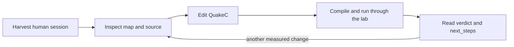

# Set up and use the lab

[Back to the README](../README.md#lab-workflow) |
[Full operator guide](../tools/argus_mcp/README.md)

The lab compiles QuakeC, installs the result, runs the real engine and reports
what happened. Playing the prebuilt mod does not require this setup.

## 1. Install the lab binary

You need Rust/Cargo (the repository pins its toolchain in
[`rust-toolchain.toml`](../rust-toolchain.toml)), Python 3, a modern fteqcc
and a dedicated-capable Quake engine with game data. Install `matplotlib`
into that Python for trajectory plots and navigation images (for example,
`python -m pip install matplotlib`); the Linux rig uses `python3-matplotlib`.
Engine/data/compiler installs remain machine-local.

From the repository root, run this **terminal command**:

```text
cargo install --locked --path tools/argus_mcp --root tools/argus_mcp/install
```

The binary is `tools/argus_mcp/install/bin/argus-mcp`, with `.exe` on Windows.
Use its full path or add its directory to your `PATH`. Do not point your MCP
client at `target/release`: `cargo clean` can remove that build directory.
The installation and update details are in the
[operator guide](../tools/argus_mcp/README.md).

## 2. Configure local paths

Copy [`tools/argus_mcp.toml.example`](../tools/argus_mcp.toml.example) to
`tools/argus_mcp.toml`, then replace its example paths with your real ones.
These keys may also be supplied as environment variables; environment wins.

| Key | Points to |
|---|---|
| `ARGUS_ROOT` | This repository |
| `ARGUS_FTEQCC` | Modern fteqcc executable |
| `ARGUS_ENGINE` | Dedicated-capable Quake executable |
| `ARGUS_BASEDIR` | Engine data directory containing `id1/` and the `argus/` mod |
| `ARGUS_PYTHON` | Python 3 executable |

`ARGUS_MAPS` optionally overrides the default `maps_local/`. The game data,
maps and player model are separate from the lab binary. Use the
[configuration reference](../tools/argus_mcp/README.md#config) for resolution
order, optional paths and defaults.
`ARGUS_GAME` is an optional game-directory name, defaulting to `argus`.
`config_check` reports its existence under `ARGUS_BASEDIR`, independently of
the process working directory; an absent optional game does not change `complete`.

For an MCP client, adapt [`.mcp.json.example`](../.mcp.json.example): set its
stdio command to the installed binary and give it the same local paths.
Restart the client after changing its server command or updating the binary.
In the reconnected chat, call `see what=project` and require
`lab_identity.authoritative: true` with matching source fingerprints.

## 3. Choose an interface

| Interface | Start it | Use it for |
|---|---|---|
| Web wizard | Terminal: `argus-mcp gui` | Map ingest, compile/install, graph preview, backup and restore |
| MCP | Connect the client to the installed `argus-mcp` stdio server | Inspection, experiments and structured reports |
| CLI | Terminal: `argus-mcp client observe`, `argus-mcp corpus`, etc. | Direct observations, link probes and saved-run queries |

The wizard opens `127.0.0.1:7420`; `argus-mcp gui --no-open` keeps the browser
closed. It uses the same configuration as MCP. Tools such as `see`,
`experiment`, `tune` and `config_check` are **MCP calls**, not shell verbs.
Starting bare `argus-mcp` in a terminal starts the stdio server, not a REPL.

Make these **MCP calls** first:

```text
see what=project
config_check
see what=map name=dm4
```

Inspect-only tools need the repository path. Compile, navigation generation
and match tools require the full configuration and name any missing key.

## 4. Preserve human sessions before launching an engine

A new engine launch can truncate `qconsole.log`. After playing, quit the
engine and run this **terminal command from the repository root first**:

```text
python tools/harvest_session.py --tag my_session
```

The harvester moves the freshest root/`engine/` console log into `runs/` and
pairs recent demos from `engine/argus/` under `runs/demos/`. If you played
from another install, first preserve its log and demo and place copies in
those expected input locations. Check what will move with `--dry-run`.
See [recording and harvest](telemetry.md#record-and-harvest-a-human-session).

Do this before experiments, the GUI's engine actions or link probes. Keep
human tracks as review data; they do not belong in bot comparison bands.

## 5. Edit, test and read the report



Examples below are **MCP calls**:

| Task | Call |
|---|---|
| Inspect a route | `see what=path name=dm4:quad->lg` |
| Read a function and callers | `see what=fn name=Argus_HazardSteer` |
| After a QuakeC edit | `experiment map=dm4 duration_sec=30 skill=2` |
| Several maps, one compile | `matrix_experiment maps=["dm2","dm4"] duration_sec=30 skill=2` |
| Compare similar-length saved runs | `compare_runs log_a=baseline log_b=latest` |
| Change the live baseline | `tune command="skill 3"` |
| Read live status | `see what=status` |

Only one compiler may run at a time. Compilation backs up the previous
sources and binaries before installing. Keep the source/tree identity with
each control and candidate arm. A live console skill change applies on
respawn; changing a compiled constant requires a new build.

Read the returned `next_steps`, native brief and quality gates. Reuse the
status response's `next_line` as `since_line` on the next status call to read
only new output.

### What the result establishes

- `experiment` scales baseline counts to the short candidate duration.
  `compare_runs` is unscaled and needs comparable tape lengths.
- Different tick classes invalidate a comparison. The default lab launch
  requests the played rate; measure actual cadence rather than assuming it.
- One movement tape settles nothing. Use two maps or a suitable repeated
  control, and keep outliers and failed attempts.
- A short clean match is smoke evidence. It does not establish better win
  rate, balance or human readability. A selection event is not a pickup, and
  a shot event is not a hit.

For exact baselines, primary metrics and repeated-run statistics, use the
[measurement guide](../tools/argus_mcp/README.md#what-the-instrument-can-see-and-when-to-stop).

### Focused checks without deployment

For observation, historical-source reconstruction, combat, button, door,
plan and entry contracts,
these **terminal commands** do not launch an engine:

```text
python -m pip install -r tools/requirements-perception-cohort.txt
python -m unittest discover -s tools -p "test_perception*.py"
python tools/test_muzzle_fixture.py
python tools/test_tactic_fixture.py
python tools/test_review_outputs.py
python tools/test_plan_progress.py
python tools/test_offset_entry.py
python tools/test_muzzle_combat.py
python tools/test_button_physical.py
python tools/test_door_actuator.py
python tools/test_private_fixtures.py
python tools/test_tools_cli.py
python tools/test_argus_navjson.py
python tools/test_argus_tape.py
python -m unittest discover -s tools -p "test_behaviour*.py"
python tools/test_compile_private_fixtures.py
python tools/test_nav_budget.py
python tools/test_nav_preview.py
python tools/test_map_intelligence_report.py
python tools/test_study_comparison.py
python tools/test_freeze_recovery.py
python tools/test_mover_transfer.py
python tools/test_target_attention.py
python tools/test_argus_mapgate.py
```

The budget, map-report, freeze-receipt and mover-receipt suites above also
block the fast workflow. They need no engine, BSPs or historical backups and
reject invalid receipt fields, cadence and tape hashes. The compile workflow's
`freeze`/`mover` checks prove compilation separately; native trials establish
physical outcomes.

The repo invariant job also blocks on `python tools/argus_ci.py all`.
Use `python tools/argus_ci.py links` to check only documentation paths and
fragments, including explicit HTML anchors. It reads tracked Markdown files,
ignores fenced/code examples and external URLs, and excludes archived
`backups/` and `docs/plans/` documents. It needs no engine or network access.

The pinned NumPy/SciPy requirements support historical cohort calculations;
install them for the perception discovery command even though it launches no
cohort. Every suite listed above is a blocking check in the fast workflow's
lab job; individual tests that require machine-local inputs may self-skip.
The CLI suite also carries the offline analysis tools -
tape parity, humanness profiling, gait attribution and the graph void probe -
and self-skips the cases that need machine-local maps or tapes. On restricted Windows runners, use a writable workspace
temporary directory for `TEMP` and `TMP` if temporary-copy tests hit ACL errors.
Fast-workflow coverage is tracked in [#585](https://github.com/saworbit/argus/issues/585).

For an authorised native check, preserve human sessions first, require a
source-authoritative lab and use one compiler at a time. `compile_qc
install=false` prevents installation but still writes `ARGUS_PROGS`, so point
both `ARGUS_SRC` and `ARGUS_PROGS` at an owned private build tree. `experiment
compile=false` tests the already-staged lab binary; it does not compile or
select the intended candidate for you. Record and verify that binary's hash
before running, then restore every saved binary location on success or error.
Do not use the default installing compile path in a no-deployment task.

The retained `verify_muzzle_clearance.py`, `prepare_blind_perception.py` and
`investigate_health_stalls.py` scripts are fixed session drivers, not reusable
public CLIs. They require local ignored snapshots, fresh hard-coded names or
output directories, and have no argument parser or `--help`. Do not invoke
them merely to discover options, delete prior evidence, or restart completed
cohorts. The [diagnostics guide](behaviour-diagnostics.md#ordinary-rocket-muzzle-clearance)
records the original checks and their limits. Their maintained successor uses
fresh private sources, assets, binaries and runs, and never overwrites installed
game files. It checks protected hashes after success or failure and refuses
existing output directories:

```text
python tools/verify_private_fixtures.py --help
python tools/verify_private_fixtures.py muzzle --output backups/muzzle-check-1 --prefix muzzle_check_1
```

Choose a fresh directory and prefix for every invocation. Replace `muzzle`
with one of these fixture names:

| Fixture | Native coverage |
|---|---|
| `muzzle` | Shared clearance geometry and declared negative controls |
| `combat` | Actual ordinary combat trigger, ammo/projectile emission and movement preservation |
| `health` | Active health/inventory information boundary; does not resolve #583 |
| `button` | Real bot/player floor-button activation and disabled-support control |
| `door` | Bounded opener lookup, activation acknowledgement and opening ownership/timeout |


Compile-only CI also checks all 20 maintained variants across `muzzle`,
`combat`, `health`, `button`, `door`, `plan`, `offset`, `freeze`, `mover` and `attention`. It reuses the native
verifiers' staging helpers, including extracted production decision wrappers:

```text
python tools/compile_private_fixtures.py --help
python tools/compile_private_fixtures.py --compiler <pinned-fteqcc> --family door --output backups/door-compile-1
```

Use the FTEQCC revision pinned in `.github/workflows/compile.yml`. Omit
`--family` to compile every family serially. Supply a new output directory;
existing evidence is refused. Each variant must produce a fresh id-format
`progs.dat` and the compiler's id-format finish line. Source/compiler/binary
hashes, logs and failure receipts remain in that directory. This needs no
lab connection, engine, BSPs or historical snapshots and never installs a
binary. It proves compilation only; native trials still determine fixture
outcomes. CI runs it when sources, fixtures or Python staging helpers change.

Shared failed-plan checks have a separate repeatable native driver:

```text
python tools/verify_plan_progress.py --output backups/plan-check-1
```

Choose a new directory beneath `backups/`; existing evidence is refused.
`--help` starts no lab or engine. The default fixed schedule runs decision
contracts on dm2/dm4, live-item and respawn-camp physical escape fixtures on
dm2, and a legacy-reset negative control. `--mode contract` or `--mode physical`
selects one part. `--mode edges` runs 39 controller checks each on dm2/e1m2
for co-op retries, detours, waypoint cycles and deadline ownership. These
inject waypoint arrivals and co-op state; the physical fixtures separately
verify escape. `--allow-failed` is restricted to diagnostic edge controls;
retain their failures and never report them as passing acceptance.
This is a small fixture suite, not a gameplay cohort.

Physical retry/detour follow-up uses `--mode physical-edges`. Add
`--physical-part coop` for the passing dm2 co-op rest/retry/contact check or
`--physical-part normal` for the completing e1m2 route at shipped speed.
The supported deadline witness uses a slower real door, with the bot motor
unchanged. Run each bounded part separately with a fresh output directory:

```text
python tools/verify_plan_progress.py --mode physical-edges --physical-part mover --output backups/mover-check-1
python tools/verify_plan_progress.py --mode physical-edges --physical-part mover-control --output backups/mover-control-check-1
python tools/verify_plan_progress.py --mode physical-edges --physical-part mover-release --output backups/mover-release-check-1
```

`mover` requires real contact after 20.5 seconds. `mover-control` disables only
deadline renewal and requires release at the old deadline without contact;
`mover-release` disables only the opening wait and requires premature failure.
Each is one 45-second native experiment. `--physical-part detour` combines the
normal route and mover cases; the full schedule stops at its first failure.
Historical `half` and `deadline-control` selectors retain the unsupported
160-speed motor override outside automatic acceptance. They do not scale the
graph's arcs or fixed launch thresholds. No half-speed success is claimed.
Do not count controller callbacks or goal selection as physical arrival.
These switches add no production controls and do not establish deployment safety.

For its isolated offset entry, use `python tools/verify_offset_entry.py
--output backups/<new-directory>`. This seeds only the initial route and
placement, then observes actual movement/contact. Default cases cover grounded
and airborne, centred and offset entries; the old-handoff control disables the
new guard only in its private copy. Use `--variants current --cases 3` for one
fixed case. Current failures fail the command. Step 1b is active again in
development, with fresh controlled boundary checks and the prior dm4 warning
still open; these checks do not establish that the entire source bundle is
ready for installation.

Offset options accept comma-separated values: `--variants current,old_handoff`
and `--cases 1,2,3,4` are the defaults. Cases 1/2 are grounded centred/offset
entries; 3/4 are airborne offset/centred entries. `--output` must name a new
directory beneath `backups/`; `--help` starts no lab or engine. Current-case
failures return nonzero. The old-policy airborne-offset case 3 must fail;
an unexpected pass or malformed receipt also fails the command. Other old-policy
cases remain diagnostic. Invalid receipts are retained before rejection.

These verifiers reuse the existing native-lab environment configuration;
they add no dependencies, production console switches or environment variables.
Their overrides for source, binary, runs and game assets stay inside the owned
test directory. Historical receipts retain the code and bounds of their run.

The driver requires the matching source-built CLI and configured local game
assets. It copies sources and assets into the output directory, compiles
with `install=false`, and launches through the native lab with private
`ARGUS_BASEDIR` and `ARGUS_PROGS`. It never stages a candidate over the
installed game. Preserve any pending human session before running.
Receipts include the fixed schedule, source/decision/binary/tape hashes and
installed-binary hashes before and after. The physical oracle requires a
new valid goal, continuous displacement beyond 220 units, retained health,
and a failed-plan shelf while the original prize remains in its initial
state. The fixture assigns only initial conditions; ordinary bot code
chooses the alternative and moves. Raw tapes and licensed assets stay local.

The blind-review page saves ratings to the browser profile/origin or exports
them on request. Keep its key outside the served anonymous directory until
the reviewer scores, preserve pre-reveal ratings, and separate subjective
judgments from native metric gates. Generated WebM files contain local game
assets and should not be staged in Git. A loopback preview is temporary local
viewing, not a deployment or a published evidence URL.
Generated review pages/clips are ignored by default; the reusable HTML
template remains tracked. Raw session-study tapes are also retained locally,
with checksums in `runs/local-study-tapes.json`. Do not overwrite frozen tapes.

### Cross-map routing evaluation

Build the source-matched native executable at the study drivers' default
location before using them:

```text
cargo build --release --manifest-path tools/argus_mcp/Cargo.toml --target-dir tools/argus_mcp/target-stage
```

The runners use `target-stage/release/argus-mcp` (`.exe` on Windows), the
existing `ARGUS_*` lab configuration and local engine/map assets. The map
runner, route verifier and report accept `--lab` for another fresh binary;
the recovery and mover verifiers currently use the default location.
No new environment variables or game-engine extensions are introduced.

The [broader map runner](map-intelligence.md) evaluates frozen source arms on
eight maps outside dm2/dm4. It retains native briefs, named tapes, source and
binary identities, and refuses comparisons across measured cadence classes.
It uses private game assets and compiles with `install=false`.

```text
python tools/run_map_intelligence.py --output backups/map-screen/control --prefix screen_a
python tools/run_map_intelligence.py --output backups/map-screen/candidate --prefix screen_b --baseline backups/map-screen/control
python tools/report_map_intelligence.py backups/map-screen/control backups/map-screen/candidate --output runs/map-screen.results.json --native-gates backups/map-screen/gates
```

The default is two 60-second matches per map and arm at skill 2. Longer
holdouts can select maps explicitly with `--maps dm3,dm6 --seconds 185`.
The [routing contract](../tools/verify_route_distance.py) separately exercises
the production search in the real engine; its negative control must fail the
distance tie-break and shopping checks. Graph correctness and a short match
screen do not establish that the bot plays better against people.

Use `--primary freezes` when registering a freeze-recovery arm. The primary
is frozen in its protocol and passed to native `compare --primary` for
both per-tape artifacts and the report's `--native-gates` comparison. Before
creating output or starting a match, the runner rejects baselines with a
different map list, duration, skill, requested cadence, primary or analysis
executable hash. Source and program identities may differ between arms;
each tape must match its own arm's frozen identities and retained raw hash.

New per-tape `.compare.json` files use `registered-native-compare-v1`, with
`effective_primary`, input identities, the matched protocol and the verbatim
`native_gate_card`. These single-pair cards remain advisory; complete both
arms before requesting the final band cards. Older artifacts are unchanged.
A primary cannot waive the severe-freeze veto on any individual candidate tape.
The [recovery study](freeze-recovery.md) keeps physical replays separate from
ordinary map matches:

```text
python tools/verify_freeze_recovery.py --output backups/recovery/played --prefix recovery_played
python tools/verify_freeze_recovery.py --output backups/recovery/slow --prefix recovery_slow --ticrate .1
python tools/verify_freeze_recovery.py --output backups/recovery/corner --prefix recovery_corner --maps e1m7 --seat corner
```

Run the same commands against a frozen unchanged `--source` for positive
controls. Engine checks and private compiles run serially. The `freeze`
family is also included in the maintained private-fixture compile gate.

The [mover investigation](mover-intelligence.md) adds a continuing-route
platform task with measured boarding, static-floor landing and route
retention. Run `tools/verify_mover_transfer.py` with a new `--output` and
`--prefix`; `--control` records an incomplete baseline without treating it
as a successful transfer. The `mover` family is compiled by the same serial
gate. Experimental graphs on disk do not establish runtime navigation:
reports require both the frozen dispatcher and compilation-list entries.

### Combat decision checks

The [target-decision study](combat-attention.md) tests production perception
with recent aggression, observed invulnerability, focus/reaction clocks,
retreat ownership and hidden-state guards. The driver emits the recognised
fixture quarantine marker and keeps these tapes out of normal match bands.

```text
python tools/verify_target_attention.py --output backups/attention/played --prefix attention_played
python tools/verify_target_attention.py --output backups/attention/slow --prefix attention_slow --ticrate .1
python tools/verify_target_attention.py --output backups/attention/control --prefix attention_control --source <frozen-control-src> --legacy-control
```

The default maps are dm6 and lqdm2. Outputs and prefixes must be new;
`--legacy-control` must reproduce exactly the declared fixation failures.
Its receipt/privacy tests run in fast CI and the `attention` private family
is compiled with the other maintained variants.

## Add or regenerate navigation

Use **MCP**, with a real local BSP path in place of the example:

```text
cartograph bsp=maps_local/mymap.bsp generate_nav=true
```

This generates QC, its JSON twin and a graph image. Registration is requested
by default, but a new map remains experimental until current reach and engine
mill evidence pass; over-budget graphs are refused. Inspect the returned
edict/playability verdict and follow its next steps.

Never hand-edit `src/argus_nav_<map>.qc`. Keep probe convictions and proven
links in their sidecars for the next generation. For **terminal** link checks:

```text
python tools/argus_reach.py mymap
argus-mcp probelinks mymap 30 0
```

Use bounded chunks and check generated jump families as described in the
[mill guide](../tools/argus_mcp/README.md#the-mill-probelinks-and-the-verdict-files).
After a navigation change, run the lab experiment/matrix loop.

## Update or restore the lab

- **Stale build:** rerun the install command and reconnect the MCP client.
  Check the original chat's running/checkout identities; a fresh verification
  session does not replace its existing connection. Require
  `lab_identity.authoritative: true` before quality verdicts.
- **Windows executable locked:** use the operator guide's
  [staged update procedure](../tools/argus_mcp/README.md#update-a-running-windows-server).
  The startup that swaps the file still runs the old image; reconnect again
  to load the new one.
- **Restore a build:** use the wizard's dated backups. Keep human session
  evidence separate from build restoration.

The [water-route checks](../tools/argus_mcp/README.md#water-route-decision-checks)
add the `water` private compile family, bringing the maintained total to 21.
Run `python tools/verify_water_route.py --output backups/<new-directory> --prefix <new_prefix>`
for native production movement with private initial conditions. Preserve
negative receipts and distinguish injected candidate links from generated
routes. `tools/test_water_route.py` and `tools/test_argus_nav_anchors.py`
check receipt and proof-sidecar rejection; they do not establish gameplay
safety.

For deterministic route tests, counterbalanced A/B, tactical fixtures, task
cancellation and the full tool catalog, use the
[operator guide](../tools/argus_mcp/README.md). Unattended soak/cycle jobs are
explicit operator actions; they are not part of this quick-start loop.
