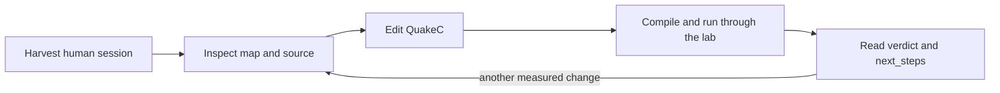

# Set up and use the lab

[Back to the README](../README.md#lab-workflow) |
[Full operator guide](../tools/argus_mcp/README.md)

The lab compiles QuakeC, installs the result, runs the real engine and reports
what happened. Playing the prebuilt mod does not require this setup.

## 1. Install the lab binary

You need Rust/Cargo (the repository pins its toolchain in
[`rust-toolchain.toml`](../rust-toolchain.toml)), Python 3, a modern fteqcc
and a dedicated-capable Quake engine with game data. Install `matplotlib`
into that Python for trajectory plots and navigation images (for example,
`python -m pip install matplotlib`); the Linux rig uses `python3-matplotlib`.
Engine/data/compiler installs remain machine-local.

From the repository root, run this **terminal command**:

```text
cargo install --locked --path tools/argus_mcp --root tools/argus_mcp/install
```

The binary is `tools/argus_mcp/install/bin/argus-mcp`, with `.exe` on Windows.
Use its full path or add its directory to your `PATH`. Do not point your MCP
client at `target/release`: `cargo clean` can remove that build directory.
The installation and update details are in the
[operator guide](../tools/argus_mcp/README.md).

## 2. Configure local paths

Copy [`tools/argus_mcp.toml.example`](../tools/argus_mcp.toml.example) to
`tools/argus_mcp.toml`, then replace its example paths with your real ones.
These keys may also be supplied as environment variables; environment wins.

| Key | Points to |
|---|---|
| `ARGUS_ROOT` | This repository |
| `ARGUS_FTEQCC` | Modern fteqcc executable |
| `ARGUS_ENGINE` | Dedicated-capable Quake executable |
| `ARGUS_BASEDIR` | Engine data directory containing `id1/` and the `argus/` mod |
| `ARGUS_PYTHON` | Python 3 executable |

`ARGUS_MAPS` optionally overrides the default `maps_local/`. The game data,
maps and player model are separate from the lab binary. Use the
[configuration reference](../tools/argus_mcp/README.md#config) for resolution
order, optional paths and defaults.

For an MCP client, adapt [`.mcp.json.example`](../.mcp.json.example): set its
stdio command to the installed binary and give it the same local paths.
Restart the client after changing its server command or updating the binary.
In the reconnected chat, call `see what=project` and require
`lab_identity.authoritative: true` with matching source fingerprints.

## 3. Choose an interface

| Interface | Start it | Use it for |
|---|---|---|
| Web wizard | Terminal: `argus-mcp gui` | Map ingest, compile/install, graph preview, backup and restore |
| MCP | Connect the client to the installed `argus-mcp` stdio server | Inspection, experiments and structured reports |
| CLI | Terminal: `argus-mcp client observe`, `argus-mcp corpus`, etc. | Direct observations, link probes and saved-run queries |

The wizard opens `127.0.0.1:7420`; `argus-mcp gui --no-open` keeps the browser
closed. It uses the same configuration as MCP. Tools such as `see`,
`experiment`, `tune` and `config_check` are **MCP calls**, not shell verbs.
Starting bare `argus-mcp` in a terminal starts the stdio server, not a REPL.

Make these **MCP calls** first:

```text
see what=project
config_check
see what=map name=dm4
```

Inspect-only tools need the repository path. Compile, navigation generation
and match tools require the full configuration and name any missing key.

## 4. Preserve human sessions before launching an engine

A new engine launch can truncate `qconsole.log`. After playing, quit the
engine and run this **terminal command from the repository root first**:

```text
python tools/harvest_session.py --tag my_session
```

The harvester moves the freshest root/`engine/` console log into `runs/` and
pairs recent demos from `engine/argus/` under `runs/demos/`. If you played
from another install, first preserve its log and demo and place copies in
those expected input locations. Check what will move with `--dry-run`.
See [recording and harvest](telemetry.md#record-and-harvest-a-human-session).

Do this before experiments, the GUI's engine actions or link probes. Keep
human tracks as review data; they do not belong in bot comparison bands.

## 5. Edit, test and read the report



Examples below are **MCP calls**:

| Task | Call |
|---|---|
| Inspect a route | `see what=path name=dm4:quad->lg` |
| Read a function and callers | `see what=fn name=Argus_HazardSteer` |
| After a QuakeC edit | `experiment map=dm4 duration_sec=30 skill=2` |
| Several maps, one compile | `matrix_experiment maps=["dm2","dm4"] duration_sec=30 skill=2` |
| Compare similar-length saved runs | `compare_runs log_a=baseline log_b=latest` |
| Change the live baseline | `tune command="skill 3"` |
| Read live status | `see what=status` |

Only one compiler may run at a time. Compilation backs up the previous
sources and binaries before installing. Keep the source/tree identity with
each control and candidate arm. A live console skill change applies on
respawn; changing a compiled constant requires a new build.

Read the returned `next_steps`, native brief and quality gates. Reuse the
status response's `next_line` as `since_line` on the next status call to read
only new output.

### What the result establishes

- `experiment` scales baseline counts to the short candidate duration.
  `compare_runs` is unscaled and needs comparable tape lengths.
- Different tick classes invalidate a comparison. The default lab launch
  requests the played rate; measure actual cadence rather than assuming it.
- One movement tape settles nothing. Use two maps or a suitable repeated
  control, and keep outliers and failed attempts.
- A short clean match is smoke evidence. It does not establish better win
  rate, balance or human readability. A selection event is not a pickup, and
  a shot event is not a hit.

For exact baselines, primary metrics and repeated-run statistics, use the
[measurement guide](../tools/argus_mcp/README.md#what-the-instrument-can-see-and-when-to-stop).

## Add or regenerate navigation

Use **MCP**, with a real local BSP path in place of the example:

```text
cartograph bsp=maps_local/mymap.bsp generate_nav=true
```

This generates QC, its JSON twin and a graph image. Registration is requested
by default, but a new map remains experimental until current reach and engine
mill evidence pass; over-budget graphs are refused. Inspect the returned
edict/playability verdict and follow its next steps.

Never hand-edit `src/argus_nav_<map>.qc`. Keep probe convictions and proven
links in their sidecars for the next generation. For **terminal** link checks:

```text
python tools/argus_reach.py mymap
argus-mcp probelinks mymap 30 0
```

Use bounded chunks and check generated jump families as described in the
[mill guide](../tools/argus_mcp/README.md#the-mill-probelinks-and-the-verdict-files).
After a navigation change, run the lab experiment/matrix loop.

## Update or restore the lab

- **Stale build:** rerun the install command and reconnect the MCP client.
  Check the original chat's running/checkout identities; a fresh verification
  session does not replace its existing connection. Require
  `lab_identity.authoritative: true` before quality verdicts.
- **Windows executable locked:** use the operator guide's
  [staged update procedure](../tools/argus_mcp/README.md#update-a-running-windows-server).
  The startup that swaps the file still runs the old image; reconnect again
  to load the new one.
- **Restore a build:** use the wizard's dated backups. Keep human session
  evidence separate from build restoration.

For deterministic route tests, counterbalanced A/B, tactical fixtures, task
cancellation and the full tool catalog, use the
[operator guide](../tools/argus_mcp/README.md). Unattended soak/cycle jobs are
explicit operator actions; they are not part of this quick-start loop.
