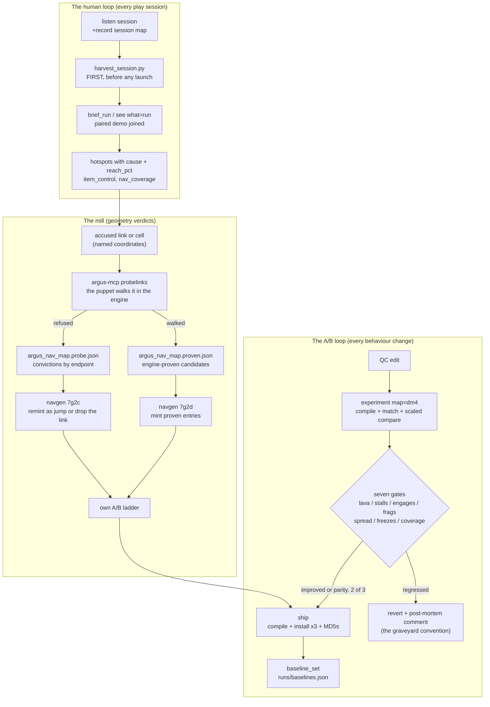

# Argus lab MCP server

Rust stdio MCP server for the Argus lab. It compiles QuakeC, ingests
maps, runs headless matches, and briefs the result the way this
project already judges A/B. Toolchain only: it does not change QuakeC
or the engine.

Current version: see `Cargo.toml`, the source of truth. Operator guide
(this file). Design history: `docs/specs/2026-08-17-argus-mcp-design.md`.
Captured external spec and triage: `docs/mcp_quake_dev_spec.md`.

```
cargo test --manifest-path tools/argus_mcp/Cargo.toml
cargo install --locked --path tools/argus_mcp --root tools/argus_mcp/install
```

Binary: `tools/argus_mcp/install/bin/argus-mcp` (`.exe` on Windows).
Point the client at this installed binary so startup is not a cargo build and
`cargo clean` cannot delete the configured server. Rerun the install command to
update it, then restart the client.

Every structured MCP response carries `lab_identity`: the running package version and a
build-time fingerprint of `Cargo.toml`, `Cargo.lock`, `build.rs`, and the Rust
source, beside the same identity recomputed from the checkout. Inspection stays
available when those identities differ, but the lab refuses quality-gate
verdicts from `compare_runs`, `suggest_next` compare mode, `experiment`,
`campaign_experiment`, and `matrix_experiment`. Repair an identity mismatch with
the install command above, then restart the MCP client. This checkout comparison
catches an old installed process even when no newer `target-stage` build exists;
the older `lab_stale` stage banner remains a separate early-warning mechanism.

For a config saved before the stable install was documented, run this after
the install:

```
python tools/migrate_mcp_config.py
```

The command checks the known Codex, Grok and project config paths. Pass one or
more TOML or JSON paths to check only those files. It changes only the `argus`
entry when its command exactly ends in the retired
`tools/argus_mcp/target/release/argus-mcp` path, refuses an absent installed
binary, reparses the saved file to verify every other setting, and tells you to
restart the client. Existing environment and timeout values stay unchanged.

### Update a running Windows server

The running process locks the exe on Windows. To build an update without
stopping the client, stage it instead:

```
cargo build --release --manifest-path tools/argus_mcp/Cargo.toml --target-dir tools/argus_mcp/target-stage
```

At startup, the installed binary uses `ARGUS_ROOT` to find a newer stage and
swaps it into place. The process performing that swap still runs its old
image and reports `lab_stale`; reconnect once more to load the replaced file.
Use the client's MCP restart/reconnect action to apply pending server settings.
Then call `see what=project` in the original chat and require
`lab_identity.authoritative: true`, with matching build/checkout fingerprints.
The package version alone cannot distinguish builds of the same version.
A fresh verification session checks the installed executable; existing chat
connections must be checked separately. Do not commit `target*/` or `install/`.

## Tactical fixture suites

Suite receipts use `legacy_source_md5` for their existing unprefixed QC/SRC
digest. It is distinct from Python's path-prefixed `source_sha256` identity.
Historical receipts keep their original field and bytes.

`argus-mcp tactic-suite <dm4|dm2> <new-run-name>` compiles and runs the full
15-trial developer suite in its own match. Add `--no-compile` to reuse the
same build, `--step 0.1` for the slow arm, `--deathmatch 4` for unlimited ammo,
or `--cases 0,0,0,10` for a bounded subset. Add `--record` to save a
protocol-15 demo from the fixture opponent eye (scratch4 517). The camera
and view entity are restored before the cleanup acknowledgement. Requested case/ID writes must be
acknowledged before the client impulse. Trials wait for matching begin/end
and restored-state acknowledgements, with a 15-second deadline. Case 9 also
checks refused overlap. Errors stop the owned engine and retain its tape.
Reports pin source, installed binary and nav hashes. Cadence is measured by
the fixture frame counts, not inferred from the step option. Run the
[acceptance checker](../../tools/check_tactic_fixture.py) on the tape;
acknowledgement success alone is not tactical acceptance. See the
[manoeuvre guide](../../docs/attack-cover-return.md#engine-acceptance).

## Rendered POV evidence

`argus-mcp record-pov <new-demo-stem> [roster-slot=1] [seconds=30]` joins
an existing lab match on localhost:26000. It records the original complete
server messages before decoding, including signon, through the stock camera
impulses. Each mode and target selection waits for a client-visible reply.
The recorder joins as `labcamera`, an instrument excluded from bot and human
statistics. It requires protocol 15 and reports an incompatible server protocol
as soon as it arrives. Set `sv_protocol 15` and `max_edicts 600` in the private
game's `autoexec.cfg` before starting the server. Missing signon packets retain
the eight-second timeout; failed signon does not publish a partial demo.
The slot is the roster slot 0..3, not a network entity number. The duration
is 2..185 seconds and the demo name must be new. The recording includes
camera setup before the requested observation period, with a 32 MiB cap.
Selection requires the actual protocol view entity to carry that bot skin; matching
positions alone would still render the bot model through the camera. Death can
make the stock spectator camera select a different living target.

`argus-mcp capture-demo <demo-stem> [start-sec=1] [frames=1] [interval-sec=0.2]`
replays that recorded POV in the configured rendering engine. The matching
MCP call is `bot_capture_pov_frame` with `demo`, `start_sec`, `frame_count`
and `interval_sec`. Without `demo`, it records the live `bot_client_id`
roster slot (default 1) for eight seconds first. Debug overlays and changing
the viewpoint of an existing demo are refused explicitly.

The renderer writes fresh 640x480 PNGs and a manifest under ignored
`backups/render_capture/`. It stages local `id1` PAKs and the configured game's
loose `maps`, `progs`, `sound` and `gfx` directories in a fresh game directory.
The game's PAKs retain their filenames and engine search precedence; configs
and logs outside those packs are excluded. Symlinked assets are refused.
User configs and session logs are untouched. Licensed assets stay local.
The child has a 45-second deadline and is killed and reaped on timeout.
There are at most 12 images, 0.1..5 seconds apart, starting 0.5..120 seconds
into a complete protocol-15 demo and ending before its final message.
The MCP result includes image blocks. A missing acknowledgement or incomplete
PNG fails the call instead of returning a substitute plot.

The isolated playback sets `con_notifytime -1` so even zero-age capture
acknowledgements stay out of the image. Every message remains in `qconsole.log`;
engine errors and missing acknowledgements still fail capture.

`argus-mcp capture-video <demo-stem> [start-sec=0.5] [duration-sec=3] [playback-rate=1]`
exports a silent lossless VP9 WebM from the same renderer. FFmpeg with
`libvpx-vp9` must be on PATH for this command; PNG capture has no encoder
dependency. `ffprobe` is not required. Before creating capture output or
starting the renderer, preflight records `ffmpeg -version` and encodes a built-in
16x16 PNG through stdin with the required VP9 settings. It uses the PNG decoder
and `image2pipe` demuxer, without requiring `lavfi` or the `color` filter. Each
preflight has a five-second deadline covering input, child exit and output
reads, with a 64 KiB output limit per stream. Failures close the pipes and allow
at most one second to kill and reap the owned child. Descendants and unrelated
processes are not killed. Missing codec support fails early with encoder
diagnostics; ordinary PNG capture does not run preflight.
Video samples at 10 source frames/sec, rounds
duration to the nearest 0.1 seconds and accepts 0.2..12 seconds at playback
rates 0.1..4. A rate of 0.5 plays at half speed and doubles clip duration.
Start and demo-end bounds match PNG capture; the video path permits at most
120 source frames without increasing the 12-image MCP limit.

The exporter checks decoded YUV frame hashes against every ordered source
frame, including the decoded frame count, timestamps and playback timebase.
It publishes `clip.webm` only after verification, with `video_manifest.json`
recording input identity, source times, output rate, duration and frame hashes.
PNG-to-YUV conversion precedes lossless encoding. Each encoder child has a
45-second deadline and is killed and reaped on timeout. Failures retain
`encoder.log` and intermediate evidence; existing outputs are never overwritten.

Manifest input digests identify the demo, rendering engine and staged assets.
The additive `assets` list is sorted by relative path under `id1/` and
`capture/`, with each file's byte length and MD5. `assets_md5` hashes the compact
JSON encoding of that ordered list. Assets are copied into independent files;
source and staged identities are checked before and after rendering. Changed
inputs fail capture. These checks detect changed bytes at the check points;
they do not monitor writes that restore the original bytes between checks.
The video manifest adds `encoder.executable_md5`, the full version/build
output in `encoder.version`, and selected codec, input-rate and frame-count
options grouped in `encoder.settings`. The resolved encoder path is pinned for
all steps and its bytes are checked between steps. Asset contents are not embedded;
preserve the local inputs alongside the manifests for reproduction.

Playback uses a fixed 0.05-second frame step and gamma 0.7. This does not
resimulate the match. Manifest times describe scheduled playback steps,
not exact event times. Use the source tape for actual physics cadence,
shots and damage. The recorder's PVS and field of view still limit what
can be seen. The fixture observer does not reproduce a human player's
input or hit feedback, and rendered evidence cannot establish enjoyment.

## Human deploy wizard

Same binary, not MCP. Design:
`docs/specs/2026-08-18-argus-lab-gui-design.md`.

```
argus-mcp gui
argus-mcp gui --port 7420 --no-open
```

Binds `127.0.0.1` only (never a public interface) and opens a
browser. One page:

- path strip (repo root, Quake basedir, game dir) for this process
- map list from `list_maps` (bsp / pak / nav / dispatcher flags)
- drop a `.bsp` into `maps_local/` (BSP29 check; simple names only)
- **Generate nav** (first registration waits for current reach and mill evidence)
- **Compile and install** (backup first, then `compile_qc`)
- **A/B quality gates** (evaluates candidate runs against baseline and renders visual gate cards)
- **Backup only** / **Restore**

After generate it shows the full edict-budget and playability verdicts,
`runs/nav_<map>.png`, and the 0.17 cartographer brief (islands, door
cuts, corridor misses, edicts). An over-budget run stops before
registration. A new map without current reach and engine evidence is
labelled `experimental`; generation still writes its QC and JSON so the
mill can inspect it. The PNG is optional: `preview_generated` reports whether
the current invocation produced it. A `nav-preview-v1` receipt at
`<out_png>.json` binds the QC, graph JSON and PNG hashes. Missing matplotlib
or a plot failure preserves valid graph outputs and withholds the image.
The wizard also refuses images with absent or mismatched receipts, including
older unreceipted previews. Existing PNG bytes can remain on disk.
Id maps stay on this machine; the wizard will not pack them.

Compile always writes `$ARGUS_ROOT/backups/<YYYYMMDD-HHMMSS>/`:
`lq1/progs.dat`, each install `progs.dat` (lab basedir, `game/argus`,
and the rerelease Saved Games copy if that folder exists),
`src/progs.src`, `src/argus_nav_dispatch.qc`, every
`src/argus_nav_*.qc`, plus `manifest.json`. Restore copies those
files back. `backups/` is gitignored.

Restore validates every destination before writing. Targets must remain under
the resolved repo root, basedir, or the user's
`Saved Games/Nightdive Studios/Quake` directory. Parent traversal and links
escaping those roots are refused. A write failure rolls back prior file bytes
and removes newly created files and directories; rollback errors are reported.

Agents keep using `see` / `experiment`. The GUI only buttons the
same functions.

## Developer CLI subcommands

The `argus-mcp` binary also acts as a unified CLI runner for the developer toolchain:

```
argus-mcp compile [--install] [--backup]
argus-mcp nav <map> [--register|--no-register]
argus-mcp analyze <log_path> [options]
argus-mcp harvest [--tag <name>]
argus-mcp reach [map]
argus-mcp measure [--write <path>]
```

- `compile`: Compiles QuakeC `progs.dat` via `fteqcc` with timestamp verification and optional backup creation and installation.
- `nav`: Runs `argus_navgen.py` to generate waypoint navigation graphs (`src/argus_nav_<map>.qc`) and minimap PNGs (`runs/nav_<map>.png`). First registration requires the current graph to pass reach and the mill.
- `analyze`: Runs `analyze_match.py` to parse telemetry logs into briefs, stats, and plots.
- `harvest`: Runs `harvest_session.py` to archive listen server logs and paired demos into `runs/`.
- `reach`: Runs `argus_reach.py` to audit directed item reachability for shipped navigation graphs.
- `measure`: The detection limit per map and metric over every committed same-build arm, and what four gates cost measured on the null corpus. Read-only. Writes `docs/specs/2026-09-16-lab-measurement-limits.md`.

## What it is for

An agent should not invent a shell pipeline of its own. This file is
the session protocol; a clone has no `AGENTS.md` or `CLAUDE.md`, both
are gitignored. The loop is:

1. `see what=project` (or open `argus://project`) for the tree, maps,
   and the next call.
2. `see what=map name=dm4` to ingest the BSP as a brief.
3. Look deeper without grepping: `see what=item name=dm4:quad`,
   `see what=path name=dm4:quad->lg`, `see what=search name=CONTENT_LAVA`,
   `see what=fn name=Argus_HazardSteer` (source plus calls and callers),
   `see what=plan name=latest` for GOAP plan events.
4. After a QC edit: `experiment map=dm4 duration_sec=30 skill=2`
   (compile + match + duration-scaled lite compare). Several maps:
   `matrix_experiment`.
5. `see what=last` for this process's last experiment. `tune
   command="skill 3"` then `see what=live` for a running child
   (Unix stdin; Windows console inject).

The long form (`compile_qc` → `match_run` → `compare_runs`) is still
there. Use it for a full-length, unscaled A/B (185 s vs the shipped
baseline). `experiment` is the one-call loop.

Read-only tools need only `ARGUS_ROOT`. Compile, navgen, and match
also need the compiler, engine, basedir, and Python.

## How the lab fits together

Four instruments feed one loop. The tape is the ruler, the demo is
the microscope, the puppet is the referee, and navgen is the pen
that writes what the referee decided back into the shipped graph.



The mill has killed every chronic stall cell it has been pointed at
(dm3 quad-court, dm2 grate room, dm3 RL islet). Its standing rule:
the engine testifies, navgen re-types, bots inherit - never knit or
delete blind.

## Config

No baked-in machine paths. Required for a full lab:

| Key | Meaning |
|-----|---------|
| `ARGUS_ROOT` | Repo root. Scripts live at `$ARGUS_ROOT/tools/`. |
| `ARGUS_FTEQCC` | Modern fteqcc executable. |
| `ARGUS_ENGINE` | Dedicated-capable Quake (QuakeSpasm in the lab). |
| `ARGUS_BASEDIR` | Engine `-basedir` (contains `id1/` and the game dir). |
| `ARGUS_PYTHON` | Python 3, used only for `argus_navgen.py` and `analyze_match.py`. |

Optional, with defaults under `ARGUS_ROOT`:

| Key | Default |
|-----|---------|
| `ARGUS_GAME` | `argus` |
| `ARGUS_SRC` | `$ARGUS_ROOT/src` |
| `ARGUS_RUNS` | `$ARGUS_ROOT/runs` |
| `ARGUS_PROGS` | `$ARGUS_ROOT/lq1/progs.dat` |
| `ARGUS_MAPS` | `$ARGUS_ROOT/maps_local` |

Load order: optional TOML, then env. Env wins. TOML path is
`$ARGUS_MCP_CONFIG`, else `$ARGUS_ROOT/tools/argus_mcp.toml`, else
`./tools/argus_mcp.toml`. If `ARGUS_ROOT` is still unset, the server
walks parents from the process cwd for `game/argus/autoexec.cfg` and
fills fteqcc / engine / basedir / python when those files exist in
the usual lab layout. Explicit env still wins.

Path settings are made absolute when loaded. Relative environment values and
`ARGUS_MCP_CONFIG` use the process cwd; relative TOML values use the TOML file's
directory. Dot components are normalised before discovery and child launches.
The config report shows these resolved paths, including paths not yet created.

`config_check` always returns the resolved table and never errors.
`ARGUS_GAME` keeps its game-name value; its existence check uses
`ARGUS_BASEDIR/ARGUS_GAME`. It is optional and does not affect `complete`,
which checks only required settings.
Other tools name the missing key and refuse.

Examples (fill real paths; do not commit secrets or this machine's
exe paths as if they were defaults): `tools/argus_mcp.toml.example`,
`.mcp.json.example`.

## Inspect (`see` and resources)

`MatchCtrl` stores a `u16` UDP port and exposes `port()`, defaulting to
`DEFAULT_PORT` (26000). Attached protocol clients use that controller's
port. The `probelinks`, `benchmark`, `within-ab`, `tactic-suite`,
`behaviour-suite`, `campaign` and `match` CLI commands accept `--port N`;
`record-pov` accepts it for the existing match it records. Values must be
1024 through 65535. Missing, duplicate and malformed values are refused
before compilation. Connected study APIs also offer `*_with_ctrl` entry
points; existing entry points retain their default controller.
The injected controller remains the caller's owner of the engine; callers
that cancel a helper future must stop that controller or drop it.

Engine startup checks whether the selected UDP port is already occupied
and refuses before creating a child. This is a launch-time check, not a
reservation against another process binding between the check and spawn.
Live MCP recording requires its owned match and reads that controller's
port. Campaign puppets keep the selected port and skip connection when
their launch has already failed.

The local GUI renders server fields as text. Dynamic map, backup and edge
controls bind event listeners without parsing their values as HTML or code.
`python tools/test_gui_rendering.py` checks hostile fields in an installed
Chromium browser using a temporary local page with stubbed API reads. It
does not start the lab, launch the engine or write through the API. Set
`ARGUS_GUI_BROWSER` to select a Chromium executable; the browser check skips
when none is installed.

`see` is the one inspect call. Pass `what` and, when needed, `name`.
Omit `what` (or pass `start` / `orient`) for `project`. Aliases:
`qc`/`func` → `fn`, `atlas` → `map`, `session` → `last`,
`bots` → `live`, `route` → `path`, `grep`/`find` → `search`,
`pickup` → `item`, `events` → `timeline`, `near`/`pos` → `around`,
`goap`/`goalplan` → `plan`, `dem`/`replay` → `demo`.
`see what=help` prints the vocabulary.

Tool errors are JSON `{error, hint}` with a next call. Configuration failures
also include `kind: unconfigured`. Prompts and resources carry the same fields
in JSON-RPC error data: configuration and internal failures use -32603, and
bad arguments use -32602. Missing resource targets use -32002 on older MCP
versions; the protocol library translates that to -32602 for 2026-07-28.
Unknown run or map arguments in prompts use -32602. Static help and knobs
remain readable without configuration.

Python helpers share an async process owner with null stdin, captured stdout
and stderr, and kill-on-drop cancellation. Deadlines are 180 seconds for nav
generation, 60 seconds for match plots and 30 seconds for registration's
playability check. Timeout kills and reaps the child. Nav and plot helpers
write into private temporary directories. Successful output is published only
if destinations still match their pre-run bytes; a publication error rolls
back earlier writes and reports any rollback failure. Registration edits are
published together after every playability check passes. Cancellation or a
failed helper leaves the requested outputs unchanged, apart from invalidating
the prior nav preview receipt before a new invocation.

| `what` | `name` | Returns |
|--------|--------|---------|
| `project` | | Tree: QC files, maps, live vs compile, next call |
| `help` | | This vocabulary plus resource URIs |
| `lab` | | Dashboard: config, maps (bsp/nav/dispatcher), recent runs, recommend |
| `map` | `dm4` | Cartographer brief. `detail=full` for every entity |
| `recipe` | `dm4` | Just the match / compare line |
| `node` | `dm4:56` | Waypoint, out/in links (including rocket/lift/swim), nearby control |
| `path` | `dm4:56-72` or `dm4:quad->lg` | BFS on the inspect graph (walk/drop/jump/tele/rocket/lift/swim) |
| `item` | `dm4:quad` | Control item plus snapped node |
| `fn` | `Argus_HazardSteer` | Source, `calls`, `called_by` |
| `file` | `argus.qc:120-180` | A source slice |
| `search` | `CONTENT_LAVA` | Grep Argus QC (including items/combat/weapons) |
| `const` | `AR_JUMPVEL` | Matching `AR_*` constants |
| `live` | | Last ARGLOG sample per bot (running or last match) |
| `bot` | `Reap` or `latest:Reap` | Deep tape: events, deaths, nearest node/item, mode share |
| `timeline` | `Reap` or `ab_dm4_parity:Omi` | ARGEVT stream |
| `plan` | `latest` or `ab_dm4_goap4` | GOAP `ARGEVT plan <class> via <class>` |
| `around` | `dm4:200,-900,24` | Nearest node and control at a point |
| `status` | | Dedicated child: running, pid, elapsed. `since_line` for an incremental tail |
| `run` | `latest` or `ab_dm4_parity` | Lite brief of a harvested log |
| `demo` | `shane_dm4_2026-08-27_v373` | Parse a `.dem` from `runs/demos` or the game dir: duration, named roster, full-rate tracks, projectiles, kill feed |
| `last` | | Session memory: last map, function, run, experiment |
| `knobs` | | Live cvars vs compile-time constants |

Clients that speak MCP resources can open the same data without a
tool call:

| URI | Same as |
|-----|---------|
| `argus://project` | `see what=project` |
| `argus://lab` | `see what=lab` |
| `argus://knobs` | `see what=knobs` |
| `argus://last` | `see what=last` |
| `argus://quality` | `quality_bars` |
| `argus://help` | `see what=help` |
| `argus://catalog/maps` | Exact map names accepted by direct tool arguments |
| `argus://catalog/runs` | Extensionless run names plus the `latest` alias |
| `argus://catalog/baselines` | Configured map-to-band relationships plus `baseline` / `shipped` aliases |
| `argus://map/{name}` | `see what=map name={name}` |
| `argus://fn/{name}` | `see what=fn name={name}` |
| `argus://run/{name}` | `see what=run name={name}` |
| `argus://const/{name}` | `see what=const name={name}` |
| `argus://path/{spec}` | `see what=path name={spec}` |
| `argus://search/{needle}` | `see what=search name={needle}` |
| `argus://graph-revisions/{map}` | Content-hash ids for current and committed nav JSON |
| `argus://graph/{map}/{hash}` | One exact `GraphRevision` with typed coordinate links |
| `argus://probe-verdicts/{map}/{hash}` | `ProbeVerdict` evidence beside that revision |

The three catalogs use the stable JSON envelope
`{kind, aliases, values}`. Map and run values are sorted by name; baseline
values preserve each configured map-to-band relationship. They are the
discovery path for direct tool arguments, which MCP completion does not cover.

`see what=last` persists to `runs/.lab_session.json`, so it survives a
restart (0.21).

Graph ids are `map@md5`. The hash names the JSON bytes, while `commit` and
`committed_at` retain Git provenance. `mill what=revisions map=dm4` lists
them; `mill what=diff revision_a=dm4@... revision_b=dm4@...` reports added,
removed and type-changed links. Link ids use endpoint coordinates so node
renumbering does not fabricate a change. Passing `link=` narrows the result
and fails if that id occurs in neither graph. The resources and tool wrap the
existing `.qc.json`, `.probe.json`, `.proven.json`, `.costs.json` and
`.mined.json` files plus their Git history; they write nothing.

## Deeper inspect

These stay on `see`. They do not add tools.

**Nav path.** `name` is `map:from-to` or `map:from->to`. Each end is a
node id or a control-item token. Link kinds the inspect BFS walks:
`walk`, `drop` (one-way), `jump`, `tele`, `rocket`, `lift`, `swim`.
Item tokens:

| Token | Classname |
|-------|-----------|
| `quad` | `item_artifact_super_damage` |
| `lg` / `lightning` | `weapon_lightning` |
| `rl` / `rocket` | `weapon_rocketlauncher` |
| `gl` / `grenade` | `weapon_grenadelauncher` |
| `ssg` | `weapon_supershotgun` |
| `sng` | `weapon_supernailgun` |
| `ng` | `weapon_nailgun` |
| `pent` | `item_artifact_invulnerability` |
| `ring` | `item_artifact_invisibility` |
| `mega` / `mh` | `item_health` with spawnflags 2 (id MegaHealth) |
| `ya` / `yellow` | `item_armor2` |
| `ra` / `red` | `item_armorInv` |

A classname substring also matches. Off-graph items (`reach` is
`off_graph` with no `nearest_node`) cannot be a path end.
`rocket_jump` items still resolve if they snapped to a pad node.

**QC.** `see what=fn` indexes `argus.qc`, `argus_nav.qc`,
`argus_nav_dispatch.qc`, and the masquerade-touched base files
(`defs.qc`, `items.qc`, `combat.qc`, `weapons.qc`, `world.qc`,
`client.qc`). Extra names kept: `weapon_touch`, `T_Damage`,
`W_FireLightning`, `W_Attack`, `PlayerDie`, `CheckPowerups`,
`WaterMove`, `PlayerPostThink`. `search` greps those files (needle
at least two characters, 24 hits). `file` is `name.qc` (first 80
lines) or `name.qc:120-180`.

**Tape.** `see what=bot name=Reap` uses the live or last match log.
`name=latest:Reap` or `name=ab_dm4_parity:Omi` reads a harvested
log. The deep bot view adds last events, deaths, nearest node/item,
height band, and mode share. `timeline` is the ARGEVT stream (40
events). `around` is `map:x,y,z` (commas or spaces).

## Map ingest (cartographer)

`cartograph` is the BSP ingest. Pass a path, a short name (`dm4`), or
`maps/dm4.bsp`.

Order, first hit wins:

1. The path as given, if that file exists.
2. `$ARGUS_ROOT/<path>`.
3. `$ARGUS_MAPS/<name>` or `$ARGUS_MAPS/<name>.bsp`.
4. Extract `maps/<name>.bsp` from `id1/pak0.pak` then `pak1.pak` under
   `ARGUS_BASEDIR` (also `engine/id1` and `$ARGUS_ROOT/id1`) and write
   it into `maps_local/`.

Default output is `detail=brief` (what an LLM should read). It is
not a raw entity dump:

- **control** items ranked (LG, RL, quad, pent, mega, red armour)
- each snapped to a nav node (nearest hull-1-clear eye line among
  the eight closest, else Euclidean): `reach` is `walk`, `jump`
  (normal 45u), `rocket_jump` (beyond a jump), `elevator` (near a
  plat pad), `blocked_by_door` (segment hits a door AABB), or
  `off_graph`; `island` is the weak-component id
- **graph_cuts**: weak/strong component counts, top islands with
  which control items sit on each
- **door_cuts**: walk/drop links that pierce a door AABB, plus the
  button and actuator that open it
- **corridor_misses**: 16u standable cells with no waypoint in 48u
  (the 32u sampler never sat there)
- **edict estimate**: waypoint count plus entity lump, against
  vanilla `max_edicts 600`; use the full budget verdict (live entities,
  world/client slots and runtime reserve) when deciding registration
- **height bands** from the waypoint graph (on dm4: walkway / mid /
  pit / deep)
- **recipe**: the next `experiment` / `match_run` line
- dispatcher coverage and implications

`reach=rocket_jump` means the nearest walk node sits too far below
the item for a normal jump. On dm4 the runtime pad is node 142 at
about `209 -183 -296` onto node 56 (the quad ledge). That is a
typed `Argus_NavLinkRocket`, not a parked idea. The inspect BFS
walks rocket, lift and swim edges as well as walk/drop/jump/tele,
so `see what=path name=dm4:quad->lg` can use the pad hop.

`detail=full` adds every entity, every teleporter, and button-door
causality (including one relay hop and `func_door_secret`). Atlases
and nav graphs cache until the BSP or nav JSON mtime changes.

`lab_status` lists maps with bsp / nav / dispatcher flags and a
recipe string. It does not ingest every BSP (that was 0.11). Use
`see what=map` or `cartograph` for a real brief. `cartograph_all`
still atlases every on-disk BSP.

`list_maps` lists `*.bsp` already in `ARGUS_MAPS` plus map names that
still live only inside the PAKs.

`generate_nav=true` on `cartograph` also runs `argus_navgen.py`
(`--no-dispatcher`, and `--register` by default so `progs.src` and
`argus_nav_dispatch.qc` are wired after the first-registration gate passes).
Pass `register=false` to generate an experimental graph before its reach and
mill passes.

Generated QC and its JSON sidecar must describe the same directed edges and
winning types. The ARGNAV banner counts emitted calls, including teleporters,
after all late passes and duplicate suppression. `python tools/argus_ci.py nav`
checks this agreement, node positions, runtime slot limits and live ordinary
walk hops for baked cover hints.

For an existing graph, the source generator's `--reconcile-artifacts` mode
derives sidecar families and the banner from QC without changing nodes, link
calls or slot order. It preserves independent lift, swim and other typed
families. If stale cover hints prevent publication, combine it with
`--reanalyze-tactics` to recompute hints using the BSP:

```text
python tools/argus_navgen.py maps_local/dm4.bsp dm4 src/argus_nav_dm4.qc unused.png --reconcile-artifacts --reanalyze-tactics
```

Inspect private copies first. This mode resamples no seats and promotes no
links. It validates both outputs before publication, refuses changed inputs
and rolls back a first write if the second fails. It does not install a program.

Plain jump profiles must resolve a launch strictly within 96 units of the
integer source seat emitted to QC, including vertical distance. Generation and
`--reprofile-jumps` refuse a violating profile before publishing either file.
The source generator's `--audit-jump-anchors` mode reports distances, input
hashes and violations without writing QC, JSON or images:

```text
python tools/argus_navgen.py maps_local/dm3.bsp dm3 src/argus_nav_dm3.qc unused.png --audit-jump-anchors
```

Exit 1 identifies modelled violations. Direct/fallback hops have no resolved
gap launch and are reported as unclassified, not certified by this test.
The 2026-11-02 audit of graph source `9c88ac1` found 93 profiled and 114
direct/fallback links across 13 maps. Four legacy profiles violate the bar:

| Map | Directed link | Launch distance |
|---|---|---|
| dm3 | 73 to 86 | 100.013 |
| e1m5 | 19 to 28 | 104.000 |
| e1m6 | 167 to 160 | 101.705 |
| lqdm2 | 159 to 162 | 96.000 |

These measurements describe the model, not proof of an inert engine hop.
The first three links have no alternate directed path, even with gated hops.
Current graph topology is retained pending engine-proven reseating; blindly
deleting these bridges would cut reach. lqdm2 has an alternate ungated path
through nodes 198 and 148. See #665 for the physical follow-up.

Registration flags on the atlas, GUI and lab require both the dispatcher
branch and the exact nav QC line in `progs.src`; commented entries do not count.
The first-registration reach gate includes ordinary jumps and door, teleporter,
lift, swim and train links. It excludes rocket-jump and sprint links because
a fresh spawn cannot assume the required equipment or skill. Python reach and
pointfile readers use the same family list, with gated routes available only
in their explicit gated view.

A match brief attaches `goal_reach`: each goaled classname gets the
cartographer's `reach`.

## Tape review and event counts

Python tape review, longitudinal scorecards and pointfile freeze overlays
use `tools/argus_tape.py`. Its samples, bot/human/instrument split and freeze
predicate match Rust, including legacy tracks and the busiest-level rule.
The rule has no vertical-distance or inter-sample-gap filter. Human and
instrument freezes remain outside bot totals. A shared fixture under
`tools/testdata/` verifies Rust and all three Python consumers.

`ARGEVT <name> tactic <phase-or-abort-reason>` retains the full phase/reason.
Full briefs expose `tactic_*` event counts, compact briefs expose `tactics`,
and Python review and scorecards report the same phase counts and abort
reasons. `returnshot` records a shot, never an inferred hit or completion.
Scorecard TSVs add six `tactic_*` phase columns and `tactic_abort_reasons`;
existing rows retain their values and receive blank cells for the new fields.

Event and death rows use complete sample/spawn identities before splitting
the verb, with the longest known name taking precedence. The raw closed-verb
regex is a fallback for legacy rows without identity context; those rows can
remain ambiguous when a name contains a verb. This changes no emitted format.

## Demo ingest

The 1 Hz ARGLOG tape is the ruler and the gates; a `.dem` is the
microscope. A listen session records one with the map-taking form of
`record` in the launch command (`+record session dm4` - the bare
`+record name` form before a map connects records nothing), then
`python tools/harvest_session.py --tag vNNN` stamps the tape and
demo into `runs/` under one paired stem, map sniffed from the last
confirmed SpawnServer.

`see what=demo name=<stem>` parses it: protocol-15 block stream,
fast-update deltas against baselines, obituary fragments coalesced
into whole lines. Identity is structural: a real client is entity
1..maxclients (scoreboard row = entity - 1); a bot's skin byte is
its roster slot + 1 and its scoreboard row counts down from the
top, so every player-model track comes back named. Body-queue
corpses are tagged `body`; missile/grenade tracks are tagged
`projectile` (note: entity SLOTS recycle, so a projectile track is
a slot history - split on time gaps for true per-rocket arcs).

Caveats: demos are PVS-culled to the recording client's view (an
out-of-sight bot drops to a trickle - the first walkway-corner
forensics found its freeze happened entirely off-camera), and the
engine truncates `qconsole.log` in its working directory on launch -
HARVEST BEFORE STARTING ANYTHING NEW.

`argus-mcp demo <stem>[:export]` is the CLI face of the same reader,
for sessions without an MCP client.

The brief carries analysis, not just inventory: per-player `aim`
statistics (mean and p95 angular rate, flick count - the recording
client measured from full-precision POV angles, bots from their
entity angles), and a `highlights` reel (first blood, multikills,
sprees, quad pickups and carrier deaths, environment deaths) each
with a timestamp to jump to under `playdemo`. `see what=demo
name=<stem>:export` also writes `<stem>.tracks.json` (full t / pos /
pitch / yaw vectors plus the POV series) for offline studies - the
sprint run-up forensics input format.

## The puppet client (netclient)

`netclient.rs` is a real NetQuake protocol-15 client in Rust: the
CCREQ/CCREP control handshake, a reliable channel with per-packet
acks, `clc_move` at 20 Hz, and the full signon dance. It connects
as **labprobe**, a name `Argus_CanSee` refuses on principle - the
puppet is an instrument, invisible to every bot, the same courtesy
as the spectator camera.

```
argus-mcp client observe [secs] [host] [port]   connect, spawn, report the
                                                live world (roster, my_pos,
                                                entity flow)
argus-mcp client walk <x> <y> <z> [secs]        walk toward a point, with
                                                auto-hop on stagnation
                                                (clears steps, lips, jumps)
argus-mcp client walkrel <dx> <dy> [secs]       relative walk from spawn
argus-mcp client impulse <n> [secs]             fire a player impulse from
                                                the puppet's seat - 101 adds
                                                a bot (the headless 4-player
                                                match), 216 is the dev
                                                teleport probelinks uses
```

Windows gotcha, hard-won: WinQuake binds UDP 26000 to the
hostname-resolved address, not loopback - the client mirrors the
engine's lookup and locks onto whatever address answers.
Engine-spawning tests share a lock; a stale engine on 26000 makes
every connect fail, so kill orphans first.

Developer logging alone does not arm client controls. Impulse 215 needs
server-console `scratch1 374` and reads the A/B slot mask from `scratch4`;
a successful snapshot consumes the key. Impulse 216 needs `scratch1 216`
and reads its destination from `scratch2`..`scratch4`. `probelinks` sets
that key with each destination. Set `scratch1 0` to disarm manual teleports.

Client keepalives (`svc_nop`, byte 1) preserve the rest of their message.
A malformed `svc_bad` byte stops parsing and disconnects the client; snapshots
include `protocol_error` when a protocol failure occurs.

## Tactical engine fixture

`developer 1` plus `scratch1 197` reserves impulse 217 for the
attack-cover-return fixture; otherwise navigation-task dispatch retains it.
It rewrites live state and freezes other bots for six seconds. Keep the
fixture disarmed on shared servers.
For a manual trial set `scratch3` to a distinct trial ID, then
set `scratch2` to the case number through `tune` and use
`argus-mcp client impulse 217 8`. Confirm the requested `TACFIX begin` and
matching `TACFIX done` after restoration through incremental status before
changing the case.
Time out missing acknowledgements; elapsed client time alone is insufficient.
An active fixture refuses another impulse with `TACFIX busy`.

The [manoeuvre guide](../../docs/attack-cover-return.md#engine-acceptance)
defines the full 15-case suite at played cadence and 10 Hz, rate controls
and the deliberate overlap check. Prefer the [suite driver](#tactical-fixture-suites).
Use `tools/check_tactic_fixture.py --review-suite` with the tape path and
`--hz 10` for the full slow arm. Native briefs report tactical phases; the
fixture checker establishes movement and damage acceptance. Its owned-rocket
observer supports ordinary and unlimited ammo without using phase events as
proof of hits.

## Water-route decision checks

`python tools/verify_water_route.py --output backups/<new-directory> --prefix <new_prefix>`
uses private sources/assets and `install=false`. It runs production routing
and physics after initial placement and task assignment. `BHVRPL` quarantines
the tape from ordinary gameplay bands. The parser requires continuous
movement, retained task ownership, full health or healing, measured cadence,
and physical completion; bank cases require dry ground. `--ticrate .1`
selects the measured 100 ms profile; `.0139` selects played cadence.

Cases 1 and 2 test original pool entries (case 1 also supports dm3).
Cases 3 through 6 inject candidate edges once at setup and are graph experiments,
including rejected alternatives. Cases 7 through 9 use the generated graph without
injected links: ramp, full rocket-launcher task, and moat-to-bank escape.
A failed full task remains a failed task even when its escape segment works.
`--control` requires the original eighteen-second zero-handoff failure;
it is intended for cases 1 and 2, not partial-route negatives.
Cases 10 through 12 inspect e1m1 movement. Case 11 is a positive ordinary ride.
Case 12 starts the observed slab raised, then leaves its normal call/crush
cycle to the engine. It requires a healthy horizontal exit in under six
seconds; `--control` requires the old delay of at least seven seconds.
Cold case 11 is not a valid pin negative. All injury remains a rejection.
Current sources also run 56 native decision controls, covering route
shortcuts, capability-aware actions, supported arrivals and bounded failed
action recognition. `tools/test_water_route.py` checks receipt rejection.

The optional `argus-proven-anchors-v1` navigation sidecar nominates at most
eight exact seats backed by hashed, continuous case-6 routes at both
cadences. The loader verifies map, geometry, direction and raw identities;
navgen checks player-hull clearance, nearby fine samples and the existing
waypoint budget. Witnessed jump actions survive coarse walk classification.
Legacy proven-pair arrays retain their existing meaning. See the
[e1m5 investigation](../../docs/e1m5-encounters.md).

## Continuing lift-route checks

```text
python tools/verify_mover_transfer.py --output backups/<new-directory> --prefix <new_prefix>
```

This private, no-install fixture places one bot at the e1m6 or dm3 boarding
point and assigns a task beyond the lift exit. Production routing and physics
own all movement afterwards. Success requires actual boarding, dry static-floor
landing near the exit, observed consumption of the exit into its planned forward
successor and uninterrupted task ownership. A rescue warp rejects the result.
A landing alone is insufficient.

`--ticrate .1` selects the measured 100 ms profile; `.0139` selects played
cadence. `--source <frozen-src>` uses a frozen source tree. `--control` records
the unchanged controller's outcome without requiring success. Use a fresh
output and prefix for every run; `--maps e1m6` limits the task set and `--port`
isolates an engine from other matches. Compilers must still run serially.

`MTRACE` samples are read-only observations of position, support, platform
phase and route ownership. `BHVRPL` quarantines the tape from ordinary gameplay
bands. The receipt parser rejects missing or inconsistent landing/handoff
proof, wrong maps and cadence. Layout `mover-transfer-v2` records generation-stamped
route expectations around the production arrival assignment, its consumed
successor, a world-floor landing and measured frame count. Read-only callbacks
are injected only into the private source. Setup controls install a different
node and an expected node without consumption; both must fail the handoff check.
The observer audit rejects actor mutations and steering after setup.

The archived `tools/fixtures/mover_transfer_v1.qc` and historical receipts retain
their weaker `node_difference` proof. The parser never upgrades those outcomes
to forward-consumption proof. See [#647](https://github.com/saworbit/argus/issues/647)
and the historical [e1m6 evidence](../../docs/e1m6-decisions.md). The
[v2 receipts](../../runs/mover-handoff-v2.results.json) retain four matching-program
witnesses and the real-engine node-difference mutation control with raw hashes.

## Camera chase controls

```text
python tools/verify_camera_chase.py --output backups/<new-directory> --prefix <new_prefix>
```

The private `camera` fixture surrounds a camera subject with real BSP brushes
and observes production `ArgusCam_SmartChase` after all eight flyby rays fail.
It checks the final vector basis and bounded position blend. `--ticrate .1`
selects a separate 100 ms arm. Use a fresh output and prefix; compilers remain
serial. Source, fixture, program and raw identities survive a failed check.
These `BHVRPL` tapes are component evidence outside ordinary gameplay bands.
Live impulse 210 can verify camera ownership through the puppet; it does not
replace a human visual judgement of a director cut.
The [camera receipts](../../runs/camera-chase-v1.results.json) retain both
cadences and the original basis and unbounded-blend failure controls.

## Mover forecast controls

```text
python tools/verify_mover_forecast.py --output backups/<new-directory> --prefix <new_prefix> --case 2
```

This private e1m6 component fixture measures one production
`Argus_MoverGapJumpOK` call at a seeded 140 u/s seat, followed by 1.5 seconds
of production `Argus_Physics` and real engine physics. It holds a task and
exit node without running AI reselection after setup. It does not claim a
completed route. The observer cannot move the actor. Use fresh outputs and
prefixes and run compilers serially. `--ticrate .1` selects the separate
100 ms arm; `--port` isolates the engine.

Cases are `1` feasible, `2` actual BSP brush obstruction, `3` mismatched exit
floor, `4` a physically ascending undocked platform and `5` real pool entry.
Invalid seeds require forecast refusal, survival and retained task and node
ownership. Each later mover launch must have a same-frame accepted production
forecast; a valid escape from another heading is not an invalid launch. Live
forecast decisions and totals are retained. The feasible seeded forecast must
pass, so always refusing fails.
Pair these component controls with the continuing lift-route fixture at both
cadences, including its played e1m6 production jump witness.

The shared arc predictor rejects lava and slime but permits water. Case 5
records real point contents, pool depth and observed body waterlevel. Water
entry is separate from a dry world-floor landing; it does not prove a dry
transfer or recommend changing the runtime liquid policy. `BHVRPL` excludes
all these tapes from ordinary gameplay bands. Source, program, fixture and raw
identities are retained even when a control fails. The compile gate includes
the `forecast` family and fast CI runs its receipt and observer tests.
The [forecast receipts](../../runs/mover-forecast-v1.results.json) retain ten
matching-program controls, two rejected real-engine mutations and a reference
to the positive transfers using the same production controller source.

## Fixed navigation benchmark

For passive `BHVDBG` snapshots and the isolated on/off observer fixture, see
[behaviour diagnostics](../../docs/behaviour-diagnostics.md).
`argus-mcp behaviour-suite --help` documents the acknowledged suite driver.
It reuses TACFIX in an owned disposable match and does not attach to human play.

The private ordinary-rocket verifier additionally emits `MFIX`, with
`BHVRPL begin` marking the entire run as a controlled fixture. This adds no
MCP argument, console switch or gameplay metric. Its gate/stock-fire harness
and two negative controls are described in the
[muzzle-clearance contract](../../docs/behaviour-diagnostics.md#ordinary-rocket-muzzle-clearance).
For no-install build/staging precautions and local test commands, use the
[focused-check runbook](../../docs/lab-workflow.md#focused-checks-without-deployment).

Shared plan-recognition fixtures use `python tools/verify_plan_progress.py
--output backups/plan-check-1`. They drive this native lab with private sources,
binary and assets; `PLANFIX` checks decisions and `PEFIX` checks actual escape
and alternative selection. They add no MCP tool or production console switch.
`--mode edges` selects short dm2/e1m2 controller checks for co-op retries,
longer detours and waypoint cycles; waypoint arrivals are injected inputs.
`--mode physical-edges` instead requires real motor movement and trigger
contact. Use `--physical-part coop` for the passing dm2 retry, or
`--physical-part normal` for the e1m2 detour (#593). It uses the
native co-op experiment for the former and native experiments for the latter.
The `half` and `deadline-control` parts retain the historical motor-override
diagnostic. They are excluded from the default gate; they do not represent
a supported speed setting or a uniformly slowed navigation model.
The `mover`, `mover-control` and `mover-release` parts select the shipped-speed
route with a slower real door, its deadline-disabled control and its
premature-door-release control. Run each separately with a fresh output directory
for a bounded 45-second experiment. See [the opening-door contract](../../docs/behaviour-diagnostics.md#opening-door-ownership-and-physical-deadline).
`python tools/verify_offset_entry.py --output backups/<new-directory>` isolates
the e1m2 entry with a seeded existing route and real movement/contact. Its
default matrix includes the fixed policy and an old-handoff counterfactual.
Current-case success and the declared old-handoff case 3 failure are enforced
automatically; invalid or unexpected control receipts fail. Neither
verifier changes the native MCP schema or shipped console controls.
See [the contract and limits](../../docs/behaviour-diagnostics.md#shared-failed-plan-recognition).

Repeat current-source muzzle or active health/inventory boundary checks with
`python tools/verify_private_fixtures.py muzzle --output backups/<new-directory> --prefix <new_prefix>`.
Replace `muzzle` with `health` for the active health/inventory boundary checks.
Select `combat` for the actual ordinary-combat trigger and its negative control,
including a separate measured embedded-muzzle contract. See the
[clearance limits](../../docs/behaviour-diagnostics.md#ordinary-rocket-muzzle-clearance).
Use `--help` before choosing a fixture. This maintained driver uses the matching
native lab with `install=false`, private source/assets/runs and serial engines.
It retains declared current/control outcomes and SHA256 receipts, checks
protected production inputs after success or failure, and never overwrites an
installed game binary. Old session drivers and evidence remain available.
The health boundary checks do not settle the outstanding dm4 gameplay warning.
Select `button` for real bot/player floor-button contact and a disabled-callback
control, or `door` for target-chain, activation and bounded opening-wait contracts.
See [the physical contract](../../docs/behaviour-diagnostics.md#solid-floor-buttons-and-relayed-doors).

The benchmark is the low-variance complement to free-running matches. It
places one real Argus bot at a declared nav coordinate, assigns a synthetic
goal, and observes completion through the NetQuake puppet. The other bots are
removed and the task bot ignores the observer, so combat and spawn luck cannot
change the route trial.

```
argus-mcp benchmark benchmarks/dm4_navigation.json [limit] [--no-compile]
```

Suites are JSON manifests containing a map, skill, start/goal coordinates,
budgets, and `train` or `heldout` labels. Each suite pins the MD5 of its nav
JSON: a regenerated graph invalidates the yardstick until its routes are
reviewed deliberately. Reports preserve individual results and summarize
completion rate plus median game time for all, train, and held-out tasks.
Completion requires finite engine game time within the task's `budget_sec`,
including the exact boundary. Late finishes keep their raw `game_sec` but
count as incomplete and do not enter successful-time medians. Wall-clock
grace only bounds the harness wait.
Compilation and installation happen by default; `--no-compile` deliberately
measures the currently installed build.

## Counterbalanced within-match A/B

For a QuakeC behaviour change that can be gated per bot, both arms can share
one world instead of paying the variance of two unrelated matches:

```
argus-mcp within-ab dm4 60 [--skill 2] [--run PREFIX] [--no-compile]
```

The runner adds a fourth bot, assigns two control and two candidate bodies,
then repeats the match with the assignment swapped across roster slots. That
counterbalance is mandatory because each slot has a different personality.
The report gives per-arm bot means, paired candidate-minus-control deltas, and
a two-arm Bradley-Terry log-strength estimate from cross-arm kills. An interval
covering zero is inconclusive, not parity.

Candidate code opts in by testing `self.ar_abarm`; absent such a gate both
arms are identical and the pair measures the instrument's null error. This is
not valid for nav graphs or any other world-level change shared by both arms.

## The mill (probelinks and the verdict files)

Empirical link verification - the killer app the netclient was
built for. Per walk link: spawn the lab engine at skill 0, connect
the puppet, dev-teleport it to the link's start (impulse 216 +
`scratch1 216` and coordinate scratch cvars, one semicolon-joined inject),
walk toward the far node, judge arrival.

```
argus-mcp probelinks <map> [limit] [skip] [--coop] [--jumps]
                                                cap 80 per run; chunk with
                                                skip. ~2600 links/hour, so a
                                                full-rotation sweep is an
                                                evening, not an overnight
```

The default pass covers ordinary walk and drop links. `--jumps` covers the
generated jump subset. A community BSP found only in `ARGUS_MAPS` is copied
into the game directory for the pass and removed when the engine stops.

Failures persist by ENDPOINT COORDINATES (indices shift per regen)
in `src/argus_nav_<map>.probe.json`, merged across sweeps. The
output also counts `teleport_failures` - on teleporter maps the
puppet can step into a live mouth mid-walk and read as a distant
failure; triage convictions against the `trigger_teleport` AABBs
before trusting them (a walk line through a mouth is invalid for
bots too - `teleport_touch` is class-blind - but it is a different
defect than a void).

Each pass also records the MD5 of the exact graph it walked. First
registration accepts only matching deathmatch evidence for ordinary links and,
when the graph has them, generated jumps. A refused jump is stored separately
from walk convictions, removed on the next regen, and drawn as a dark red
dashed line with an X at the far end in the debug PNG. Because that changes the
graph digest, run the short passes once more before registration.

Nav sidecar files, all consumed by `argus_navgen.py` on the next
regen of that map:

| File | Written by | Consumed by |
|---|---|---|
| `argus_nav_<map>.qc.json` | navgen | the whole lab (atlas, reach, probelinks) |
| `argus_nav_<map>.costs.json` | `learn_hotspots` | fine-edge cost inflation |
| `argus_nav_<map>.probe.json` | probelinks failures and graph-specific pass evidence | 7g2c verdict prune/remint plus first-registration gate |
| `argus_nav_<map>.proven.json` | candidate probe runs | 7g2d engine-proven entry mint |
| `argus_nav_<map>.candidates.json` / `.splice.json` | entry-candidate sessions | paper trail of how proven.json was derived |

Sweeping the whole rotation is a chunk loop: a detached driver
calling `probelinks` with advancing `skip`, honouring
`runs/soak.stop`, writing its position to
`runs/probe_soak_state.json`. Monitor the STATE FILE with one-shot
reads - never `tail -f` a log a PowerShell writer appends to
(MSYS tail blocks the appends silently, and killing the monitor
orphans the tail; this manufactured the "orphan handle" mystery
of 2026-08-28).

## Idle hands (soak and cycle)

Two CLI modes for the unattended lab. Neither is scheduled by
anything; they exist for the night the operator feels like it.

`argus-mcp soak` loops matches and gates every tape against the
shipped baseline, writing `runs/soak_<stamp>.md` as it goes. Hard
caps, not suggestions: `--hours` (default 4, max 12), `--matches`
(default 60), `--max-mb` bytes written (default 200; a real night of
tapes is under 10 MB), and a stop file - create `runs/soak.stop` and
the loop ends after the current match. `--learn` folds hotspots into
`costs.json` at the end (write-only; nothing regens automatically).

`argus-mcp cycle <map>` closes the offline learning loop ONCE, with
a guard: learn hotspots -> regen the nav (reach gate printed) ->
compile and install the candidate -> 185 s probe -> judge. An
improved verdict keeps the learned costs and graph in src/ (record
the new install MD5 in the handoff); anything else restores nav,
costs and every installed progs.dat byte for byte from the snapshot
(never by recompiling - fteqcc is not byte-stable). Its first dm4
trial self-rejected on the lava gate, exactly as the 2026-08-20
forensics predicted.

## The decision tape (ARGDBG)

### The edict dump

`tune command="edicts"` makes the server print every edict with all
its non-default fields, ours included: `ar_node`, `ar_goal`,
`ar_mode`, `ar_door`, `ar_liftwait`, `ar_failstreak`. That is the
state a forensics session used to add a dprint and recompile to read.
`edict <n>` prints one, `edictcount` just the totals. All three only
print, so they are as safe to inject as `status`.

`tools/argus_edicts.py` reads the result back: edict pressure against
the 600 ceiling, per-bot state ordered for "why is this stuck",
`--field` to compare one value across bots, `--dump N` when a log
holds several, and `--make-cfg SECS --repeat N` to arm dumps for
`+exec` when there is no injection channel. A stochastic freeze will
not sit still for one dump.

Caveat: the dump is lossy under load. A 236 edict dump lost four
`EDICT` headers to the console. Field values survive; counts do not,
and the reader says so.

Console `scratch1 1` (live via `tune command="scratch1 1"`; the
scratch cvars are vanilla's QC float pipe) makes every goal pick
print `ARGDBG <name> pick <class> u <utility> | w <> a <> h <> r <>
p <> o <> ws <atoms> streak <n>` - the full per-class utility board
behind the choice. `scratch1 0` silences it. Plain ARGDBG lines,
outside the closed ARGEVT vocabulary; grep them, they never touch
briefs or gates.

## Lite vs full

Default returns from `experiment`, `compare_runs`, `brief_run`,
`see what=run`, and `probe` are **lite**: headline, totals, flags,
gates (when comparing), hotspots (first five), bot frag lines, and
`next_steps`. That is what you act on.

Pass `detail=full` for the whole `MatchBrief` pair (events, weapons,
every hotspot). Review prompts (`orient`, `review_run`, `review_ab`,
`review_map`) also embed the lite JSON. Two text-only procedure prompts expose
the lab's safety rules without reading config or changing state:
`harvest_before_play tag=vNNN` returns the exact harvester-first sequence, and
`validate_change` accepts a change description plus optional `maps` and
`primary` context for a controlled multi-map A/B. The latter requires at least
two maps, at least three tapes per arm on dm2, trusted `next_steps`, and valid
metric boundaries.

The server also advertises MCP completions for supported prompt arguments and
resource-template variables. Review prompts complete map, extensionless run
and baseline names; `validate_change` completes maps and primary metrics;
typed map/run/graph resources complete their names, with graph hashes derived
from the selected map in completion context. Function and constant resource
variables complete from the same QC index their readers use; free-form path
and search variables deliberately do not. The protocol does not define
completion for arbitrary tool arguments, so the tools retain their existing
validation rather than claiming autocomplete they cannot serve.

`brief_run` and `compare_runs` advertise a stable MCP `outputSchema` and
return the same information in `structuredContent` as
`{format, detail, data}`. JSON uses detail `brief` or `full` and carries
the exact value rendered by the existing text block; CSV uses detail `table`
and carries the exact CSV text. The text channel is unchanged for clients that
do not consume structured output, and tool-level failures are not wrapped as
successful data.

Long-running `match_run`, `experiment`, `campaign_experiment`, and
`matrix_experiment` calls honor the MCP request progress token when a client
supplies one. Notifications name the compile, match, and analysis stage;
active matches advance by elapsed seconds against the requested duration.
Progress delivery is best-effort and never changes the synchronous result.
Repeated or backward progress values are skipped, including duplicate stage
boundaries, so every delivered value strictly increases for its request token.
Clients without progress support keep the existing call and polling behavior.

The server also implements the SEP-2663 Tasks extension for `match_run`.
Clients that declare Task support receive a `CreateTaskResult`, poll the handle
with `tasks/get`, and may request cooperative cancellation with `tasks/cancel`.
The status message identifies whether the run is waiting for the serialized
match slot, starting, playing, or finalizing. Cancellation does not report a
terminal state until the owned engine child has stopped and its tape cleanup
has finished. A client that does not declare Task support receives the same
synchronous `match_run` result and progress notifications as before. Other
tools remain synchronous. Match Tasks advertise a 30 minute observation TTL,
but that deadline never aborts active work: an engine-owning future remains
cooperatively cancellable until cleanup completes. Terminal payloads remain
available until the advertised TTL and for at least a further 10 minute grace
after completion, then are evicted. `match_status` and the owner-independent
`match_stop` remain available to every client as the operational fallback.

`argus://last` and `argus://lab` are live subscription resources. The server
accepts both current `subscriptions/listen` filters and legacy
`resources/subscribe` calls, then emits `notifications/resources/updated`
only when match identity, running state, exit status, or session memory changes.
Re-read `argus://lab` after navigation, registration, configuration or external
run changes. These do not independently emit subscription notifications.
Subscription ticks do not read or analyse the live tape. `argus://lab` reads
include the full current match status. Explicit resource reads, `match_status`, and
`since_line` polling remain supported fallbacks.

`compare_runs` uses form elicitation for one genuinely ambiguous case: the
caller omits both `log_a` and `map`, and the candidate tape contains no map.
The offered values are restricted to configured baseline bands with tapes on
disk. Explicit arguments and ordinary candidate-map inference never prompt.
Clients without form elicitation, plus decline, cancel, malformed response,
or timeout paths, receive the same error as before; the server never guesses.

`compare_runs` is unscaled: it expects two tapes of similar length.
`experiment` duration-scales the baseline counts to the candidate
duration so a 30 s probe is not judged as an engagement collapse
against the 185 s shipped tape (`ab_dm4_water`, falling back to
`ab_dm4_parity`). Scaling preserves each tape's observed duration, so
coverage stays ungated if any source tape was shorter than 120 seconds.
Invalid durations return a Mixed verdict instead of normalizing malformed
counts. The lite compare carries `scaled` and `scale_note` when scaling happens.

A registered primary decides the statistical count gates. Severe freezes
remain release vetoes: every candidate tape is checked for damage while
stationary, a new 10-second statue, or a large increase in total frozen time.
Long-window and total-time limits use the control band's maximum observed
severity; a freeze under fire always rejects, including on unchanged code.
The diagnostic identifies the offending candidate tape even when the displayed
median-stall representative is clean. Statistical null-pair calibration is
separate from this release-readiness check.

The [frozen-source study drivers](../../docs/lab-workflow.md#cross-map-routing-evaluation)
use private game assets and never install over the playable mod. Their final
report forwards the registered primary through native CLI band comparisons.
The MCP `compare_runs` interface currently has no primary argument, so the
runner's per-tape comparison files retain the MCP defaults.

Project inventory labels navigation as on disk and reports QC/JSON presence,
the compilation-list entry and dispatcher entry separately. `installed_navigation`
is null when the installed program has no matching compile receipt.
e1m3/e1m4 remain unregistered experimental maps.

A successful native compile freezes its navigation inputs in
`backups/navigation_builds/<program-md5>.json`. Receipts are immutable by
program hash. A source change during compilation withholds this proof and
reports the reason in the compile tail. Compilation itself can still succeed.
At launch the lab selects the receipt by the actual game program's bytes,
then harvest writes `<run>.nav.json` beside the tape with its log hash and
frozen graph. Keep that sidecar when retaining a tape. Recorded ladder and
human receipts share their tapes' append-once check.

`nav_coverage.pct` is spatial proximity, not a route-consumption counter.
Its `provenance` states whether the graph is a build snapshot or a current-tree
diagnostic, whether the recorded build registered navigation, and whether
navigation claims are eligible. `loaded_in_tape` records the matching ARGNAV
initialization; registration alone cannot establish a runtime claim.
Historical tapes without proof remain unknown;
today's registration never establishes what an older program contained.
Dormant-link and directed-sink claims require build attribution. Atlas claims
also require the current atlas graph to match that frozen graph.
The existing comparison coverage gate counts spatial 64-unit cells independently
of navigation nodes; its duration rules are unchanged.

The frozen-source study report verifies the protocol's source-file hashes and
both registration entries. Unknown or uncompiled navigation and unfrozen graph
coverage are unavailable as runtime scores. Spatial diagnostics remain inspectable.

## Tools

### Maps

Map names are trimmed, lowercased and checked as `[a-z0-9_]{1,32}` across the
engine, graph revisions, GUI import and generator. `dispatch` is reserved.
Hyphens are refused because the same name forms a QuakeC function suffix.
GUI uploads may include a `.bsp` extension. Invalid or noncanonical generated
QC filenames stop dispatcher sync with the filename in the error.

Graph parsing and cached loading live in `nav_graph`; map-enriched views live
in `nav_view`. Numeric node routes need only the graph. Node and area views
report `atlas: "unavailable: <reason>"` when map items cannot be read, and
item routes return that error rather than claiming no item exists.

| Tool | Needs | Does |
|------|-------|------|
| `lab_status` | `ARGUS_ROOT` | Dashboard: config, map flags, recent runs, recommend. No per-map ingest. |
| `cartograph` | `ARGUS_ROOT` | Ingest a BSP. Default **brief**. `detail=full` for every entity. `generate_nav=true` also compiles nav and registers it. |
| `cartograph_all` | `ARGUS_ROOT` | Atlas every on-disk BSP in `ARGUS_MAPS` |
| `list_maps` | `ARGUS_ROOT` | Maps on disk and in id1 PAKs |
| `nav_generate` | full lab | Generate per-map waypoint QC/JSON and an optional PNG. Return `preview_generated`, edict and playability verdicts; attach an image only with a matching freshness receipt. Over-budget graphs and first-time maps without current reach and mill evidence are not registered. |
| `nav_sync_dispatch` | `ARGUS_ROOT` | Register new `argus_nav_<map>.qc` in the dispatcher and `progs.src` |

Generation counts unique destinations across every typed family against the
runtime's eight slots. Walk pruning preserves typed connectivity. More than
eight typed destinations refuses generation before output, rather than
choosing a lift, train or other typed route to discard. Late stitches and
engine-proven additions use the same admission count, with a final overflow
check before emission. Existing graphs still need their normal engine gates
when regenerated.

`nav_generate` uses the shared map-name rule. Its QC output must be under `ARGUS_SRC`; PNG outputs from it and
`analyze_match` must be under `ARGUS_RUNS`. Paths are relative to `ARGUS_ROOT`
unless absolute. Parent traversal, output symlinks and tracked outputs are
refused, including JSON sidecars. The map's own default QC and graph may be
replaced; other existing source is protected. Registration requires that
default QC path. Preview status uses a fresh receipt, independent of stdout.

### Lab loop

| Tool | Needs | Does |
|------|-------|------|
| `config_check` | nothing | Resolved paths, exists or not |
| `compile_qc` | full lab | fteqcc from `src/`. Success is the `Compile finished` / `id format` line, not the exit code. Copies `progs.dat` to every install path: `game/argus`, the basedir game dir, and the rerelease Saved Games copy when it exists. Splits known LibreQuake warning noise from new errors. |
| `match_run` | full lab | Timed dedicated match, harvest `runs/<name>.log`, return a full brief. A `run_name` whose tape is already committed to git is REFUSED before the engine starts (#328), because that file is evidence and this path used to replace it silently. Pick a free name, or delete the committed tape first. `matrix_experiment` is exempt: its `mx_<map>` probes are meant to be refreshed. |
| `match_start` / `match_command` / `match_status` / `match_stop` | full lab | Same single child, interactive. Status includes a live headline once ARGLOG appears. `match_status since_line=N` returns only new lines plus `next_line`. |
| `analyze_match` | full lab | Existing plotter plus brief and, if two logs, a compare |
| `list_runs` | `ARGUS_ROOT` | Top-level `runs/*.log`, newest first, known baselines annotated |

### Intelligence

| Tool | Needs | Does |
|------|-------|------|
| `see` | `ARGUS_ROOT` | One inspect. See the table above. |
| `experiment` | full lab | Compile + short match + **duration-scaled lite** A/B. `detail=full` dumps both tapes. Duration 10-185 s, default 30. `primary=<metric>` pre-registers the gate this change was predicted to move; only it convicts. |
| `matrix_experiment` | full lab | One compile, then a short probe on each of dm2/dm3/dm4/dm6/lqdm2 (default 20 s). |
| `brief_run` | `ARGUS_ROOT` | Lite brief of one log. `detail=full` for the whole tape. |
| `compare_runs` | `ARGUS_ROOT` | Unscaled lite A/B. `detail=full` for both briefs. Default `log_a` is `baseline`. |
| `suggest_next` | `ARGUS_ROOT` | Just the QC places to open |
| `qc_find` | `ARGUS_ROOT` | Argus functions by name, role (`hazard`, `combat`, `nav`), or comment |
| `qc_index` | `ARGUS_ROOT` | Full function + `AR_*` constant index |
| `qc_read` | `ARGUS_ROOT` | Full source of one Argus function, with line numbers |
| `learn_hotspots` | `ARGUS_ROOT` | Fold stall/lava/hazard cells across logs. Writes `src/argus_nav_<map>.costs.json` for the next navgen; does not write QC. |
| `knobs` | nothing | Live cvars vs compile-time constants |
| `tune` | live match | Whitelisted console: skill, fraglimit, map, scratch1-4, and the read-only `edicts` / `edict <n>` / `edictcount` dumps. Unix stdin; Windows AttachConsole inject. |
| `live_snapshot` | live or last match | Last ARGLOG row per bot. `since_line` for incremental. |
| `match_status` | live match | Running, pid, elapsed, log lines. `since_line` returns only new lines plus `next_line`. |
| `probe` | full lab | Prefer `experiment`. Compile + short match + lite brief, no A/B. Duration 10-120 s. |
| `quality_bars` | nothing | The bars used by compare |

Log arguments accept a path, a run name (`ab_dm4_parity`), `baseline`
/ `shipped` (dm4 → `ab_dm4_water`), or `latest` (newest
`runs/*.log`).

## Extra spec tools (do not replace the native set)

`docs/mcp_quake_dev_spec.md` asked for five more tools. They sit
**beside** `compile_qc`, `cartograph`, `match_run`, `tune`, and
`analyze_match`. Native tools keep their jobs. Descriptions start
with "Prefer …" so a client ranks the native call first.

| Extra tool | Extra job | Prefer instead |
|------------|-----------|----------------|
| `quake_compile_qc` | Compile an optional `source_directory`. Installs only if that dir is `ARGUS_SRC`. Records requested `-O*` and still emits id-format. | `compile_qc` |
| `bsp_inspect_entities` | Raw lump-0 dump + causality, `filter_classname`. | `see what=map` / `cartograph` |
| `bot_simulate_match` | Batch report: kills, deaths, pickups, nav_errors. Default 300 s. `time_dilation` recorded, not applied. | `experiment` |
| `rcon_exec` | Whitelisted stdin line plus the following log tail. | `tune` |
| `bot_capture_pov_frame` | Real engine PNGs from a recorded POV or a live bot recorder. | `analyze_match` for telemetry plots |

## Can an LLM see into Quake and change things live?

Yes, with a hard line.

**Live (no recompile):**

At match startup, an explicitly requested `skill` is set before the map loads,
so the first roster spawns at that difficulty. An omitted value inherits the
configuration. Older lab launches placed the skill command after the map and
could record the default initial roster under a different requested label.
Retain those tapes, and inspect their `ARGUS difficulty` rows before treating
them as fixed-skill evidence. Startup ordering does not change the live
console behaviour described below.

- `tune` / `see what=knobs`: `skill 0-3` (takes effect at the **next
  bot respawn**, `Argus_SetSkill`), `fraglimit`, `timelimit`,
  `map <name>`, `developer`, `status`. Unix writes the child stdin.
  Windows injects via a short-lived helper using `AttachConsole` + `WriteConsoleInputW`.
- `live_snapshot` / `see what=live`: last ARGLOG sample per bot from
  the running child (or the last harvested match).
- `see what=bot name=Reap`: deep tape (events, deaths, nearest
  node/item). `name=latest:Reap` reads a harvested log.
- `match_command` is the deliberate raw engine console escape hatch for
  trusted fixtures, including `exec`, `quit` and semicolon-separated engine
  commands. It rejects empty input and newlines. It does not apply the
  `tune` whitelist, which limits ordinary live adjustments.

New run names are 1 through 80 ASCII letters, digits, dots, underscores or
hyphens. They cannot start or end with a dot or contain repeated dots.
This refuses `.` and `..`, hidden names and Windows trailing-dot aliases
before a run directory or engine child is created. Historical tapes remain
readable by path.

Vanilla NetQuake has no QuakeWorld RCON. There is no VM memory
inspector. The engine stays a harness.

**Windows dedicated spawn:** QuakeSpasm `Host_Error`s if stdin is a
pipe (`GetNumberOfConsoleInputEvents`). 0.12 still inherited the MCP
stdio pipe under `CREATE_NEW_CONSOLE`, so matches could die at
"Server spawned." 0.13 uses `CreateProcess` with
`bInheritHandles=FALSE`, a new hidden console, and no
`STARTF_USESTDHANDLES`. Harvest is still `-condebug` `qconsole.log`.
`tune` / `match_command` use a hidden helper process with a five-second
deadline, null stdin and captured output. Only that process calls
`AttachConsole` + `WriteConsoleInputW`; the lab keeps its console and
standard handles. The private entry point checks the source fingerprint,
PID and single-line command before attaching. It runs without starting an
async runtime. Timeout or cancellation kills the helper. If inject fails,
pass `skill` on `experiment` /
`match_start`. `match_stop` sends `quit` the same way, then kills.
Engine children are bound to an explicit process handle and terminated
on drop, and on Ctrl+C in `soak` and `cycle`, which install a handler. The stdio server does not, so a hard kill relies on the Windows job object instead.

A match that produces no `ARGLOG` / `ARGEVT` is an error with a
diagnosis and log tail, not `ok: true` on a spawn-crash log. Harvest
safeguards preserve any existing valid `ARGLOG` tape if a subsequent
match aborts or crashes without writing a tape. The runner fails fast
if the child dies before the first tape line. `start` reaps a dead child
so a zombie slot does not block the next run, and match timers verify
match identity (`run_name` / `pid`) before stopping to avoid killing
newer matches. `compile_qc` unlinks old `progs.dat`, bounds `fteqcc`
execution to a 90s timeout with process tree termination, and verifies
the compilation timestamp before allowing file installation. `experiment`
stops a leftover live match first.

**Not live (edit QC, then test):**

- `AR_JUMPVEL`, `AR_AIMRATE`, personality offsets, hazard math, nav.
  Vanilla QuakeC cannot load files, so those only change when
  `progs.dat` is rebuilt.
- Workflow: `see what=search name=AR_AIMRATE` or
  `see what=fn name=Argus_SetSkill` → edit →
  `experiment map=dm4 duration_sec=30 skill=2`.

## The tick rate, and why a verdict can be void

Every lab match runs `+sys_ticrate 0.0139`, which is about 70 frames a
second. It is not a preference. `sys_ticrate` gates Quake's dedicated
main loop, the engine default of 0.05 runs a dedicated server at about
19 Hz, and every session a human plays is a listen server at about
71 Hz. Nearly a factor of four sits on every per-frame constant in bot
physics and on the aim spring's integrator, so a tape recorded at the
old default and a played session were never the same game.

Every brief now says which game it recorded. `totals.tick_gap_mean` is
the mean gap between one bot's telemetry rows, which pins the frame
period because `Argus_Telemetry` fires on the first frame after
`time + 0.5`; `totals.tick_class` names the regime:

| class | rate | what it is |
|---|---|---|
| `listen` | about 71 Hz | what Shane plays, and what the lab runs now |
| `dedicated_fast` | about 19 Hz | the lab before 2026-09-15, 1 ms Windows timer |
| `dedicated_slow` | about 14 to 15 Hz | the same lab on a coarse-timer day |

Of the 635 readable tapes in `runs/`, 438 are fast, 124 slow and 73
listen. **Compare refuses to judge across two classes**: the verdict
is forced to Mixed, a finding names the cause and the gate card
carries a `Server tick rate ... VOID` row. Any comparison against a
baseline recorded before this change reads VOID until that map is
re-baselined, which is correct.

`ARGUS_TICRATE` overrides the default for one job only: running the
same progs at both rates to measure what the rate itself does.

## Bands, not one tape against one tape

The verdict rule that shipped sixty builds read a coin flip as a
release. Run over the sixteen pairs of byte-identical builds in
`runs/`, it returned nine "improved", five "regressed", two "mixed"
and **zero parity**. `compare_band` returns parity on thirteen of the
sixteen, with one "improved" (`ab_dm2_apexgate1` vs `2`, stalls 97 to
17) and two "regressed" still getting through. It is an instrument
with known residual error, not an oracle.

The band is fitted to those pairs. One tape a side, on identical code,
this lab produces:

| metric | null ratio range | judge on one pair? |
|---|---|---|
| stalls | 0.18x to 11.0x | no |
| engages | 0.45 to 2.82 | no |
| world deaths | 0 to 4x | no |
| freezes | 0 to 3 | no |
| coverage | 0.70 to 1.19 | yes |
| goal pickups | 0.82 to 1.27 | yes |

Coverage and goal pickups are the only two metrics here with enough
signal to read a change off a single pair. Remember that before
quoting a stall count at anyone.

The rule: regressed if the candidate median leaves the band on any
hard gate; improved only if it beats the whole band on one gate and is
no worse than the control median on every gate; parity otherwise. The
band narrows as the square root of the tape count, so `experiment`
runs three candidate matches by default (`repeats`, 1 to 5) and judges
them against the map's whole baseline band. `runs/baselines.json`
accepts a list of run names as well as a single one.

**At one tape a side an improvement cannot be expressed**, only a
regression or parity: the stall band's floor is zero there. The
finding says so and names the cure. Every "improved on all seven
gates" recorded before this rests on an instrument that could not have
said anything else.

## What a response costs

Format is a token cost, and every large part of these answers is a
table. A table as JSON repeats every field name on every row; CSV
names them once.

```
brief_run     log=latest format=csv
compare_runs  log_b=latest format=csv
corpus        what=tapes map=dm2          # always CSV
```

Measured on `ab_dm4_deadlink1`: a brief is **1765 bytes as CSV**
against **3464 as compact JSON**, and more again against the pretty
JSON the server actually sends. About half, which is the phrase the
test asserts against rather than a slogan. JSON stays the default:
an agent that wants to index into one field should not have to
parse a table.

**The live tail paginates on size.** `since_line` is still the
cursor, but the cut is a 6 KB budget with a 120 line ceiling rather
than a flat eighty lines. Record count is the wrong unit when
records vary, and telemetry lines vary by five times: `ARGEVT Reap
jump` is sixteen characters and an ARGLOG sample is over a hundred,
so the old cut returned anywhere between 1.5 and 8 KB and a busy
match returned the most. It always returns at least one line, because
a budget that can return nothing is a poll loop that never advances.

**The tool surface has a price on it.** Every exposed tool is paid
for on every request through its schema, called or not. Measured
2026-09-20: **40 tools, 19,707 bytes, about 4,930 tokens per
request**, and the suite holds a bound just above that so adding a
tool is a decision rather than a drift.

That measurement refused the last part of the issue. Retiring the
three then-parked extras (`bot_simulate_match` 619 bytes,
`bot_capture_pov_frame` 334, `rcon_exec` 253) saves 1,206 bytes, six
per cent, and breaks the table in `docs/mcp_quake_dev_spec.md` that
records them as shipped. Meanwhile 581 of those bytes were sitting in
the schema of `corpus`, which was the single most expensive tool in
the server, written one version earlier to save tokens, and which
explained each of its views twice. The cheaper saving was in the
newest code, not the oldest.

This is the historical schema measurement. `bot_capture_pov_frame` now
performs real rendering; its current contract is under
[rendered POV evidence](#rendered-pov-evidence).

## Asking the corpus a question

Ordinary queries default to `kind=bot`, including hotspot-cell queries.
Activated TACFIX/BHVFIX encounters, deterministic-input replays and
FRFIX/MVFIX physical fixtures are `kind=fixture`; use that kind explicitly to inspect them. Human and fixture
tapes cannot enter ordinary bot aggregates. Native quality comparisons also
refuse controlled fixtures, including when durations are scaled. This changes
analysis context, not the numeric ARGLOG/ARGEVT definitions. Cache rows now
carry a context schema; an old cache is ignored until rebuilt with
`argus-mcp corpus --rebuild --write` so stale labels cannot reintroduce fixtures.

Everything else in the lab is per run: brief one tape, compare two,
band a handful. `corpus` asks the whole thing at once, and returns
CSV because every answer here is a table.

```
corpus  what=tapes   map=dm2 kind=bot metric=stalls group_by=month
corpus  what=cells   map=dm4 limit=20
corpus  what=changes map=dm2 tick_class=listen
corpus  what=bisect  map=dm4 metric=lava_deaths since=2026-08-15
```

and from a shell, with the same filters as flags:

```
argus-mcp corpus --map dm2 --kind bot --metric stalls --group-by month
argus-mcp corpus --rebuild --write        # re-parse every tape, persist
argus-mcp history --map dm2 --tick listen
argus-mcp history --bisect stalls --map dm2 --since 2026-08-20
```

**The index** is `runs/tape_index.tsv`, one row per tape: run, map,
the start time from the tape's own header, tick class, kind and
every headline metric. It is a CACHE, not a source of truth - a tape
it does not name is parsed on demand and appended - so nothing
re-parses 752 tapes on an ordinary call. A full rebuild takes about
forty seconds; a query off the cache takes sixty milliseconds.

The start time comes from `LOG started on:` inside the file rather
than the file mtime, because a fresh clone stamps every file with
the checkout time and would flatten the whole time axis this exists
to provide.

**Change points.** `what=changes` finds however many steps a series
has, dates each one, names the tape it starts at, and gives it a
permutation p. Binary segmentation with a permutation-calibrated
max-t statistic, minimum segment five tapes, p below 0.01. It
reproduces the record: dm4 lava 12.3 to 4.4 at `ab_dm4_B3` is the
2026-08-14 hazard fix, dm4 stalls 35.3 to 8.0 at `ab_dm4_bisect3` is
the two-author forensics, e1m1 engages 1.1 to 17.8 at
`ab_e1m1_mover1` is #281.

Every row carries the commonest tick class either side. **A step
where those differ is a rate change before it is a regression**, and
that is the first mistake available here. Restrict to one class to
be sure. It also cannot tell a behaviour change from a metric
boundary, and this project has eight recorded boundaries: three of
the goal steps it finds are counters changing meaning, not bots.

**Bisection with a noisy oracle.** `git bisect` assumes an oracle:
each answer permanently discards half the range, so one unlucky tape
sends the search into the wrong half and it never comes back. Phase
1 came three tapes from convicting the wrong arm. `what=bisect`
keeps a posterior over where the change is, updates it with each
noisy answer, samples at the posterior median, and reports a
credible interval - so "localised to within two builds" is a
statement with a confidence rather than a judgement call. When it
cannot settle it says so and names the date to spend the next tapes
at, which is the question that actually costs time in a bisect.

Two limits, both real:

- **It assumes one change point.** Pointed at a series with three it
  wanders and says so. Run `what=changes` first and bisect one
  segment between two of its steps.
- **A position is queried at most once.** Re-querying the median is
  the algorithm, but from a fixed corpus it would feed the same
  tapes in twice and manufacture confidence. Re-querying means
  running fresh tapes.

## What the instrument can see, and when to stop

`argus-mcp measure` answers two questions the lab could always have
answered and never had. It is read-only analysis over the tapes in
`runs/`: no engine, no QC, nothing to revert. The committed output is
`docs/specs/2026-09-16-lab-measurement-limits.md`; regenerate it after
a harvest that adds a same-build arm.

```
argus-mcp measure [--write <path>]
```

**The detection limit.** A same-build ARM is a set of tapes from one
build on one map, so its spread is the instrument and nothing else.
Pooled across every committed arm, that gives a sigma per map and
metric, and from a sigma and a tape count the smallest detectable
effect is arithmetic. Measured 2026-09-16 over 84 tapes:

| map | metric | CV | MDE at 3 tapes a side |
|---|---|---|---|
| dm2 | stalls | 52% | 56, which is 119% of the mean |
| dm2 | coverage | 9% | 79, which is 20% |
| dm4 | stalls | 73% | 14, which is 168% |
| dm4 | coverage | 7% | 51, which is 15% |
| dm4 | freezes | 261% | unmeasurable as a rate |

That is the prose table above turned into numbers. dm2 stalls at three
tapes a side cannot detect anything smaller than a doubling, and a
great many historical stall verdicts were unearned in both directions.

**What four gates cost.** A verdict that convicts on any of four gates
is not one test. Over the sixteen null pairs each gate convicts a
change that does not exist 0 to 12 per cent of the time and the
verdict as a whole convicts 19 per cent of the time. The any-gate row
is always the largest in the table.

The fix is not a correction factor, it is saying in advance which gate
the change is expected to move. `experiment` and the `compare` CLI
take `primary`:

```
experiment  map=dm4 primary=lava_deaths
argus-mcp compare cand1,cand2,cand3 ctl1,ctl2,ctl3 --primary stall_parity
```

Only the named gate convicts; the rest are computed, printed and
flagged. A refused map spawn in any candidate or control tape invalidates
the comparison: it returns `mixed` with a `WRONG MAP` card and no statistical
gates. `totals.failed_spawns` retains the refused names when present, including
through duration scaling. Stage the requested BSP and record fresh tapes.
It also stops the habit of deciding which gate to believe
after the tapes are in: a change predicted to affect lava has no
business being convicted by an engagement count. Pre-registering drops
the false positive rate from 19 per cent to about 6.

**The stats block.** Every compare now carries one entry per gate
beside the band call. Positive always means the candidate is better.

- **IQM** rather than a median. Three or four tapes are too few to
  throw most of away, and the mean is at the mercy of the one tape
  where a bot fell in the pit.
- **A stratified bootstrap interval on the improvement**, 95 per cent,
  stratified by map. An interval that clears zero is what an
  improvement actually is, and the band could never produce one. It is
  ABSENT below two tapes a side, because resampling a single
  observation returns that observation and the interval would be a
  point of width zero.
- **Probability of improvement**: the chance a candidate tape beats a
  control tape. 0.5 is a coin flip. A number with a direction, which a
  three-way label is not.
- **An SPRT call**: `accept`, `reject`, `continue` or `abandon`, with
  the bound derived from the detection limit at five tapes a side, so
  the stopping rule and the instrument agree about what is visible.

**`continue` is the answer the lab could never give.** The old rule
had to return improved, regressed or parity whatever the evidence was,
and looking after every tape to decide whether to run another is
peeking, which inflates a fixed-horizon test's false positive rate. A
sequential test is built to be peeked at. `abandon` fires at a ten
tape cap so a marginal change is dropped rather than ground out.

Validated on the null corpus, which is the bar any estimator here has
to clear: zero accepts across 58 decisions from ten same-build arms
split in half, and the sixteen null pairs still read thirteen
parities. An estimator that finds an effect in code that has none is
disqualified whatever else it improves.

## The human scorecard

`tools/argus_longi.py` writes one row per tape of what the player
sees: kills each way, stalls, freezes, routefails, unstick warps and
the movement bestiary. `--append <tsv>` accumulates a scorecard
without duplicating a tape, and `harvest_session.py` appends every
harvested session to `runs/human_scorecard.tsv`.

A brief on a tape with human tracks carries `human_scorecard`:
`bot_kills_human_pm`, `human_kills_pm`, the `threat_ratio` the skill
tiers are calibrated on, `stall_pm`, `routefail_pm`, `freezes`,
`freeze_max_sec` and `unstick_warps`. Warps are on the card because a
bot vanishing and reappearing is a visible failure, never a fix; the
target is zero.

`tools/argus_tick.py` reports the rate of any tape or of the whole
archive (`--all`).

`tools/argus_humanness.py` turns the trustworthy movement half of that
archive into a descriptive distance. It builds a separate human reference
for each map from ordinary `ARGLOG` tracks, then compares bot-track
distributions for speed, pauses, direction changes, cells per minute,
gyration and 30-second local dwell inside a 1024-unit neighbourhood. The
distance uses human interquartile spread with practical-effect floors, so a
nearly constant reference feature cannot dominate the combined score. The
shared telemetry stream avoids the
demo recorder's entity-angle precision and PVS-culling confounds. Lower is
closer to the human reference, but the score is evidence, not a quality gate:

If one console log spans a level change, the reader follows the brief parser's
rule from #266: it scores only the map segment with the greatest telemetry
span, reports the ignored segment count on stderr, and never carries roles or
movement windows across the boundary.

```
python tools/argus_humanness.py --human
python tools/argus_humanness.py --reference "runs/shane_*.log" runs/candidate.log
```

## Quality bars

Encoded from the project charter, not invented per call:

- Lava/slime deaths are hull-0 contents at the death origin (and 24u
  below), same rule as `analyze_match.py`. `z < -300` is the no-BSP
  fallback only. dm4 band is about 2-7 per 185 s. dm2 lava sits at
  z about -35 and now counts. Per-map stall/engage bars: dm4 25%/70%,
  dm2 30%/65%, dm3 35%/50%.
- Stalls stay within about 25% of the baseline.
- Engagements must not fall below 70% of the baseline.
- Every bot should finish with a positive frag count.
- K/D spread across equal bots should stay tight.
- Coverage and average speed should not crater.
- Routed mode-2 links are walk-verified; hazard deflections belong
  in mode 0/1.
- Freezes are a HARD gate: the parser runs the statue scan natively
  (6 s+ under 20 u/s in a 32u circle) with an under-fire measure
  (hp lost while frozen). Any under-fire freeze, a 10 s+ statue the
  baseline lacks, or a clearly growing count makes the verdict
  regressed on its own.
- Hop success is measured, not assumed: `mover_waits` (lift + train
  events) versus `boards` (`ARGEVT board`, fired when the bot
  actually gets aboard). A wait storm with zero boards is flagged
  as broken, not slow.
- A/B baselines are config-driven: `runs/baselines.json` maps a map
  to its baseline run; era defaults are the fallback and a missing
  named run errors loudly. Refresh the file after each clean ship.

`next_steps` maps failures to code:

| Signal | Look at |
|--------|---------|
| Lava spike | `src/argus.qc` `Argus_MoveHazard` / `Argus_HazardSteer` |
| Known walkway cells | `Argus_HazardSteer` hold at `200 -900 24` / `700 -800 -200` |
| Engagements gone | `button0` / perception / `W_FireLightning` |
| No weapon events | `src/items.qc` `weapon_touch` |
| Elevated quad + routefail | `Argus_BotCanRJ` / `ARGEVT rjump` / dm4 pad 142→56 |
| Quad goaled, zero `rjump` | bot never paid the toll (no RL, dry, hp < 70, or quad) |
| Almost no routed time | `argus_nav_dispatch.qc` and `argus_nav_<map>.qc` |
| Freezes / under-fire statue | pad waits in `argus.qc` (`ar_liftwait` holds), the wait give-up clocks |
| Waits with zero boards | pad geometry vs the board gate (car edge distance), navgen pad placement |

## Prompts

`orient`, `review_run`, `review_ab`, `review_map` embed the computed
lite JSON so the model does not re-parse ARGLOG or the BSP by hand.

## Client wiring

Grok (`.grok/config.toml`):

```toml
[mcp_servers.argus]
command = "C:/argus/tools/argus_mcp/install/bin/argus-mcp.exe"
startup_timeout_sec = 15
tool_timeout_sec = 700
tool_timeouts = { match_run = 700, compile_qc = 120, nav_generate = 240, cartograph = 240, nav_sync_dispatch = 60, analyze_match = 90, experiment = 400, probe = 180, bot_simulate_match = 400 }
```

Set the five `ARGUS_*` keys in the env block or in
`tools/argus_mcp.toml`. `match_run` at 600 s plus harvest needs a
client tool timeout above that (700 s). `experiment` at 185 s plus
compile wants about 400 s. Restart the MCP client after installing or staging
the binary.

Claude-compatible (`.mcp.json`) uses the same command and an `env`
block. See `.mcp.json.example`.

## Recipes

Open a session:

```
see  what=project
```

New map (agent):

```
list_maps
see  what=map  name=dm4
# if nav is missing:
cartograph  bsp=dm4  generate_nav=true
see  what=item  name=dm4:quad
see  what=path  name=dm4:quad->lg
see  what=around  name=dm4:200,-900,24
see  what=node  name=dm4:142
```

New map (human): `argus-mcp gui`, drop the `.bsp`, Generate nav,
check the PNG, Compile and install.

A/B after a QC change:

```
experiment  map=dm4  duration_sec=30  skill=2
see  what=last
# full-length unscaled A/B:
compile_qc
match_run   map=dm4  duration_sec=185
compare_runs  log_b=latest
suggest_next  log_b=latest
```

Read an old tape, or learn across them:

```
see  what=run  name=ab_dm4_parity
compare_runs  log_a=ab_dm4_A  log_b=ab_dm4_parity
learn_hotspots  map=dm4  max_logs=8
see  what=search  name=CONTENT_LAVA
see  what=fn  name=Argus_MoveHazard
see  what=file  name=argus.qc:1-40
see  what=bot  name=latest:Reap
see  what=timeline  name=ab_dm4_parity:Omi
see  what=plan  name=latest
```

Live (Unix stdin; Windows console inject):

```
match_start  map=dm4  duration_sec=120  skill=2
see  what=live
tune  command=skill 3
match_stop
```

Several maps after one compile:

```
matrix_experiment  duration_sec=20
```

## Tests

```text
cargo fmt --manifest-path tools/argus_mcp/Cargo.toml -- --check
cargo clippy --manifest-path tools/argus_mcp/Cargo.toml --all-targets -- -D warnings
cargo test --manifest-path tools/argus_mcp/Cargo.toml
```

The repository pins Rust 1.95 with the `clippy` and `rustfmt` components.
The fast workflow runs formatting, strict Clippy and Rust library tests,
then builds the developer CLI and runs its Python CLI checks with
`ARGUS_REQUIRE_SOURCE_MCP=1`. The shared Python suites below are also blocking
steps in that workflow.

Run the shared navigation, registration, mapgate and tape contracts without
an engine or machine-local maps:

```text
python tools/test_argus_navjson.py
python tools/test_argus_mapgate.py
python tools/test_argus_tape.py
```

Run the separate CLI suite with `python tools/test_tools_cli.py`; CI requires
the freshly built source binary rather than accepting a skipped MCP check.

The repository invariant battery also reads committed Git blob metadata for
LF-designated text. This catches CRLF blobs written through an API even when a
checkout has already normalized the worktree copy.

The tape parser has two pure metamorphic oracles. Replaying representative
current ARGLOG and timestamp-prefixed ARGEVT input must serialize to identical
tapes and briefs; parsing a whole-line prefix must preserve the map, contain no
future sample or event, and never exceed the full brief's additive totals. The
fixtures need no engine, BSP or machine-local run.

The parsed navigation graph has a per-node metamorphic oracle for every route
edge family. Adding a link may only enlarge each source node's reachable set;
removing it may only shrink that set. A separate equal-aggregate fixture keeps
the test from collapsing those sets into one blind reach percentage.

Git-backed Rust fixtures share one crate-wide lock. Their temporary repositories
are collision-proof and self-cleaning, and a failed fixture command reports Git
status, stdout and stderr rather than only an assertion label. Git output calls
also retry the Windows process-loader failure `0xc0000142`; ordinary Git errors
are returned immediately.

Graph-history reads apply the same narrow policy to their persistent
`git cat-file --batch` child: a loader failure starts a fresh child and replays
the whole batch, while malformed, truncated, or ordinarily failed batches
return an explicit error with status and stderr instead of partial history.

All four blocking CI jobs pin Ubuntu 24.04 instead of following the moving
`ubuntu-latest` label. Revisit that pin by 2027-04-19, after the Ubuntu 26
runner has had a separate compatibility pass.

The headless smoke workflow verifies LibreQuake downloads against
`.github/librequake.sha256` before use or cache save. That file also contributes
to the asset cache key, so changing a pinned checksum invalidates the cache.

Every advertised MCP tool carries explicit safety hints. Inspection and
analysis tools are read-only and idempotent; tools that can write, compile,
install, launch or control a match are conservatively destructive and
non-idempotent. All tools operate inside the configured local lab rather than
an open external world.

Parser, config, cartographer, nav-graph BFS, QC search/calls, session,
resources, project view, and A/B tests do not need Quake. A mini BSP29
is synthesised in-process.
If `maps_local/dm4.bsp` and `runs/ab_dm4_parity.log` are present they
are ingested as extra checks. Compile integration runs only when the
full lab env is set. A live `match_run` is a manual lab check.

## Shutdown

When the MCP client drops stdio the server sends `quit` to any live
dedicated child (Unix stdin), waits two seconds, then kills it. At
most one match process. No RCON, no protocol overrides, no free-form
shell.

## Versions

| Ver | What landed |
|-----|-------------|
| 0.30 | Typed mill artefacts (GitHub #419). `GraphRevision` resources use content-hash ids and keep the producing commit, date, trace inputs and sidecar hashes. `ProbeVerdict` resources wrap probe and proven sidecars. The read-only `mill` tool lists history and diffs two revisions by coordinate link id, including added, removed and type-changed links plus matching convictions. A link absent from both sources is an error. Historical bytes come from Git, so there is no new on-disk format. Tape collections remain the `corpus` surface from 0.28 rather than a duplicate type. 214 tests. |
| 0.10 | Extra spec tools beside the native set. Cartographer briefs. `see` / `probe` / `tune`. |
| 0.11 | `see what=project`, `experiment`, session last-seen, MCP resources, `orient` prompt. |
| 0.12 | Lite defaults. `lab_status` no longer cartographs every map. Atlas cache. Windows `CREATE_NEW_CONSOLE`. Honest no-ARGLOG error. Extra tools defer to native names. |
| 0.13 | Windows `CreateProcess` does not inherit the MCP pipe (hidden console). Fail-fast if the child dies before ARGLOG. Diagnose crash logs. Reap dead children. `see` aliases (`qc`→`fn`, empty→`project`). Structured `{error,hint}` tool errors. Compile 90 s timeout. |
| 0.14 | Deeper `see`: nav path/item/around, QC calls/callers/search/file, bot tape + timeline. Resources `argus://path/{spec}` and `argus://search/{needle}`. |
| 0.15 | MegaHealth spawnflags. Safer QC slice. Death event dedup. Windows console inject for tune. PNG image blocks. `nav_sync_dispatch`, `matrix_experiment`, `see what=plan`. Config discovery from `game/argus/autoexec.cfg`. Edict estimate on cartograph. Alongside this release the QC tree shipped prize-only rocket-jump pads, `Argus_HazardSteer`, and GL/RL loft (see CLAUDE.md). |
| 0.16 | Cursor `since_line` on `match_status` / `live_snapshot`. mtime cache invalidation. Hull-1 snap + door/plat reach labels. Causal relay hops and secret doors. Inspect BFS walks rocket/lift/swim. Cartograph `generate_nav` registers by default. Experiment baseline is `ab_dm4_water`. |
| 0.17 | Hull-0 lava in Rust briefs (same as analyze_match.py). Per-map A/B bars. dm2 baseline `ab_dm2_lava`. Cartograph islands, door cuts, corridor misses. `learn_hotspots` writes `argus_nav_<map>.costs.json`; navgen inflates those cells. |
| 0.18 | `argus-mcp gui`: localhost deploy wizard (attach BSP, nav PNG, compile, install, dated backups + restore). |
| 0.19 | Spaced netnames parse whole (closed verb vocabulary). Freeze detection as a HARD gate with the under-fire measure. `mover_waits` vs `boards` hop-success accounting. Config-driven baselines (`runs/baselines.json`). Kind-aware `learn_hotspots` (lava cells small and heavy, deflection cells reported but never written). Cartograph `PlatBrief` boardability probes. New verbs: `retreat`, `grab`, `board`; human clients emit ARGLOG tracks. The escaped v363 west-pad tape is a permanent regression test. |
| 0.20 | The tape and the map argue with each other. Reach classifier fixed (floor-seated item origins traced 2u inside the hull-1 floor: eleven of twelve dm4 control items read off_graph). Human tracks split out of bot bands (`totals.human`); a refused map spawn flags the whole tape (every historical mx_lqdm2 probe had silently run on the start map). Hotspots carry `cause` (door / plat_column / lava_edge) and `reach_pct` (routefail clusters in directed sinks are named). Briefs cross-examine atlas labels against routing evidence, report `nav_coverage` (visited nodes, dormant typed-link families) and `item_control` (per-prize clock tightness). `see what=demo`: protocol-15 .dem parser with named full-rate tracks. Companions: `tools/argus_reach.py`, `tools/harvest_session.py`. Then the analysis layer: demo view angles + POV aim, per-player aim statistics, the highlight reel, `:export` track dumps; `argus-mcp soak` (capped unattended match loop) and `argus-mcp cycle` (guarded learn->regen->probe->adopt/restore); `scratch1-4` on the tune whitelist for the ARGDBG decision tape; CI runs the Rust suite plus a headless LibreQuake stability smoke with the reach gate. Stack sweep: Windows live tune FIXED (after AttachConsole the console input buffer must be opened as CONIN$ - GetStdHandle returns the MCP's own pipe; the inject had been broken since 0.15 and a live-engine integration test now guards it), `argus-mcp demo` CLI verb, and the plain `ARGUS shove` / `routecache adopt` console lines count as pseudo-events (`shove`, `routecache_adopt`) in briefs. |
| 0.22 | The lab joins the game: a real NetQuake client (`argus-mcp client observe/walk/walkrel`), the empirical link-verification harness (`argus-mcp probelinks`), engine-verdict files consumed by navgen, orphan-engine kill on failed matches, serialized engine tests. |
| 0.21 | The operational gaps. STALENESS SELF-AWARENESS: at startup the server detects a newer staged build, auto-swaps it into place for the next restart (Windows allows renaming a running exe), and stamps `lab_stale` on every JSON response for the rest of the session - a stale server can never again hand out an unmarked opinion. HARVEST GUARD: every match starter (MCP tools, soak, cycle) refuses to launch over an un-harvested play session (the harvester now MOVES its inputs, so leftovers are the signal). PAIRED DEMO JOIN: brief_run folds the same-stem .dem into the brief (aim stats, highlight reel, tracks) - the whole "played, review" ritual is one call. `ship` (compile + install everywhere + MD5s) and `baseline_set` (rewrite runs/baselines.json safely) close the loop's last manual steps. `soak --parallel 2` runs two engines on separate ports, halving ladder wall clock. Last-seen session memory persists to runs/.lab_session.json across restarts; `see what=project` stops listing fifty pak-only maps; compare flags any human tape as review-only material. |
| 0.23 | The issue-tracker sweep (GitHub #6-#9). Brief totals gain `grabs` and `acquisitions` (weapon switches + battle-grabs) so contested maps stop reading as consumption defects when `gl` (current-goal touches only, v3.17 boundary) looks starved; the no-pickups next_step keys on acquisitions now. The auto-swap resolves its staged twin via `ARGUS_ROOT` when the running image is a client copy outside `target/release` (the ~/.grok/bin binary can now swap itself; both client configs already set the env). Cartograph implication strings refreshed from the current graphs - no baked era counts (dm2's "31 lava-side waypoints" had outlived the lava slice by ten versions); a regression test keeps them honest. `ARGUS <name> watch spawn` counts as pseudo-event `watch` (the v3.91 post-kill spawn watch). The dm4 `see what=map` timeout (#9) did not reproduce on 0.22+: warm and cold (mtime-invalidated) atlas rebuilds both return in under a second - the observed hang is attributed to the stale pre-swap client binary that the `ARGUS_ROOT` fix retires. Later under the same stamp: pseudo-event `sprintjump` (the v3.93 launch marker), the `client impulse <n>` CLI verb (roster control and dev teleport from the puppet's seat - the headless 4-player match that closed #2 and found the RosterName misalignment), and probelinks' `teleport_failures` count. |
| 0.30 | A stale lab can no longer issue a quality-gate verdict (GitHub #499). The build embeds a deterministic fingerprint of its manifest, lockfile, build script, and Rust source; every response reports that identity beside the live checkout identity. Read-only inspection remains available under skew, while compare and experiment surfaces refuse with the exact install-and-restart remedy. This closes the gap left by 0.21's stage-only banner: a long-lived old process is detected even when no staged binary exists. |
| 0.29 | Response shaping, measured (GitHub #371). `brief_run` and `compare_runs` take `format=csv`: measured on a real dm4 tape a brief is 1765 bytes as CSV against 3464 as compact JSON, and more again against the pretty JSON the server actually sends. JSON stays the default. **The live tail paginates on SIZE, not line count**: telemetry lines vary by five times, so the old flat eighty-line cut returned between 1.5 and 8 KB depending on what the match happened to be doing, and a busy match returned the most. 6 KB budget, 120 line ceiling, `since_line` still the cursor, and always at least one line so a poll loop cannot stall. **THE TOOL SURFACE NOW HAS A PRICE ON IT**: 39 tools, 18,816 bytes, about 4,700 tokens on every request, with a bound in the suite so adding a tool is a decision rather than a drift. That measurement REFUSED the third part of the issue: retiring the three parked extras would save 1,206 bytes, 6 per cent, and break a documented spec capture, while 581 of those bytes were available by trimming the schema of `corpus` itself - which was the most expensive tool in the server, written one version earlier to save tokens. |
| 0.28 | The corpus becomes something you can ask a question of (GitHub #372, #378, #386). `corpus` is one tool with a `what` selector, like `see`: `tapes` filters and aggregates an index of every committed tape, `cells` does the same for hotspot cells, `changes` runs change point detection over the dated series, `bisect` localises one step with a noisy oracle. It returns CSV, which is about half the tokens of the same table as JSON. The index is `runs/tape_index.tsv`, a cache rather than a source of truth: a tape it does not name is parsed on demand, and nothing re-parses 752 tapes on an ordinary call. **SQLITE WAS CONSIDERED AND REFUSED**: the corpus is a few hundred rows of a fixed schema, and a named filter-and-aggregate surface costs an agent less than discovering a schema and writing SQL against it. The detector reproduces the record: dm4 lava stepping 12.3 to 4.4 at `ab_dm4_B3` is the 2026-08-14 hazard fix, e1m1 engages 1.1 to 17.8 at `ab_e1m1_mover1` is #281, and it dates the September dm2 stall rise that `CLAUDE.md` calls "not bisected" to 2026-08-29 at `ab_dm2_v403_control` - while flagging on the row that the tick class differs either side, so it must not be read as code without a single-class re-run. **TWO PARSER DEFECTS THE INDEX FOUND**: the lab puppet emits ARGLOG rows and never spawns, so the human split read it as a person and every tape it connected to briefed as a human session, two committed baselines included; and human ARGLOG tracks only exist from v3.66, so 46 of 73 harvested sessions were sitting in the bot series. Both fixed, and no tape's numbers move - verified by diffing the whole index across the change. `docs/specs/2026-09-16-corpus-change-points.md`. 182 tests. |
| 0.27 | The verdict gets an interval, a stopping rule and a pre-registered primary (GitHub #375, #376, #377). `argus-mcp measure` writes `docs/specs/2026-09-16-lab-measurement-limits.md`: the pooled within-arm sigma per map and metric over every committed same-build arm, and the smallest effect detectable at 3, 5 and 10 tapes a side. It says in print what the handoff said in prose - dm2 stalls at three tapes a side cannot see anything smaller than a 119 per cent change, and coverage at 9 per cent CV is the only metric worth reading off a small ladder. It also measures what four gates cost: each convicts a byte-identical pair 0 to 12 per cent of the time and the verdict as a whole convicts 19 per cent of the time, so `experiment` and `compare` take `primary`, the metric the change was predicted to move, and only that gate convicts. Every compare now carries a `stats` block: interquartile mean rather than median, a stratified bootstrap interval on the improvement (absent below two tapes a side, where resampling one observation is not an interval), a probability of improvement, and an SPRT call of accept, reject, continue or abandon with its bound derived from the detection limit. **Continue is the answer the lab could never give.** Validated on the null corpus: zero accepts across 58 decisions from ten same-build arms split in half, and the sixteen null pairs still read thirteen parities. 163 tests. |
| 0.26 | The instrument learns to see what the player sees (the recovery plan, phase 0). EVERY MATCH RUNS AT THE PLAYED TICK RATE: `+sys_ticrate 0.0139`, because `sys_ticrate` gates the dedicated main loop and the engine default ran every tape in `runs/` at about 19 Hz against the 71 Hz of every human session. Measured on dm4: default mean ARGLOG gap 0.5134, flagged 0.5074, human tapes 0.506 to 0.509. This refutes the v4.09 note that sys_ticrate does nothing to the dedicated tick and the v4.07 "frametime 0.1", which was `ftos` printing a 0.05 s frame to one decimal. Briefs carry `tick_gap_mean` and `tick_class`, and compare REFUSES a verdict across two classes. THE VERDICT STOPS BEING A COIN FLIP: `compare_band` judges candidate medians against a control band fitted to the sixteen null pairs (which the old OR rule read as nine improvements and zero parities, and which now read thirteen parities, one improvement and two regressions); `experiment` gains `repeats`, default 3; `baselines.json` takes a list. THE HUMAN SCORECARD becomes a lab surface: `tools/argus_longi.py` and `tools/argus_tick.py` join the tree, `harvest_session.py` appends to `runs/human_scorecard.tsv`, and a brief on a human tape carries `human_scorecard` including unstick warps. Also `argus-mcp match <map> [duration] [name] [--port N]`, so a ladder can be driven without an MCP client and two engines can run at once. |
| 0.25 | A committed tape is evidence (GitHub #328). `match_run` takes a `run_name` and writes `runs/<name>.log`; a name that collided with a tape already in git overwrote it in place, with no warning and nothing to notice by but a modified file in `git status`. It happened twice in one week, and the second time the ladder tape it destroyed survived only in a session transcript. `MatchCtrl::start` now refuses such a name before the engine spawns, beside the harvest guard it mirrors. TRACKED BY GIT IS THE TEST, not "the file is there": the matrix probe rewrites `mx_<map>.log` every run by design and five of those are committed, so it asks for a one-shot exemption that `start` consumes. IT FAILS OPEN - no git, or not a checkout, and the match proceeds, because a guard that cannot answer must not wedge the lab. |
| 0.24 | The tracker batches (GitHub #29-#40, #101-#103). THE CAMERA WAS UNINDEXABLE IN THREE LAYERS: `argus_cam.qc` was missing from `index_argus` AND from `qc_search`'s separate list, `keep_fn` kept only names starting `"Argus_"` (which `"ArgusCam_POV"` does not), and the call regex had the same hole - so `see what=fn name=ArgusCam_*` and calls/callers could never see the camera or the director. All four fixed, plus the mover/trigger/player base files in both lists. Cartograph plats cross-reference the shipped graph (`nav_served`): dm3 rides its three plats every tape while static hull 0 alone briefed two of them "cannot walk aboard". Typed hops stop briefing as walks - `train`/`sprint`/`door` get their own `Route` arms and fields, and `load_nav_graph` finally loads `trainlinks`/`sprintlinks` into the adjacency used for island detection and graph cuts (`train_links` and `door_links` join the overlay). `pick_logs` matches whole stem tokens, so `lqdm2` tapes stop answering a `dm2` sweep and starving `learn_hotspots`. `line_clear` samples every 16u instead of splitting any length into 20 steps (a 1200u trace stepped 60u and walked over 16u walls). The netclient hostname retry falls back `COMPUTERNAME` -> `HOSTNAME` -> `hostname`, so it works off Windows. Travel distance ignores respawn teleports (any segment implying over 700 u/s), which had been adding about one map width per death to `dist` and `avg_speed` - A METRIC BOUNDARY: speed and distance are not comparable across this change. `harvest_session` banks a confirmed map before the next spawn attempt, so a session that played and then tried a missing map no longer archives as `unknown`. 92 tests. |
